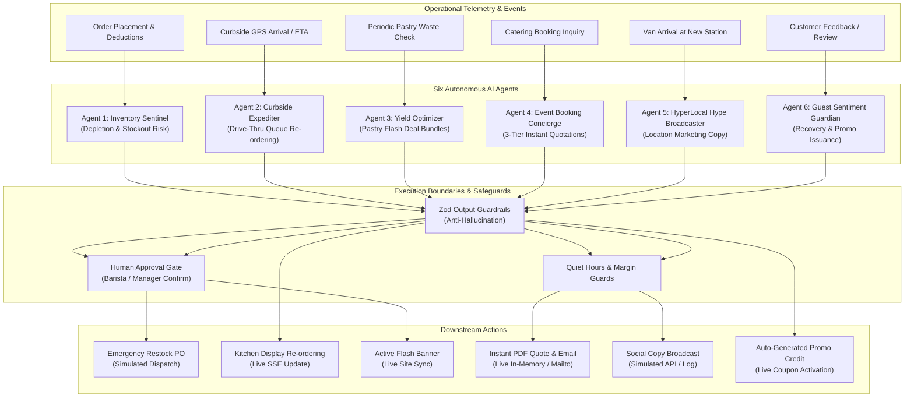

# BREW Mobile Coffee Platform — Autonomous AI Agent Subsystem

**Document Version:** 1.0.0  
**Updated:** November 2026  
**Architecture:** Decoupled Domain Agents with Hybrid Mathematical Engines & Gemini GenAI

---

## 1. System Overview & Philosophy

The BREW AI Subsystem rejects fragile monolithic prompts in favor of **six specialized, single-responsibility domain agents**. Each agent possesses dedicated TypeScript models, deterministic mathematical evaluation loops, strict Zod schema guardrails, and human-in-the-loop validation barriers.

---

## 2. Agent 1: 🛡️ Inventory Sentinel

### 2.1 Business Problem
Mobile coffee vans have limited storage footprint (no warehouse). Running out of key ingredients (coffee beans, whole milk, paper cups) halts service, while over-ordering causes spoilage.

### 2.2 Input Data
- Current van stock reading (`InventoryStock`): beans (kg), milks (L), paper cups (units), syrups (L), pastries (units).
- Rolling hourly consumption rates derived from the last 20 orders.
- Fixed lead time: 2 hours (standard supply transit time).

### 2.3 Decision Process & Mathematical Model
1. **Consumption Rate Calculation:**
   $$\text{hourlyRate} = \frac{\text{unitsConsumed}}{\text{windowHours}}$$
2. **Reorder Point (ROP):**
   $$\text{ROP} = (\text{hourlyRate} \times \text{leadTimeHours}) + \text{safetyStock}$$
3. **Hours to Stockout:**
   $$T_{\text{stockout}} = \frac{\text{currentStock}}{\text{hourlyRate}}$$
4. **Risk Classification:**
   - $T_{\text{stockout}} \le 1.0\text{h}$: `CRITICAL` risk $\implies$ Draft emergency restock PO.
   - $\text{currentStock} < \text{ROP}$: `HIGH` risk $\implies$ Normal restock request.
   - $\text{currentStock} \ge \text{ROP}$: `SAFE` $\implies$ Monitor continue.

### 2.4 Guardrails & Human Approval
- **Zod Guardrail:** Validates that reorder quantities are positive integers and match authorized catalog supplier IDs.
- **Human Approval:** Draft purchase orders require barista one-click acknowledgment on the KDS before dispatch.
- **Failure Handling:** If Firestore stock is unreachable, falls back to in-memory cached readings (`DEFAULT_INVENTORY_STOCK`).
- **Action Status:** **Simulated.** Generates valid PO record and updates KDS alert state; physical supplier dispatch is logged and simulated.

---

## 3. Agent 2: 🚗 Curbside Drive-Thru Expediter

### 3.1 Business Problem
Guests parking near the van expect immediate handover. If hot coffee is prepared too early, it cools; if prepared too late, cars idle in traffic and block the spot.

### 3.2 Input Data
- Vehicle description and arrival signal from `curbside_arrivals`.
- Order prep time estimated from item complexity (espresso = 45s, pour over = 180s, baked pastry = 15s).
- Estimated customer arrival time (ETA in minutes).

### 3.3 Decision Process & Mathematical Model
1. **Curbside Urgency Score:**
   $$\text{Urgency} = \begin{cases} 
   \text{CRITICAL} & \text{if vehicle is ARRIVED and order status is 'received'} \\
   \text{HIGH} & \text{if } \text{ETA} \le \text{prepTimeMinutes} + 2 \\
   \text{NORMAL} & \text{otherwise}
   \end{cases}$$
2. **Queue Priority Score:**
   $$\text{Priority} = \text{waitMinutes} \times 2.0 + (\text{isCurbside} ? 10 : 0) + (\text{isArrived} ? 25 : 0)$$
   Higher priority orders automatically jump ahead in the barista's active brewing queue on `/barista`.

### 3.4 Guardrails & Failure Handling
- **Guardrails:** Prevents re-ordering completed, cancelled, or already served tickets.
- **Failure Handling:** Deterministic fallback to FIFO (First-In, First-Out) queuing if vehicle ETA telemetry drops.
- **Action Status:** **Live.** Re-orders tickets in the real-time barista KDS state over SSE.

---

## 4. Agent 3: ⚡ Yield Optimizer

### 4.1 Business Problem
Artisanal pastries and fresh baked goods have a 24-hour shelf life. Leftover pastries at 5:00 PM represent complete write-offs.

### 4.2 Input Data
- Real-time pastry stock (`pastriesCount`).
- Current van operating hour and closing time (typically 11:00 PM).
- Average hourly pastry sales rate during evening hours.

### 4.3 Decision Process & Mathematical Model
1. **Waste Risk Assessment:**
   $$\text{projectedSales} = \text{hourlyRate} \times \text{hoursUntilClosing}$$
   $$\text{surplusUnits} = \text{currentStock} - \text{projectedSales}$$
2. **Flash Deal Generation:**
   - If $\text{surplusUnits} \ge 4$, triggers `SURPLUS_ALERT`.
   - Bundles surplus pastry with high-margin slow-roasted beverage (e.g. Cappuccino + Cinnamon Roll).
   - Enforces minimum gross margin:
     $$\text{Margin} = \frac{\text{BundlePrice} - \text{COGS}}{\text{BundlePrice}} \ge 45\%$$
   - Enforces maximum discount: Discount percentage cannot exceed 40%.

### 4.4 Guardrails & Human Approval
- **Zod Guardrail:** Schema rejects any deal with negative prices, $>40\%$ discounts, or margins $<45\%$.
- **Human Approval:** Flash deals display in the Barista KDS as "Recommended Deal". Baristas must click "Activate Flash Deal" to publish.
- **Failure Handling:** If AI evaluation fails, uses pre-approved `YIELD_PRESET_BUNDLES`.
- **Action Status:** **Live.** Once approved, synchronizes across customer store banners via `VanContext`.

---

## 5. Agent 4: 🎪 Event Booking Concierge

### 5.1 Business Problem
Inquiries for corporate office campuses and college fests require instant cost estimates. Delays of 24 hours result in lost bookings.

### 5.2 Input Data
- Guest count (e.g. 50, 200, 1000).
- Event type (Corporate Tech Park, College Fest, Wedding/Private).
- Venue location and date flexibility.

### 5.3 Decision Process & Mathematical Model
Executes in $<100\text{ms}$ using deterministic unit economics:
1. **Ingredient & Staffing Calculations:**
   $$\text{cupsPerGuest} = 1.35 \implies \text{TotalCups} = \lceil \text{Guests} \times 1.35 \rceil$$
   $$\text{BeansKg} = \lceil \text{TotalCups} \times 0.018\text{kg} \rceil$$
   $$\text{Baristas} = \max(2, \lceil \text{Guests} / 120 \rceil)$$
2. **3-Tier Quotation Generation:**
   - *Tier 1: Essential Roast:* ₹180 / guest (Core espresso, single-origin roasts, standard milk).
   - *Tier 2: Artisanal Signature (Recommended):* ₹270 / guest (Signature affogatos, oat/almond milk, cold brews, artisanal rolls).
   - *Tier 3: Grand Reserve:* ₹390 / guest (Unlimited custom barista bar, nitro brews, personalized cups, VIP tasting menu).
3. **Gross Margin & Risk Validation:**
   - Guarantees minimum gross margin of $\ge 50\%$ across all tiers.
   - Enforces approval flag if crowd $> 500$ guests.

### 5.4 Guardrails & Failure Handling
- **Idempotency Defense:** Cryptographic hashing prevents duplicate inquiries from creating redundant records.
- **Failure Handling:** If automated quotation engine fails, sets enquiry status to `PENDING_MANUAL_REVIEW`.
- **Action Status:** **Live / Hybrid.** Computes real instant quote in browser, stores record in Cloud Firestore, and prepares pre-filled email backup.

---

## 6. Agent 5: 📢 HyperLocal Hype Broadcaster

### 6.1 Business Problem
When a mobile coffee van arrives at a new tech park or station, surrounding office workers need to know immediately.

### 6.2 Input Data
- Current station name, address, and landmark.
- Weather conditions and time of day.
- Active station specials (e.g. Cold Brew afternoon).

### 6.3 Decision Process
- Generates 3 platform-tailored promotional copy variants:
  1. *Instagram / Social Caption:* Visual emoji style, station tags, and hashtag groups (`#BrewOnWheels`).
  2. *SMS / Push Notification:* Concise, high-urgency call to action under 160 characters.
  3. *Corporate Slack / Teams Announcement:* Professional tone for office community channels.

### 6.4 Guardrails & Quiet Hours Policy
- **Quiet Hours Policy:** Strictly blocks campaign generation between 10:00 PM and 7:00 AM.
- **Factual Integrity Guard:** Validates that generated copy mentions only genuine menu items and active station hours.
- **Action Status:** **Simulated.** Generates copy and logs to audit trail; external social API integrations are simulated.

---

## 7. Agent 6: ❤️ Guest Sentiment Guardian

### 7.1 Business Problem
Unhappy guests at a mobile van often leave without speaking to staff, resulting in negative word-of-mouth.

### 7.2 Input Data
- Star rating (1 to 5).
- Customer comment text.
- Customer name and matched order history.

### 7.3 Decision Process
1. **Sentiment Classification:**
   - 4–5 Stars $\implies$ `POSITIVE` $\implies$ Log appreciation, generate thank-you note.
   - 3 Stars $\implies$ `NEUTRAL` $\implies$ Operational feedback logged for barista training.
   - 1–2 Stars $\implies$ `NEGATIVE` $\implies$ Flag recovery incident.
2. **Autonomous Recovery Compensation:**
   - Auto-generates unique recovery coupon: `BREWCARE-<UUID>` for ₹50 credit.
   - Validates that the order was an authentic verified purchase before issuing credit.
   - Detects critical keywords (e.g. "allergy", "sick") and elevates immediately to `MANAGER_ALERT`.

### 7.4 Guardrails & Action Status
- **Abuse Defense:** Limits recovery coupon issuance to maximum 1 per verified phone/order.
- **Action Status:** **Live.** Generated `BREWCARE` recovery codes are immediately redeemable in `/cart` for a ₹50 discount.
