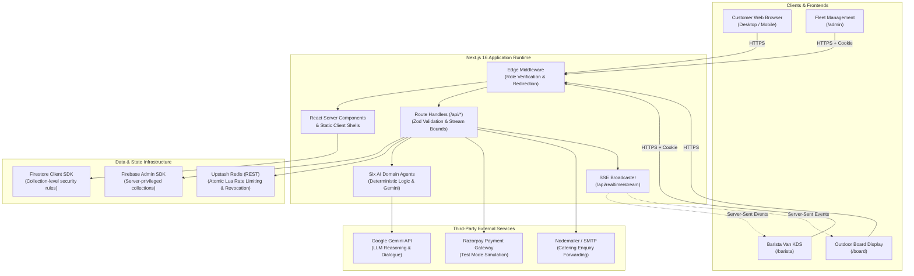

# BREW Mobile Coffee Platform — System Architecture

**Document Version:** 1.0.0  
**Updated:** November 2026  
**Scope:** Architecture specification, runtime components, communication channels, and deployment topology.

---

## 1. High-Level Architecture Overview

The BREW Coffee Platform is architected as a modular, full-stack web application leveraging the **Next.js 16 App Router**. It separates public consumer interactions from privileged staff operations via edge middleware, role-based access control (RBAC), and server-authoritative state machines.

---

## 2. Next.js App Router & Component Hierarchy

### 2.1 File & Route Organization
The application utilizes Next.js 16 App Router conventions located in `src/app/`:

| Route Path | Type | Rendering Strategy | Purpose |
| :--- | :--- | :--- | :--- |
| `/` | Page | Static Shell (SSG) + Client Hydration | Hero brand discovery, 3D splash canvas, coffee discovery quiz, and bottom card links. |
| `/menu` | Page | Static Shell (SSG) + Client Hydration | Artisanal menu catalog (15 items), live text search, category tabs, dynamic add to cart. |
| `/cart` | Page | Static Shell (SSG) + Client Hydration | Item quantity management, promo codes, delivery/tax computation, walk-up vs curbside pickup, checkout CTA. |
| `/location` | Page | Static Shell (SSG) + Client Hydration | Van GPS coordinates, operating hours, tour schedule, catering quotation request modal. |
| `/board` | Page | Static Shell (SSG) + SSE Client | High-contrast sunlight-legible outdoor display showing live ticket progression without page refreshes. |
| `/reviews` | Page | Static Shell (SSG) + Client Hydration | Verified guest reviews, interactive 5-star submission form, automated sentiment evaluation. |
| `/order-status/[id]` | Page | Dynamic Server Route (SSR) | Individual ticket tracking, Web Push vibrating pager trigger, haptic vibration, and pickup buzzer. |
| `/barista` | Page | Protected Route (RBAC) | Live kitchen display system (KDS), ticket advancement (`brewing` $\to$ `ready`), inventory deductions. |
| `/admin` | Page | Protected Route (RBAC) | Fleet telematics, van battery/fuel levels, and autonomous agent logs. |
| `/login` | Page | Static Page (SSG) | Dual-mode login: Customer account creation / demo guest access or Staff 4-digit PIN authentication. |
| `/privacy`, `/terms` | Pages | Static Pages (SSG) | Production privacy policy, terms of service, and test-mode payment disclosures. |

### 2.2 Client State Management & Context Providers
Global client state is partitioned into three focused React Context providers wrapped in `src/app/layout.tsx`:

1. **`AuthContext` (`src/context/AuthContext.tsx`):**
   - Manages customer session identity (authenticated Firebase user vs. demo guest).
   - Coordinates sign-in modal state, staff PIN authentication, and session cookie lifecycle.
2. **`CartContext` (`src/context/CartContext.tsx`):**
   - Stores cart items, quantities, and line-item customizations.
   - Synchronizes cart state to browser `localStorage` (`brew_cart_v1`) with hydration error protection.
3. **`VanContext` (`src/context/VanContext.tsx`):**
   - Maintains real-time van coordinates, current operational station, active tour stops, and curbside alerts.
   - Establishes a persistent SSE connection to `/api/realtime/stream` for multi-client synchronization.

---

## 3. Server Architecture & API Route Design

All backend logic resides in Next.js Serverless Route Handlers in `src/app/api/*`. Every endpoint enforces:
- **Bounded Request Body Reader:** Replaces standard unbounded `req.json()` with `readBoundedBody()` (`src/lib/boundedBody.ts`), strictly enforcing a 100KB ceiling to prevent Denial of Service (DoS) attacks via memory exhaustion.
- **Strict Zod Schema Validation:** Incoming payloads are parsed using `.strict()` Zod schemas that reject unmapped, unexpected, or privilege-escalating fields.
- **Structured JSON Responses:** Uniform response payloads formatted as `{ success: boolean, data?: ..., error?: string }` with explicit HTTP status codes.

---

## 4. Database & Storage Architecture

BREW utilizes a **Dual-SDK Cloud Firestore** design to achieve separation between untrusted client reads and privileged server operations:

### 4.1 Client SDK Access (Bounded by `firestore.rules`)
Public client browsers communicate directly with Cloud Firestore using the client Firebase SDK (`firebase/firestore`). This is used for reading static catalog telemetry and creating unverified orders:
- Restricted strictly by `firestore.rules`.
- Clients can read `/orders`, `/inventory`, `/vans`, `/future_stops`, `/curbside_arrivals`, and `/reviews`.
- Clients can **never** mark an order as `paid`, `captured`, or `ready`.
- Direct client writes to sensitive collections (`/inventory`, `/vans`, `/future_stops`) are explicitly denied (`allow write: if false;`).

### 4.2 Firebase Admin SDK (Privileged Server Operations)
The Next.js backend utilizes `firebase-admin/firestore` initialized via `src/lib/firebaseAdmin.ts` using server-side credentials (`FIREBASE_SERVICE_ACCOUNT` or individual project envs):
- Completely bypasses client Firestore rules.
- Manages privileged collections: `/payment_orders`, `/van_requests`, `/processed_webhooks`, and `/revoked_sessions`.
- Executes atomic transitions on `/orders/{id}` when cryptographic payment signatures or staff actions are verified.

---

## 5. Distributed Cache & Rate Limiting Architecture

Distributed rate limiting is implemented via **Upstash Redis** (`src/lib/rateLimit.ts`):
- **Communication:** Serverless HTTPS REST interface using `@upstash/redis` (`UPSTASH_REDIS_REST_URL` and `UPSTASH_REDIS_REST_TOKEN`).
- **Atomic Sliding-Window Lua Script:** Rate limits are calculated atomically within Redis using a Lua script that records timestamps in sorted sets (`ZADD`), prunes expired windows (`ZREMRANGEBYSCORE`), and counts current window requests (`ZCARD`).
- **Sensitive Endpoints Guarded:**
  - `/api/auth/session`: 5 requests per 60 seconds (brute-force defense).
  - `/api/payments/create-order`: 10 requests per 60 seconds (gateway flood protection).
  - `/api/request-van`: 5 requests per 60 seconds (spam prevention).
  - `/api/realtime/events`: 30 requests per 60 seconds (event flood control).
- **Fail-Closed Production Policy:** If Redis credentials are unconfigured or Redis experiences an outage, sensitive production endpoints intentionally return **HTTP 503 Service Unavailable** rather than degrading insecurely to permissive in-memory state.

---

## 6. Real-Time Communication Architecture (SSE)

BREW utilizes **Server-Sent Events (SSE)** rather than WebSockets:
- **Stream Endpoint:** `GET /api/realtime/stream` establishes an open HTTP connection returning `Content-Type: text/event-stream`.
- **Event Dispatcher:** `POST /api/realtime/events` accepts authorized events (`ORDER_STATUS_CHANGED`, `INVENTORY_CHANGED`, `LOCATION_CHANGED`) from authenticated baristas or server workers and broadcasts them to all connected clients.
- **Heartbeat & Resiliency:** Server emits periodic keep-alive pings (`: keep-alive`) every 15 seconds to prevent intermediate proxy timeouts.
- **Zero Additional Infrastructure:** Functions cleanly on single-node or serverless environments without requiring dedicated WebSocket cluster infrastructure.

---

## 7. Autonomous AI Subsystem

Six domain-specific autonomous agent loops execute specialized operational workflows (`src/lib/*/`):
- **Architectural Philosophy:** Decoupled specialized agents rather than a single monolithic prompt.
- **Dual Engine Design:** Deterministic mathematical computations (formulas, queue weights, risk thresholds) combined with Google Gemini API (`gemini-1.5-flash`) for natural language summarization and dialogue.
- **Zod Schema Guardrails:** All AI responses pass through strict Zod schemas ensuring zero hallucination of ungrounded products, negative prices, or unauthorized discounts.
- **Human-in-the-Loop:** High-impact business actions (emergency restock purchase orders and promotional flash-deal activations) require barista or manager confirmation.

---

## 8. Deployment & Runtime Topology (Render Free)

The application is deployed as a standalone Node.js process on **Render Free Tier**:
- **Build Step:** `NODE_OPTIONS='--max-old-space-size=1536' next build --webpack` compiles a self-contained `.next/standalone` bundle.
- **Runtime Step:** `HOSTNAME=0.0.0.0 node --max-old-space-size=450 .next/standalone/server.js` binds to all interfaces on port `10000`.
- **Memory Ceiling:** Enforces a 450MB heap limit to operate safely within Render's 512MB RAM free-tier allocation.
- **Health Telemetry:** Render monitors `GET /api/health` to confirm process availability, Firestore latency, and Upstash Redis health.
