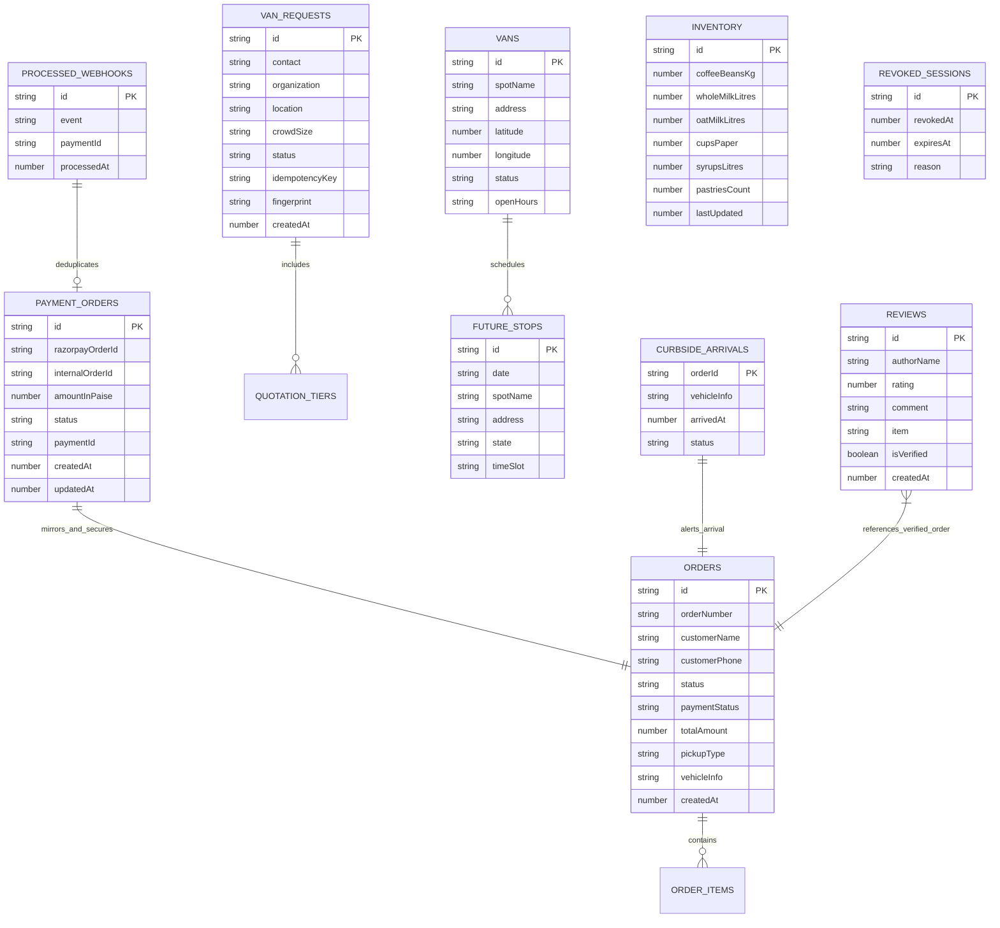

# BREW Mobile Coffee Platform — Database Design

**Document Version:** 1.0.0  
**Target Engine:** Google Cloud Firestore (NoSQL Document Store)  
**Schema Governance:** Hybrid Client Security Rules (`firestore.rules`) + Server-Side Zod Contracts

---

## 1. Firestore Architecture & Access Model

Google Cloud Firestore operates as a scalable, document-oriented NoSQL database. Documents are organized into root-level collections. BREW partitions collections into two access tiers:

1. **Public / Client-Accessible Collections:** Readable by client browsers and bounded by declarative validation rules in `firestore.rules`.
2. **Server-Authoritative Collections:** Completely inaccessible to client SDKs (`allow read, write: if false;`). Managed exclusively via the Firebase Admin SDK on authorized server routes.



---

## 2. Comprehensive Collection Specifications

### 2.1 `orders` (Real-Time Customer Orders)
- **Access Rule:** Public read (`allow read: if true;`); Client create allowed with strict constraints (`allow create: if ...;`); Client update/delete strictly denied (`allow update, delete: if false;`).
- **Purpose:** Primary operational record rendered on the customer order status tracker (`/order-status/[id]`), barista KDS (`/barista`), and display board (`/board`).
- **Document Structure:**
  ```typescript
  interface VanOrder {
    id: string;               // e.g. "ord_1793507063461_pmkc2" or "ord-101"
    orderNumber: string;      // e.g. "101", "102"
    customerName: string;     // e.g. "Arjun Reddy"
    customerPhone?: string;   // e.g. "+919876543210"
    items: OrderItem[];       // Array of items { id, name, price, quantity, category }
    totalAmount: number;      // Integer or float total in INR
    pickupType: "walkup" | "curbside";
    vehicleInfo?: string;     // e.g. "Silver Honda City, hazard lights on"
    vanLocationName?: string; // e.g. "HITEC City — Cyber Towers & Mindspace Plaza"
    notes?: string;           // e.g. "Oat milk please, extra hot"
    status: "pending" | "received" | "brewing" | "ready" | "served" | "completed";
    paymentStatus?: "pending" | "paid" | "failed";
    paymentId?: string;       // e.g. "pay_test_1793507063758" or "Outlet Cash"
    paymentMethod?: string;   // e.g. "Razorpay (Online)" or "Pay at Outlet"
    createdAt: number;        // Epoch timestamp in milliseconds
  }
  ```
- **Security Invariant:** Client creations cannot set `paymentStatus` to `'paid'` or `'captured'`, cannot set `isVerified: true`, and cannot set `status` beyond `'pending'` or `'received'`.

---

### 2.2 `payment_orders` (Server-Authoritative Payment Ledger)
- **Access Rule:** Server Admin SDK only (`allow read, write: if false;`).
- **Purpose:** Cryptographic source of truth created by `/api/payments/create-order` prior to launching the Razorpay checkout modal. Prevents client-side price tampering.
- **Document Structure:**
  ```typescript
  interface PaymentOrderRecord {
    id: string;                 // Razorpay Order ID (e.g. "order_test_1793506728629_bjhto")
    internalOrderId: string;   // Associated internal order ID
    items: { id: string; quantity: number }[];
    customerName: string;
    customerPhone: string;
    amountInPaise: number;     // e.g. 45400 (₹454.00)
    currency: "INR";
    breakdown: {
      subtotal: number;
      memberDiscount: number;
      promoDiscount: number;
      tax: number;
      deliveryFee: number;
      finalTotal: number;
    };
    status: "pending" | "paid" | "failed";
    razorpayPaymentId?: string;
    paidAt?: number;
    createdAt: number;
    updatedAt: number;
  }
  ```

---

### 2.3 `processed_webhooks` (Payment Webhook Deduplication Store)
- **Access Rule:** Server Admin SDK only (`allow read, write: if false;`).
- **Purpose:** Idempotency ledger for incoming Razorpay webhook events (`/api/webhooks/razorpay`). Prevents double fulfillment on re-delivered HTTP webhooks.
- **Document Structure:**
  ```typescript
  interface ProcessedWebhookRecord {
    id: string;               // Razorpay Webhook Event ID (e.g. "evt_test_1793506728")
    event: string;            // e.g. "payment.captured", "payment.failed"
    orderId: string;          // Target Razorpay order ID
    paymentId: string;        // Razorpay payment ID
    amount: number;           // Amount in paise
    processedAt: number;      // Epoch timestamp in milliseconds
  }
  ```

---

### 2.4 `van_requests` (Catering & Location Requests)
- **Access Rule:** Server Admin SDK only (`allow read, write: if false;`).
- **Purpose:** Holds corporate and campus catering booking enquiries submitted via `/location` and processed by Agent #4 (Event Booking Concierge).
- **Document Structure:**
  ```typescript
  interface VanRequestRecord {
    id: string;               // Unique enquiry ID (e.g. "req_1793506728")
    contact: string;          // Organizer email or phone (3-150 chars)
    organization: string;     // Company or college campus (1-150 chars)
    location: string;         // City / venue details (1-200 chars)
    crowdSize: string;        // e.g. "150–300 People"
    eventDate?: string;       // Preferred date or "Flexible"
    notes?: string;           // Venue requirements or power outlets
    status: "pending" | "reviewed" | "quoted" | "confirmed";
    idempotencyKey?: string;  // SHA-256 hash of (contact + org + eventDate)
    fingerprint?: string;     // SHA-256 hash of complete payload
    quotation?: {
      estimatedCrowd: number;
      baristasAssigned: number;
      recommendedTier: string;
      tiers: Array<{
        name: string;
        pricePerGuest: number;
        totalAmount: number;
        perks: string[];
      }>;
    };
    createdAt: number;
    updatedAt: number;
  }
  ```
- **Idempotency Defense:** `/api/request-van` hashes the submission payload into an `idempotencyKey`. If a duplicate submission arrives with identical credentials, it returns the existing quote as an idempotent replay without duplicating records. If the contact matches but the organization/venue differs, it returns HTTP 409 Conflict.

---

### 2.5 `inventory` (Real-Time Raw Ingredient Stock)
- **Access Rule:** Public read (`allow read: if true;`); Client write denied (`allow write: if false;`).
- **Purpose:** Tracks physical bulk ingredient levels inside the mobile van. Deducted atomically as baristas brew coffee or bake pastries.
- **Document Structure (Document ID: `van-01` or `stock_current`):**
  ```typescript
  interface InventoryStock {
    coffeeBeansKg: number;        // e.g. 14.5 (kg)
    wholeMilkLitres: number;      // e.g. 28.0 (litres)
    oatMilkLitres: number;        // e.g. 12.0 (litres)
    cupsPaper: number;            // e.g. 350 (units)
    syrupsLitres: number;         // e.g. 4.5 (litres)
    pastriesCount: number;        // e.g. 42 (pieces)
    lastUpdated: number;
  }
  ```

---

### 2.6 `vans` & `future_stops` (Van Telemetry & Tour Schedule)
- **Access Rule:** Public read (`allow read: if true;`); Client write denied (`allow write: if false;`).
- **Purpose:** Telemetry representing the mobile van's active GPS stop and upcoming regional tour schedule across Telangana and Andhra Pradesh.
- **Document Structures:**
  ```typescript
  // Collection: vans (Doc ID: "van-01")
  interface VanLocation {
    id: string;
    spotName: string;         // e.g. "HITEC City — Cyber Towers & Mindspace Plaza"
    address: string;          // e.g. "Opposite Inorbit Mall, Madhapur, Hyderabad"
    city: string;             // "Hyderabad"
    state: "Telangana" | "Andhra Pradesh";
    latitude: number;         // 17.4474
    longitude: number;        // 78.3762
    openHours: string;        // "7:30 AM – 11:30 PM"
    status: "active" | "transit" | "closed";
    updatedAt: number;
  }

  // Collection: future_stops (Doc ID: "stop-01", etc.)
  interface FutureStop {
    id: string;
    date: string;             // e.g. "Nov 4, 2026"
    dayOfWeek: string;        // e.g. "Wednesday"
    spotName: string;         // e.g. "Gachibowli Financial District"
    address: string;
    city: string;
    state: "Telangana" | "Andhra Pradesh";
    timeSlot: string;         // "8:00 AM – 7:00 PM"
  }
  ```

---

### 2.7 `curbside_arrivals` (Drive-Up Passenger Alerts)
- **Access Rule:** Public read/create/update (`allow read: if true; allow create, update: if ...;`); Client delete denied.
- **Purpose:** Ephemeral signal emitted when a customer parks near the van for curbside delivery. Displays an urgent pulsing badge on the Barista KDS.
- **Document Structure (Document ID: `{orderId}`):**
  ```typescript
  interface CurbsideArrivalRecord {
    orderId: string;
    vehicleInfo: string;      // e.g. "White Creta, hazards flashing"
    arrivedAt: number;        // Epoch timestamp
    status: "arrived" | "handed_over";
  }
  ```

---

### 2.8 `reviews` (Guest Feedback & Ratings)
- **Access Rule:** Public read (`allow read: if true;`); Client create allowed with 1-5 rating validation; Client update/delete denied.
- **Purpose:** Displays guest testimonials and triggers Agent #6 (Guest Sentiment Guardian).
- **Document Structure:**
  ```typescript
  interface ReviewRecord {
    id: string;
    authorName: string;
    rating: number;           // Integer 1 to 5
    comment: string;
    item?: string;            // e.g. "Affogato"
    location?: string;
    isVerified: boolean;
    helpfulCount: number;
    createdAt: number;
  }
  ```

---

### 2.9 `revoked_sessions` (Durable Session Revocation Store)
- **Access Rule:** Server Admin SDK only (`allow read, write: if false;`).
- **Purpose:** Durable revocation ledger for revoked staff session tokens. When a barista or fleet admin logs out, the session ID is written here and to Upstash Redis.
- **Document Structure (Document ID: `{sessionId}`):**
  ```typescript
  interface RevokedSessionRecord {
    sessionId: string;
    revokedAt: number;
    expiresAt: number;
    reason: "logout" | "security_rotation";
  }
  ```
