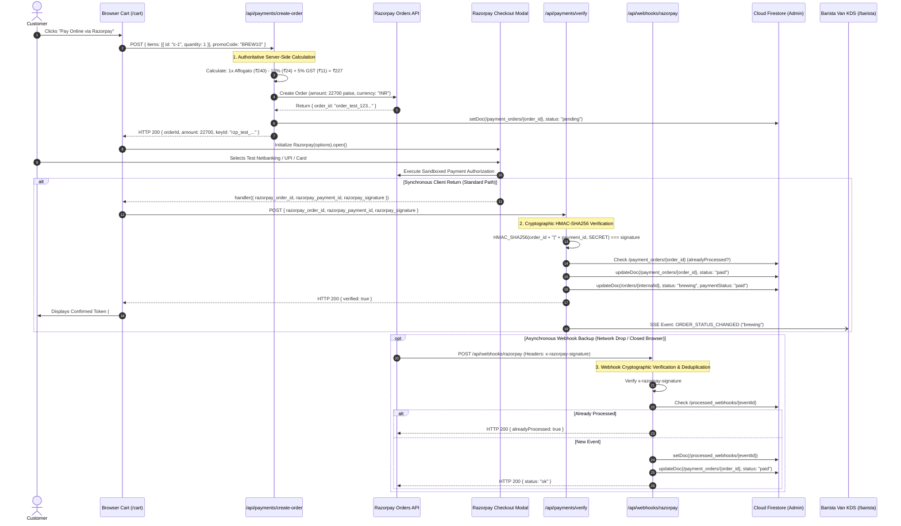

# BREW Mobile Coffee Platform — Razorpay Payment Lifecycle (Test Mode)

**Document Version:** 1.0.0  
**Updated:** November 2026  
**Operating Mode:** **Razorpay Test Mode / Sandboxed Simulation**  
**Disclaimer:** This implementation operates strictly with Razorpay Test Mode keys (`rzp_test_*`). No real monetary charges are incurred, and it does not establish live commercial merchant readiness.

---

## 1. End-to-End Payment Flow Diagram

---

## 2. Detailed Lifecycle Stages

### Stage 1: Checkout Initialization & Server-Side Price Authority
- **Threat Mitigated:** Client-side price tampering (e.g. modifying DOM or network payload to buy ₹240 coffee for ₹1).
- **Process:** The client sends only product identifiers (`id`) and counts (`quantity`). The route `/api/payments/create-order` looks up prices from the immutable server-side catalog `MENU_ITEMS`, validates promo codes (`BREW10`, `WELCOME`, `BREWCARE`), applies member discounts, computes 5% GST, and converts the final amount to integer paise:
  $$\text{AmountInPaise} = \text{round}(\text{finalTotalInRupees} \times 100)$$

### Stage 2: Razorpay Order Creation & Pending Persistence
- The server generates an official order in the Razorpay sandbox API.
- The order is persistently written to the `payment_orders` Firestore collection with `status: 'pending'`. At this point, the kitchen display has **not** received the order, preventing unpaid tickets from being brewed.

### Stage 3: Sandboxed Modal Checkout
- The client receives the `orderId` and test `keyId` and mounts `https://checkout.razorpay.com/v1/checkout.js`.
- The customer completes the simulated test payment. Razorpay returns three parameters:
  - `razorpay_order_id`: The ID of the order being paid.
  - `razorpay_payment_id`: The transaction reference (e.g. `pay_test_...`).
  - `razorpay_signature`: The gateway's cryptographic signature.

### Stage 4: Cryptographic HMAC-SHA256 Signature Verification
- In `/api/payments/verify`, the server recomputes the expected signature:
  $$\text{expectedSignature} = \text{crypto.createHmac}('sha256', \text{RAZORPAY\_KEY\_SECRET}).\text{update}(\text{order\_id} + '|' + \text{payment\_id}).\text{digest}('hex')$$
- Uses constant-time comparison (`crypto.timingSafeEqual`) to prevent timing attacks.
- If the signature does not match or was fabricated, returns **HTTP 400 Bad Request**.

### Stage 5: Replay Attack Defense & Anti-Duplicate Fulfillment
- If an attacker intercepts a valid signature and submits it repeatedly to create multiple free drinks:
  - The server queries `payment_orders` for `status === 'paid'`.
  - If already marked `paid`, it immediately acknowledges the request with `{ success: true, verified: true, alreadyProcessed: true }` without incrementing stock deductions or creating a new brewing order.

### Stage 6: Asynchronous Webhook Dual-Path Guarantee
- If a customer's phone runs out of battery, loses connection, or closes the tab before the client handler finishes, Razorpay's server sends an asynchronous webhook to `/api/webhooks/razorpay`:
  - Validates `x-razorpay-signature` against `RAZORPAY_WEBHOOK_SECRET`.
  - Checks `processed_webhooks` collection to prevent duplicate execution.
  - Transitions the order to `'paid'` and emits the real-time event so the barista still receives the ticket.

---

## 3. Sandboxed Operational Boundaries

1. **Test Cards & UPI:** Accepts standard Razorpay test card credentials (e.g. `4111 1111 1111 1111`, any future expiry, CVV `123`, OTP `123456`) or simulated UPI IDs (`success@razorpay`).
2. **Refunds:** The dedicated `/api/payments/refund` endpoint is intentionally not implemented in this demo phase; refund webhook events are acknowledged gracefully without side effects.
3. **PCI-DSS Scope:** Card numbers and UPI PINs never touch the application's servers; they are collected directly inside Razorpay's isolated iframe.
