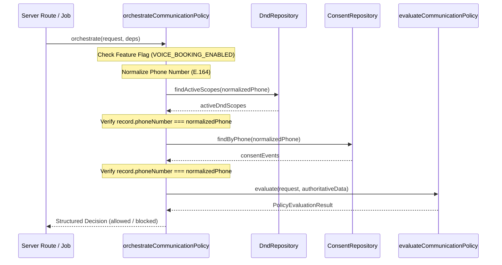

# BREW Coffee — Phase 6.1.1 Hardening Report: Communication Foundation Hardening

**Phase**: 6.1.1  
**Date**: November 1, 2026  
**Status**: Hardening Complete & Verified (100% Passing)  
**Parent Report**: [`docs/PHASE_6_1_IMPLEMENTATION_REPORT.md`](./PHASE_6_1_IMPLEMENTATION_REPORT.md)  
**Implementation Plan**: [`docs/PHASE_6_IMPLEMENTATION_PLAN.md`](./PHASE_6_IMPLEMENTATION_PLAN.md)  

---

## 1. Problems Identified in Phase 6.1

During comprehensive review of Phase 6.1, five critical architectural edge cases were identified and targeted for hardening:

1. **Consent History Reinterpretation**:
   - *Problem*: In Phase 6.1, consent records were mutated in place upon revocation (`existing.revokedAt = ...`), preventing an explicit audit trail of distinct grant and revocation events. A subsequent re-opt-in could not be cleanly represented as an explicit event without overwriting historical state.
   - *Fix*: Transitioned to an immutable append-only event-history model with distinct `grant` and `revoke` event types and a documented safety-first tie-breaking rule.
2. **Single-Scope DND Storage**:
   - *Problem*: `InMemoryDndRepository` previously stored only one `DndRecord` per phone number in `entriesByPhone: Map<string, DndRecord>`, meaning registering `whatsapp` would overwrite an existing `voice` suppression.
   - *Fix*: Restructured storage to support multi-scope coexistence (`Map<string, Map<DndScope, DndRecord>>`), ensuring `voice`, `whatsapp`, and `all` can coexist without mutual overwrites.
3. **DND Audit Privacy & History**:
   - *Problem*: DND registration previously recorded raw phone numbers in diagnostic logs, and removal deleted entries without maintaining an auditable removal trail.
   - *Fix*: Created a dedicated `DndAuditEvent` model storing masked phone numbers (`maskPhoneNumber`) and preserved an append-only event history while enforcing strict minimum justification lengths.
4. **Policy Boundary Trust Assumptions**:
   - *Problem*: `evaluateCommunicationPolicy` was a pure function accepting caller-provided consent and DND arrays. If called directly from an untrusted context, caller-provided records could bypass server-side database checks.
   - *Fix*: Implemented `orchestrateCommunicationPolicy` as an authoritative server-side boundary that loads records from repositories, verifies that repository data matches the requested phone number, and blocks if integrity checks fail.
5. **Ambiguous Mock Provider Statuses**:
   - *Problem*: Mock providers returned generic statuses (`initiated`, `delivered`) and random identifiers that could be mistaken for actual carrier or Meta Cloud API confirmations.
   - *Fix*: Standardized simulated statuses (`simulated_initiated`, `simulated_accepted`, `simulated_delivered`), explicit simulation indicators (`isSimulated: true`, `providerMode: "mock"`), and deterministic ID/timestamp injection for tests.

---

## 2. Exact Files Modified

```text
src/lib/communication/
├── types.ts                     # Added ConsentEventType, DndAuditEvent, simulation fields, updated repo interfaces
├── schemas.ts                   # Added ConsentEventTypeSchema, IsoUtcDateTimeSchema, DndAuditEventSchema
├── consent.ts                   # Event-history semantics, timestamp validation, safety-first tie-breaking
├── dnd.ts                       # Added isChannelBlockedByDndScopes for multi-scope suppression
├── policy.ts                    # Added secure server-side orchestrateCommunicationPolicy boundary
├── providers/
│   ├── voiceProvider.ts         # Simulation markers, simulated statuses, deterministic call ID injection
│   └── whatsappProvider.ts      # Simulation markers, simulated statuses, deterministic message ID injection
└── repositories/
    ├── consentRepository.ts     # Event-history append model, active grant lookup, revocation event generation
    └── dndRepository.ts         # Multi-scope coexistence, masked audit logging, administrative removal rules

scripts/
└── verify-phase6-1-communication.ts  # Expanded from 28 to 37 automated tests covering all hardened edge cases

docs/
└── PHASE_6_1_1_HARDENING_REPORT.md   # This documentation report
```

---

## 3. Corrected Consent Event Semantics

### 3.1 Event-History Model
Consent is modeled as an append-only sequence of immutable events:
- **`grant` Event**: Generated via `createConsentRecord()`. Contains `eventType: "grant"`, `granted: true`, consent text, version, and ISO UTC timestamp.
- **`revoke` Event**: Generated via `createRevocationRecord()` or `repo.revoke()`. Contains `eventType: "revoke"`, `granted: false`, reason, and its own distinct revocation timestamp.

### 3.2 Evaluation Rules
1. Records are strictly filtered for the requested `(channel, purpose)`.
2. Any event with an invalid or unparseable timestamp is rejected.
3. Events are sorted by timestamp descending.
4. **Deterministic Tie-Breaking Rule (Safety-First)**:
   - If a `grant` event and a `revoke` event share the exact same timestamp millisecond, the **`revoke` event strictly takes precedence**.
   - If both events share the same type and timestamp, lexicographical ID comparison descending (`b.id.localeCompare(a.id)`) breaks the tie.
5. The latest valid event dictates active consent:
   - `latest.eventType === "grant" && latest.granted` $\rightarrow$ **Active** (`true`).
   - `latest.eventType === "revoke" || !latest.granted` $\rightarrow$ **Inactive** (`false`).
6. **Explicit Re-Consent**: A new explicit grant with a timestamp newer than a revocation cleanly restores active consent for that specific channel and purpose without re-activating other revoked channels or purposes.

---

## 4. DND Multi-Scope Coexistence & Audit History

### 4.1 Multi-Scope Architecture
The in-memory repository stores active scopes partitioned by normalized phone number:
```typescript
Map<string, Map<DndScope, DndRecord>>
```
- **Independent Coexistence**: Registering `voice` and `whatsapp` allows both to remain active concurrently.
- **Global Suppression**: Registering `all` suppresses all outbound channels. Adding a narrower scope (`voice`) when `all` is active does NOT downgrade or overwrite `all`.
- **Targeted Removal**: `removeScope(phone, "voice", ...)` removes only the voice scope, leaving `whatsapp` active.
- **Administrative Removal of `all`**: Removing global `all` scope strictly requires a detailed administrative justification ($\ge 10$ characters). Removing `all` does not clear independently registered narrower scopes (`voice` remains active).
- **Audit Privacy**: Audit log entries store masked phone numbers (`+91******3210`) with zero raw PII.

### 4.2 Explicit In-Memory Limitations
> [!IMPORTANT]
> The in-memory audit log in `InMemoryDndRepository` is designed strictly for unit, integration, and preflight testing. It is ephemeral and reset across process restarts. **Persistent, access-controlled Firestore audit collections (`communication_consent`, `dnd_registry`) must be provisioned before production deployment or enabling the feature flag.**

---

## 5. Server-Side Policy Orchestration Boundary

To prevent untrusted callers from fabricating consent records, `orchestrateCommunicationPolicy` was added to `src/lib/communication/policy.ts`:



- **Data Integrity Verification**: If a repository returns records with phone numbers differing from the requested normalized phone, the orchestrator detects the mismatch and immediately blocks with `REPOSITORY_INTEGRITY_MISMATCH`.
- **Zero Provider Invocations**: This orchestration function strictly returns a decision; no external network or provider call is initiated.

---

## 6. Simulated Provider Status Contracts

To eliminate ambiguity between simulation and real carrier/Meta delivery:
1. `MockVoiceProvider` and `MockWhatsAppProvider` carry immutable runtime properties:
   - `isSimulated = true`
   - `providerMode = "mock"`
2. Status outputs are prefixed with `simulated_`:
   - Voice: `simulated_initiated`, `simulated_in_progress`, `simulated_ended`.
   - WhatsApp: `simulated_accepted`, `simulated_delivered`.
3. Deterministic injection methods allow unit tests to verify specific IDs without random values:
   - `voiceProvider.setNextCallId("call_det_001")`
   - `voiceProvider.setNextTimestamp("2026-11-01T10:00:00.000Z")`
   - `waProvider.setNextMessageId("wa_det_789")`
   - `waProvider.setNextTimestamp("2026-11-01T10:05:00.000Z")`
4. Verified that zero HTTP/HTTPS network calls are made by monkey-patching `http.request` and `https.request`.

---

## 7. Verification Suite Results

### 7.1 Dedicated Hardened Test Suite (`npm run test:p61`)
```text
37 / 37 tests PASSED (100%):
1. Consent Engine & Event History Semantics (13 tests)
  ✓ Normalizes standard 10-digit Indian numbers to E.164
  ✓ Rejects malformed or invalid phone numbers
  ✓ Rejects invalid or unparseable timestamps
  ✓ Creates validated, auditable ConsentRecord with E.164 phone and eventType='grant'
  ✓ Missing consent returns false
  ✓ Voice consent is independent of WhatsApp consent
  ✓ Transactional consent does not imply marketing consent
  ✓ Event Semantics: Grant (T1) -> Revoke (T2) results in inactive consent
  ✓ Event Semantics: Grant (T1) -> Revoke (T2) -> Explicit New Grant (T3) restores consent
  ✓ Event Semantics: Older grant (T1) submitted after newer revocation (T2) remains inactive
  ✓ Event Semantics: Voice revocation does not affect active WhatsApp consent
  ✓ Event Semantics: Equal timestamps resolved deterministically (Safety-First: Revoke beats Grant)
  ✓ InMemoryConsentRepository handles saving events, querying active grant, and revoking

2. Do-Not-Contact (DND) Multi-Scope Engine & Audit Logging (10 tests)
  ✓ Global DND ('all') blocks all outbound channels
  ✓ Multi-Scope: 'voice' and 'whatsapp' can coexist independently
  ✓ Multi-Scope: Removing 'voice' scope leaves 'whatsapp' active
  ✓ Multi-Scope: Global 'all' coexists with 'voice' and cannot be downgraded
  ✓ Multi-Scope: Removing 'all' leaves independently active 'voice' scope intact
  ✓ Repeated registrations are idempotent and do not corrupt storage
  ✓ DND removal strictly rejects invalid or insufficiently detailed justifications
  ✓ DND audit history stores masked phone numbers and preserves full event trail
  ✓ Recognizes English, Hindi, and Telugu opt-out phrases deterministically
  ✓ Safely rejects conversational or ambiguous phrases from triggering DND

3. Communication Policy Engine & Server-Side Orchestration (9 tests)
  ✓ Blocks communication when feature flag is disabled
  ✓ Blocks communication when consent is missing
  ✓ Blocks communication when consent was revoked
  ✓ Blocks communication when customer is in DND registry
  ✓ Calling-hour policy enforces 09:00 - 20:00 IST boundaries for voice
  ✓ Voice call outside calling hours is blocked by policy
  ✓ Non-voice transactional messages (WhatsApp) do NOT inherit voice calling hours
  ✓ Server-Side Orchestration: orchestrateCommunicationPolicy loads authoritative repository data
  ✓ Server-Side Orchestration: Blocks when repository returns mismatched phone number (Integrity Check)

4. Provider Contracts & Simulation Mocks (5 tests)
  ✓ MockVoiceProvider clearly identifies as simulation with deterministic status and IDs
  ✓ MockVoiceProvider simulates failures when configured
  ✓ MockWhatsAppProvider clearly identifies as simulation with deterministic message ID
  ✓ MockWhatsAppProvider simulates provider failure cleanly
  ✓ Zero external network requests from mock providers
```

### 7.2 Full Repository Baseline Verification

| Command | Status | Result Summary |
|---|---|---|
| `npm run typecheck` | **PASSED** | 0 TypeScript errors across entire repository (`tsc --noEmit`) |
| `npm run lint` | **PASSED** | 0 errors, 3 pre-existing script warnings in deployment tests |
| `npm test` | **PASSED** | 19 / 19 master test suites passed in 14.0s |
| `npm run test:e2e` | **PASSED** | 18 / 18 Playwright end-to-end tests passed in 16.2s |
| `npm run build` | **PASSED** | Standalone production bundle compiled in 2.7s |

---

## 8. Remaining Production Limitations

1. **Persistent Firestore Adapters**: Currently, `InMemoryConsentRepository` and `InMemoryDndRepository` provide in-memory storage only. Dedicated Firestore adapters for collections `communication_consent` and `dnd_registry` must be added and secured in a subsequent additive phase before production release.
2. **Feature Flag**: `VOICE_BOOKING_ENABLED` remains set to `false` by default and is not enabled in production environments.
3. **No External Integrations Active**: No telephony trunk (Twilio/Vapi), speech synthesis, browser microphone recording, Gemini voice agents, or Meta Cloud API webhooks have been activated.

---

## 9. Stop Condition

Phase 6.1.1 hardening is complete. All preservation rules respected. Awaiting review prior to Phase 6.2.
