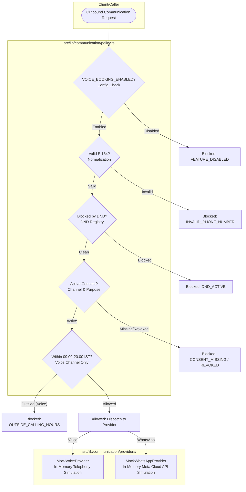

# BREW Coffee — Phase 6.1 Implementation Report: Communication Foundation, Consent Engine & Provider Contracts

**Phase**: 6.1  
**Date**: November 1, 2026  
**Status**: Completed & Verified (All Tests Passing)  
**Parent Plan**: [`docs/PHASE_6_IMPLEMENTATION_PLAN.md`](./PHASE_6_IMPLEMENTATION_PLAN.md)  
**Provider Strategy**: [`docs/PHASE_6_PROVIDER_STRATEGY.md`](./PHASE_6_PROVIDER_STRATEGY.md)  

---

## 1. Executive Summary

Phase 6.1 implements the isolated backend communication foundation for the **BREW Coffee Platform** without modifying any existing user interface, checkout flow, pricing logic, authentication, or database security rules.

### Key Deliverables Established
1. **Strongly Typed Domain Models**: Runtime validated using the repository's existing Zod v4 installation for phone normalization (E.164), consent records, Do-Not-Contact (DND) entries, and provider payloads.
2. **Consent Engine**: Pure functional logic enforcing unbundled, independent permissions for voice booking calls, WhatsApp transactional updates, and marketing communications. Enforces that revocation overrides earlier grants.
3. **Do-Not-Contact (DND) & Multilingual Opt-Out Engine**: Deterministic detection of opt-out phrases in English, Hindi (Devanagari & Hinglish), and Telugu (Script & Tenglish) with zero regex false positives on conversational phrases.
4. **Communication Policy Engine**: Multi-stage evaluation verifying the server-side feature flag, E.164 normalization, DND status, active consent, and calling-hour constraints in `Asia/Kolkata` (09:00 - 20:00 IST) strictly for voice channels.
5. **Deterministic Mock Providers**: `MockVoiceProvider` and `MockWhatsAppProvider` with zero external network requests, deterministic call IDs, configurable simulation failure modes, and PII masking.
6. **In-Memory Repositories**: `InMemoryConsentRepository` and `InMemoryDndRepository` supporting audit trails and requiring mandatory justification for DND removal.

---

## 2. Files Added and Modified

```text
src/lib/communication/
├── config.ts                     # Feature flag (VOICE_BOOKING_ENABLED) & PII phone masking
├── consent.ts                    # Pure consent evaluation, E.164 normalization & revocation
├── dnd.ts                        # DND suppression & deterministic multilingual opt-out matching
├── errors.ts                     # Domain error hierarchy (ConsentMissing, DndBlocked, etc.)
├── index.ts                      # Clean barrel export
├── policy.ts                     # Multi-stage communication policy engine & IST calling hours
├── providers/
│   ├── voiceProvider.ts          # VoiceProvider interface & MockVoiceProvider simulation
│   └── whatsappProvider.ts       # WhatsAppProvider interface & MockWhatsAppProvider simulation
├── repositories/
│   ├── consentRepository.ts      # ConsentRepository interface & InMemoryConsentRepository
│   └── dndRepository.ts          # DndRepository interface & InMemoryDndRepository
├── schemas.ts                    # Zod runtime validation schemas
└── types.ts                      # Strict TypeScript domain interfaces

scripts/
└── verify-phase6-1-communication.ts  # 28 automated unit & integration tests

docs/
├── DEPLOYMENT_GUIDE.md           # Documented VOICE_BOOKING_ENABLED environment variable
└── PHASE_6_1_IMPLEMENTATION_REPORT.md # This report

package.json                      # Added npm run test:p61 test target
```

---

## 3. Architecture & Module Responsibilities



---

## 4. Consent and DND Rules

### 4.1 Consent Rules
- **Channel & Purpose Isolation**: Channels (`voice`, `whatsapp`) and Purposes (`voice_booking`, `transactional_update`, `marketing`) are stored independently.
- **Unbundled Transactional vs Marketing**: Transactional permissions (such as booking confirmation or voice quote calls) NEVER grant or imply marketing permission.
- **Revocation Precedence**: Consent history is sorted by effective event timestamp (`max(timestamp, revokedAt)`). If the most recent action was revoked or had `granted: false`, consent is immediately considered inactive. An older grant record can never override a newer revocation.
- **Zero Excessive PII**: Raw IP addresses and full browser user-agent strings are not collected in consent records.

### 4.2 Do-Not-Contact (DND) Rules
- **Scope Hierarchy**:
  - `all`: Blocks every outbound channel (voice and WhatsApp).
  - `voice`: Blocks voice calls only; allows WhatsApp transactional messages.
  - `whatsapp`: Blocks WhatsApp messages only; allows voice calls.
- **Idempotency**: Repeated opt-out events are idempotent and preserve broader scopes (an incoming `voice` DND will never downgrade an existing `all` scope).
- **Mandatory Justification for Removal**: `InMemoryDndRepository.remove()` strictly throws if an explicit, auditable justification (minimum 5 characters) is not provided.
- **Multilingual Opt-Out Matching**:
  - **English**: `STOP`, `UNSUBSCRIBE`, `DO NOT CALL`, `QUIT`, `CANCEL`, `END`, `OPT OUT`, `DON'T CALL ME`, `STOP CALLING`
  - **Hindi (Devanagari)**: `रोको`, `बंद करो`, `कॉल मत करो`, `संदेश मत भेजो`, `अनसब्सक्राइब`, `फोन मत करना`
  - **Telugu (Script)**: `ఆపండి`, `వద్దు`, `కాల్ చేయవద్దు`, `ఫోన్ చేయకండి`, `మెసేజ్ చేయవద్దు`, `రద్దు చేయండి`
  - **Romanized (Hinglish / Tenglish)**: `band karo`, `call mat karo`, `roko`, `phone mat karo`, `aapandi`, `vaddu`, `call cheyavaddhu`, `phone cheyakandi`
  - **Safe Conversation Rejection**: Anchored matching prevents false positives on natural sentences like *"I will stop by at 4pm"* or *"Can you call me tomorrow?"*.

---

## 5. Calling-Hour Policy (`Asia/Kolkata`)

Voice call initiation is constrained to **09:00:00 to 20:00:00 IST** via `Intl.DateTimeFormat` with `timeZone: "Asia/Kolkata"`:

| Time | Local IST Time | Voice Status | WhatsApp Status | Policy Reason |
|---|---|---|---|---|
| `03:29:59Z` | 08:59:59 IST | **BLOCKED** | Allowed | `OUTSIDE_CALLING_HOURS` |
| `03:30:00Z` | 09:00:00 IST | **ALLOWED** | Allowed | `ALLOWED` (Window open) |
| `14:29:59Z` | 19:59:59 IST | **ALLOWED** | Allowed | `ALLOWED` (Window active) |
| `14:30:00Z` | 20:00:00 IST | **BLOCKED** | Allowed | `OUTSIDE_CALLING_HOURS` (Cutoff) |
| `14:30:01Z` | 20:00:01 IST | **BLOCKED** | Allowed | `OUTSIDE_CALLING_HOURS` |
| `17:00:00Z` | 22:30:00 IST | **BLOCKED** | **ALLOWED** | Non-voice does not inherit voice window |

---

## 6. Security & Privacy Decisions

1. **Server-Side Enforcement**: `src/lib/communication/config.ts` verifies `typeof window === "undefined"` and aborts execution if imported into a browser client.
2. **Feature Flag Defaults to Disabled**: `VOICE_BOOKING_ENABLED` defaults strictly to `false` when missing or unconfigured. Only `"true"` or `"1"` enables it.
3. **Safe Phone Masking**: Logging helpers format E.164 phone numbers as `+91******3210` to prevent PII exposure in application telemetry.
4. **Zero External Calls from Mocks**: `MockVoiceProvider` and `MockWhatsAppProvider` operate entirely in memory. Verified in unit tests by monkey-patching `http.request` and `https.request`.
5. **No Production Firestore Schema Changes**: Firestore persistence adapters for `communication_consent` and `dnd_registry` remain unimplemented and inactive during Phase 6.1.

---

## 7. Verification Results

All acceptance criteria and test commands were executed and recorded:

### 7.1 Phase 6.1 Dedicated Suite (`npm run test:p61`)
```text
28/28 tests PASSED (100%):
1. Consent Engine & Phone Number Normalization (8 tests)
  ✓ Normalizes standard 10-digit Indian numbers to E.164
  ✓ Rejects malformed or invalid phone numbers
  ✓ Creates validated, auditable ConsentRecord with E.164 phone
  ✓ Missing consent returns false
  ✓ Voice consent is independent of WhatsApp consent
  ✓ Transactional consent does not imply marketing consent
  ✓ Revocation overrides earlier grant and cannot be undone by older records
  ✓ InMemoryConsentRepository handles saving, querying, and revoking

2. Do-Not-Contact (DND) Engine & Multilingual Opt-Out Matching (7 tests)
  ✓ Global DND ('all') blocks all outbound channels
  ✓ Voice-only DND blocks voice but allows WhatsApp
  ✓ WhatsApp-only DND blocks WhatsApp but allows voice
  ✓ Repeated opt-out events are idempotent and preserve 'all' scope
  ✓ DND removal strictly requires explicit auditable justification
  ✓ Recognizes English, Hindi, and Telugu opt-out phrases deterministically
  ✓ Safely rejects conversational or ambiguous phrases from triggering DND

3. Communication Policy Engine (8 tests)
  ✓ Blocks communication when feature flag is disabled
  ✓ Blocks communication when consent is missing
  ✓ Blocks communication when consent was revoked
  ✓ Blocks communication when customer is in DND registry
  ✓ Calling-hour policy enforces 09:00 - 20:00 IST boundaries for voice
  ✓ Voice call outside calling hours is blocked by policy
  ✓ Non-voice transactional messages (WhatsApp) do NOT inherit voice calling hours
  ✓ Masks phone number in policy result without leaking PII

4. Provider Contracts & Deterministic Mocks (5 tests)
  ✓ MockVoiceProvider handles successful lifecycle deterministically
  ✓ MockVoiceProvider simulates failures when configured
  ✓ MockWhatsAppProvider handles transactional template dispatch
  ✓ MockWhatsAppProvider simulates provider failure cleanly
  ✓ Zero external network requests from mock providers
```

### 7.2 Full Repository Baseline Verification

| Command | Status | Result Summary |
|---|---|---|
| `npm run typecheck` | **PASSED** | Exit code 0, 0 type errors across whole codebase |
| `npm run lint` | **PASSED** | Exit code 0, 0 errors, 3 pre-existing script warnings |
| `npm test` | **PASSED** | 19 / 19 test suites passed in 13.5s |
| `npm run test:e2e` | **PASSED** | 18 / 18 Playwright end-to-end tests passed in 16.6s |
| `npm run build` | **PASSED** | Standalone compiled in 3.5s, 18/18 static pages rendered |

---

## 8. Confirmation of Zero Outbound Action & Zero UI Changes

- **Real Telephony**: Zero phone calls or SIP connections initiated.
- **Real WhatsApp Messages**: Zero messages sent to Meta Cloud API or external numbers.
- **Existing Website UI**: Unaltered (Homepage, Menu, Cart, Checkout, Order Status, KDS, Admin).
- **Existing Business Logic**: Unaltered (`/api/request-van`, Event Booking Concierge, Razorpay checkout, Auth).

---

## 9. Stop Condition

Phase 6.1 is complete. No work on browser voice recording, speech synthesis, Gemini API prompt streaming, WhatsApp Cloud API webhooks, or staff approval dashboard has been initiated. Awaiting review prior to Phase 6.2.
