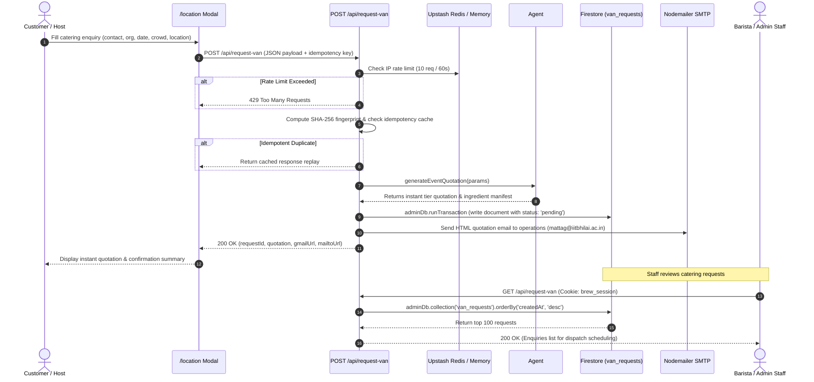
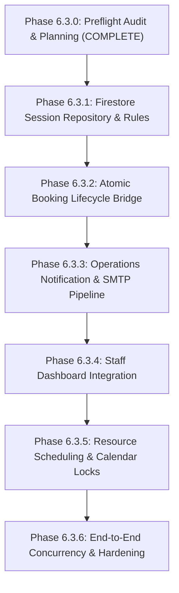
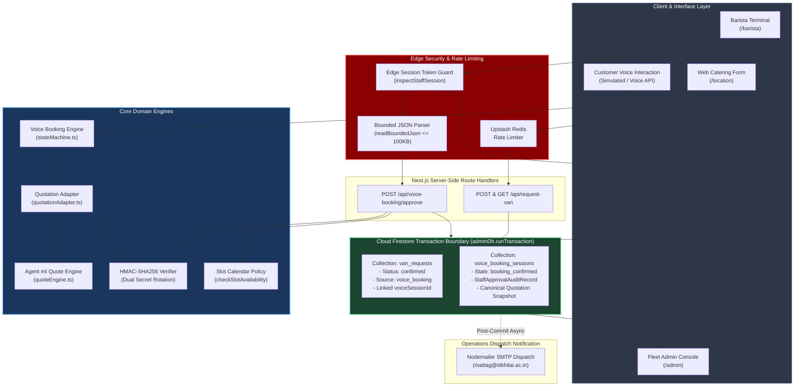

# BREW Coffee — Phase 6.3.0: Booking Workflow Integration Preflight Report

**Report Version:** 1.0.0  
**Date:** 2026-11-01  
**Status:** COMPLETE (READ-ONLY INVESTIGATION & ARCHITECTURE SPECIFICATION)  
**Safety Classification:** NON-DESTRUCTIVE / PREFLIGHT PLANNING ONLY  

---

## Executive Summary

Phase 6.2 (Multilingual AI Voice Booking Engine) has successfully passed all adversarial security reviews, including fail-closed staff authorization, HMAC-SHA256 quotation snapshot integrity with dual-key rotation, exhaustive pricing/logistics/ingredient recomputation, and atomic approval serialization.

Phase 6.3.0 performs a comprehensive, read-only architectural preflight audit to prepare the seamless integration of the AI voice booking engine into BREW Coffee's operational booking lifecycle.

This report establishes the complete architectural blueprint for connecting voice booking sessions, staff approval, Cloud Firestore persistence, resource scheduling, operational notifications, and staff dashboard visibility—while strictly preserving existing application behavior, security boundaries, and zero-downtime backwards compatibility.

---

## 1. Existing Architecture Overview

The BREW Coffee platform is architected around the Next.js App Router (Node.js runtime) following Clean Architecture principles:

```
┌────────────────────────────────────────────────────────────────────────┐
│                        PRESENTATION LAYER                              │
│  - Customer Storefront & Catering Page (src/app/location/page.tsx)     │
│  - Barista Operational Terminal (src/app/barista/page.tsx)             │
│  - Fleet Commander Admin Dashboard (src/app/admin/page.tsx)            │
│  - Live Order Status Board (src/app/board/page.tsx)                    │
└────────────────────────────────────┬───────────────────────────────────┘
                                     │ HTTP / Server Actions
┌────────────────────────────────────▼───────────────────────────────────┐
│                        EDGE / ROUTE CONTROLLERS                        │
│  - POST /api/request-van (Public intake, Zod validation, Idempotency)  │
│  - GET /api/request-van (Staff-only RBAC, Firestore query)             │
│  - POST /api/voice-booking/approve (Staff RBAC, Atomic approval)       │
│  - POST /api/auth/session (Session minting & revocation checks)        │
└────────────────────────────────────┬───────────────────────────────────┘
                                     │ Domain Invocations
┌────────────────────────────────────▼───────────────────────────────────┐
│                         CORE DOMAIN ENGINES                            │
│  - Agent #4: Event Booking Concierge (src/lib/eventBookingConcierge/)  │
│      * quoteEngine.ts: Multi-tier pricing, staffing, logistics, BOM    │
│      * booking.ts & policy.ts: Resource scheduling & double-booking    │
│  - Agent #6: AI Voice Booking Engine (src/lib/voiceBooking/)           │
│      * stateMachine.ts: Deterministic conversation states              │
│      * conversationEngine.ts: LLM parsing, turn management            │
│      * quotationAdapter.ts: HMAC integrity & invariant validation     │
└────────────────────────────────────┬───────────────────────────────────┘
                                     │ Repository Interfaces
┌────────────────────────────────────▼───────────────────────────────────┐
│                    INFRASTRUCTURE & ADAPTERS                           │
│  - Firebase Admin SDK (src/lib/firebaseAdmin.ts): Server-side only     │
│  - Upstash Redis (src/lib/rateLimit.ts): Distributed rate limiting     │
│  - Edge Session Tokens (src/lib/authTokens.ts): HMAC-SHA256 cookies    │
│  - Nodemailer SMTP: Dispatch notifications to business operations      │
└────────────────────────────────────────────────────────────────────────┘
```

### Key Architectural Characteristics
1. **Server-Side Authority**: Cloud Firestore security rules strictly prohibit public client writes to operational collections (`match /van_requests/{id} { allow read, write: if false; }`). All mutations must occur through server-side route handlers via the Firebase Admin SDK (`adminDb`).
2. **Deterministic Idempotency**: All booking actions enforce idempotency via payload fingerprinting (SHA-256) and multi-level caching (in-memory + durable file/ledger).
3. **Defense-in-Depth Authentication**: Staff session tokens (`brew_session`) carry cryptographic signatures, session IDs (`sid`), and role claims (`barista`, `fleet_admin`), with durable revocation checks in Firestore (`revoked_sessions`).
4. **Resilient Fallback Design**: In development, test runners, or environments without live cloud credentials, all data layers gracefully degrade to structured local persistence without crashing the server.

---

## 2. Existing Booking Lifecycle Diagram

The existing manual booking workflow operates via the `/location` catering modal and the `/api/request-van` endpoint:



---

## 3. Phase 6.2 Voice Booking Architecture

Phase 6.2 implements an automated, multilingual, voice-driven conversation engine that collects event requirements, generates authoritative quotations, captures explicit customer confirmation, and holds bookings in an approval queue for human staff authorization:

```
[Customer Call / Voice Session]
               │
               ▼
   [State: created / language_selected]
               │
               ▼
   [State: collecting_requirements] <──────────────┐
               │                                   │ (Clarifications /
               ▼                                   │  Corrections)
   [State: details_collected] ─────────────────────┘
               │
               ▼
   [State: quotation_presented]
     * Invokes generateVoiceBookingQuotation()
     * Generates HMAC-SHA256 snapshot (QUOTATION_SNAPSHOT_SECRET)
               │
               ▼
   [State: awaiting_customer_confirmation]
               │
               ├── Customer: "Yes, I confirm" (positive_acceptance)
               ▼
   [State: customer_confirmed]
     * Validates snapshot integrity before transition
     * If requirements were modified, forces re-quote
               │
               ▼
   [State: awaiting_staff_approval]
               │
               ▼ (POST /api/voice-booking/approve)
     * Authenticated via server-side session (inspectStaffSession)
     * Re-verifies HMAC snapshot & authoritative quotation equality
     * Re-verifies logistics & ingredient manifests
     * Executes atomicApproveBooking() conditional write
               │
               ▼
   [State: booking_confirmed] (Terminal success)
```

---

## 4. Exact Integration Points

| Integration Point | Current Voice Booking State (Phase 6.2) | Target Integrated State (Phase 6.3) | Integration Mechanism |
| :--- | :--- | :--- | :--- |
| **1. Session Persistence** | `InMemoryVoiceSessionRepository` (ephemeral Node.js Map, process-local locks) | `FirestoreVoiceSessionRepository` (durable Cloud Firestore collection) | Replace default repository injection in `src/lib/voiceBooking/` with an adapter implementing `VoiceSessionRepository`. |
| **2. Staff Approval Route** | `/api/voice-booking/approve` updates in-memory session only | Updates Firestore session AND creates official booking record atomically | Execute dual write inside `adminDb.runTransaction()` to guarantee atomic state transition and booking creation. |
| **3. Quotation Engine Bridge** | `quotationAdapter.ts` calls `generateEventQuotationRecord` from `eventBookingConcierge` | Preserves existing bridge; maps voice quote into `van_requests` schema | Re-use existing `EventQuotationRecord` structure without schema translation loss. |
| **4. Resource Scheduling** | No calendar resource lock during voice booking | Check calendar slot collision via `checkSlotAvailability` & lock slot via `reserveSlot` | Integrated during staff approval transaction to prevent double-booking mobile coffee vans. |
| **5. Operational Dispatch Visibility** | Sessions invisible to barista and admin staff | Voice bookings queryable via `GET /api/request-van` with `source: 'voice_booking'` | Expose voice bookings in staff dashboard alongside web enquiries with distinct visual indicator. |
| **6. Email Dispatch Notification** | No email sent upon voice booking approval | Nodemailer SMTP triggers automated operations notification upon approval | Non-blocking post-commit dispatch sending HTML breakdown to `BUSINESS_EMAIL`. |

---

## 5. Firestore Repository Design

### 5.1 Collection Architecture: Top-Level `voice_booking_sessions`

We specify a top-level collection `voice_booking_sessions` rather than a subcollection:
- **Rationale:** Staff must query pending approvals across all customers globally (`where('state', '==', 'awaiting_staff_approval')`). In Firestore, top-level collections provide the most efficient querying, indexing, and transactional locking semantics without requiring collection group indexes.

### 5.2 Document Schema

```typescript
// Collection: voice_booking_sessions
// Document ID: session.id (e.g., "vbs_1730467200000_a1b2c3d4")
interface FirestoreVoiceBookingSessionDocument {
  id: string;                               // Unique session identifier
  phoneNumber: string;                      // E.164 normalized customer phone
  language: "en" | "hi" | "te";             // Selected language
  state: VoiceBookingState;                 // Current state machine state
  requirements: BookingRequirements;        // Extracted customer requirements
  quotation: EventQuotationRecord | null;   // Full multi-tier quote breakdown
  quotationSnapshot: QuotationMaterialSnapshot | null; // Signed HMAC-SHA256 snapshot
  conversationHistory: ConversationMessage[];// Bounded dialogue messages (< 50 turns)
  createdAt: string;                        // ISO 8601 UTC
  updatedAt: string;                        // ISO 8601 UTC
  staffApprovalId: string | null;           // Audit identifier if approved
  staffApprovalAudit: StaffApprovalAuditRecord | null; // Full audit details
  bookingId: string | null;                 // Linked booking/van_request ID
  metadata: {
    source: "voice_agent";
    engineVersion: "6.2.4";
    ipAddress?: string;
    userAgent?: string;
  };
}
```

### 5.3 Document Size Analysis
A 20-turn dialogue with full quotation breakdown and ingredient manifest occupies approximately 12–18 KB. This is well below Cloud Firestore's 1 MB per-document limit. Keeping the session self-contained avoids subcollection round-trips and allows single-document atomic transactions.

### 5.4 Required Firestore Indexes (`firestore.indexes.json`)
```json
{
  "indexes": [
    {
      "collectionGroup": "voice_booking_sessions",
      "queryScope": "COLLECTION",
      "fields": [
        { "fieldPath": "state", "order": "ASCENDING" },
        { "fieldPath": "createdAt", "order": "DESCENDING" }
      ]
    },
    {
      "collectionGroup": "voice_booking_sessions",
      "queryScope": "COLLECTION",
      "fields": [
        { "fieldPath": "phoneNumber", "order": "ASCENDING" },
        { "fieldPath": "createdAt", "order": "DESCENDING" }
      ]
    }
  ],
  "fieldOverrides": []
}
```

### 5.5 Security Rules Impact (`firestore.rules`)
In accordance with BREW's zero-trust server-authoritative security model, the new collection must be strictly inaccessible to direct client SDK reads and writes:

```javascript
// Server-Authoritative Collections (Admin SDK only, client denied)
match /voice_booking_sessions/{sessionId} {
  allow read, write: if false;
}
```
Direct client access is blocked. All reads and mutations route exclusively through server-side endpoints authenticated via `brew_session`.

---

## 6. Transactional Approval Design

### 6.1 Atomic Approval via `adminDb.runTransaction()`

The repository contract requires `atomicApproveBooking(sessionId, authContext, transitionFn)`. In the Firestore repository, this must be executed inside a native Firestore transaction:

```typescript
export class FirestoreVoiceSessionRepository implements VoiceSessionRepository {
  async atomicApproveBooking(
    sessionId: string,
    authContext: StaffAuthorizationContext,
    transitionFn: (
      session: VoiceBookingSession,
      authContext: StaffAuthorizationContext
    ) => VoiceBookingSession
  ): Promise<AtomicApprovalResult> {
    const adminDb = getAdminFirestore();
    if (!adminDb) {
      throw new Error("Firestore Admin SDK is not available.");
    }

    const sessionRef = adminDb.collection("voice_booking_sessions").doc(sessionId);

    return await adminDb.runTransaction(async (transaction) => {
      // 1. Read phase inside transaction
      const docSnap = await transaction.get(sessionRef);
      if (!docSnap.exists) {
        return {
          success: false,
          error: "session_not_found",
          message: `Voice booking session not found: ${sessionId}`,
        };
      }

      const rawSession = docSnap.data() as VoiceBookingSession;

      // 2. Pre-condition checks
      const hasExistingAudit = Boolean(rawSession.staffApprovalAudit);
      if (rawSession.state === "booking_confirmed" || hasExistingAudit) {
        return {
          success: false,
          error: "already_approved",
          message: `Booking session '${sessionId}' has already been approved and confirmed. Duplicate approval rejected.`,
        };
      }

      if (rawSession.state !== "awaiting_staff_approval") {
        return {
          success: false,
          error: "invalid_state",
          message: `Cannot approve booking: session is in state '${rawSession.state}', expected 'awaiting_staff_approval'.`,
        };
      }

      // 3. Execute domain transition function (verifies HMAC and sets audit record)
      const approvedSession = transitionFn(rawSession, authContext);

      // 4. Commit updated session in transaction write phase
      transaction.set(sessionRef, approvedSession);

      return {
        success: true,
        session: approvedSession,
      };
    });
  }
}
```

### 6.2 Distributed Concurrency & Locking
- Cloud Firestore transactions use **optimistic concurrency control**.
- If two staff members attempt to approve the same session simultaneously:
  1. Both read the document in state `awaiting_staff_approval`.
  2. The first transaction commits successfully and transitions the state to `booking_confirmed`.
  3. The second transaction detects the document version modification and automatically retries.
  4. On retry, the second transaction reads the updated document, detects `state === "booking_confirmed"`, and immediately aborts with `already_approved` (HTTP 409 Conflict).
  5. Exactly one approval succeeds; duplicate approvals are mathematically impossible across any number of serverless pods.

---

## 7. Booking Lifecycle Integration Design

### 7.1 Lifecycle Strategy: Unified Dual-Record Linkage

To achieve full operational integration without breaking existing systems, we adopt a **Unified Dual-Record Linkage** pattern:

```
┌─────────────────────────────────┐           ┌─────────────────────────────────┐
│     voice_booking_sessions      │           │          van_requests           │
│─────────────────────────────────│           │─────────────────────────────────│
│ id: "vbs_1730..."               │           │ id: "enq_voice_1730..."         │
│ state: "booking_confirmed"      │           │ status: "confirmed"             │
│ phoneNumber: "+919876543210"    │           │ contact: "+919876543210"        │
│ quotationSnapshot: { ... }      │ ────────> │ source: "voice_booking"         │
│ staffApprovalAudit: {           │ (Linked)  │ voiceSessionId: "vbs_1730..."   │
│   staffIdentity: "barista_01"   │           │ staffApprovalId: "appr_1730..." │
│   approvedAt: "2026-11-01T..."  │           │ quotation: { ... }              │
│ }                               │           │ eventDate: "2026-11-15"         │
└─────────────────────────────────┘           └─────────────────────────────────┘
```

### 7.2 Rationale
1. **Existing Barista Workflows Preserved**: The barista dispatch console and `/api/request-van` endpoints already consume documents from `van_requests`. By writing an approved voice booking into `van_requests` with `status: "confirmed"` and `source: "voice_booking"`, the existing staff UI immediately gains visibility without requiring a rewrite of legacy components.
2. **Audit Isolation**: The deep conversation transcript, HMAC snapshot, and turn-by-turn extraction logs remain isolated in `voice_booking_sessions` to prevent bloating the operational catering collection.
3. **Double-Booking Check**: Inside the approval workflow, `checkSlotAvailability(eventDate, timeSlot)` verifies that no existing booking occupies the van schedule before confirming.

### 7.3 Backwards Compatibility with `/api/request-van`
- The `GET /api/request-van` handler queries `van_requests`.
- Voice bookings will appear with `source: "voice_booking"` and `status: "confirmed"`.
- Existing web enquiries will continue to appear with `source: "web"` (or undefined) and `status: "pending"`.
- Zero disruption to web customer enquiries.

---

## 8. Comprehensive Security Assessment

| Risk ID | Severity | Threat Description | Architectural Mitigation |
| :--- | :---: | :--- | :--- |
| **SEC-01** | **CRITICAL** | **Client-Forged Approval Context:** Caller crafts request body containing arbitrary `staffRole: "admin"` to approve sessions without credentials. | **Resolved in 6.2.3/6.2.4:** `inspectStaffSession()` derives identity strictly from verified server-side HMAC session cookie. Request body `staffRole` and `staffIdentity` are completely ignored. |
| **SEC-02** | **CRITICAL** | **Quotation Tampering / Price Undercharging:** Adversary modifies guest count or prices after quotation generation but before confirmation. | **Resolved in 6.2.4.1–6.2.4.3:** HMAC-SHA256 snapshot verification with secret rotation + full authoritative quotation recomputation + mandatory logistics & ingredient manifest equality. |
| **SEC-03** | **HIGH** | **Direct Database Mutation Bypass:** Malicious client attempts to use Firebase Client SDK to alter `voice_booking_sessions` or `van_requests`. | **Mitigated:** Firestore security rules enforce `allow read, write: if false;` on all operational collections. Mutations strictly require Firebase Admin SDK with server credentials. |
| **SEC-04** | **HIGH** | **Concurrent Staff Approval Race Condition:** Multiple staff members click "Approve" at the same millisecond on separate browser tabs or pods. | **Mitigated:** Cloud Firestore atomic `runTransaction` provides distributed optimistic locking. Exactly one caller succeeds (HTTP 200); all others receive HTTP 409 Conflict. |
| **SEC-05** | **MEDIUM** | **Customer PII Leakage:** Phone numbers, event locations, and organization details exposed via unauthenticated endpoints. | **Mitigated:** All voice booking endpoints enforce `inspectStaffSession()` requiring `barista` or `fleet_admin` RBAC. Unauthenticated GET requests return HTTP 401. |
| **SEC-06** | **MEDIUM** | **Payload Flooding / ReDoS on JSON Body:** Attacker streams multi-megabyte JSON payloads to voice booking routes to exhaust server memory. | **Mitigated:** `readBoundedJson` enforces a strict 100 KB payload ceiling and drops connections immediately upon overflow. |
| **SEC-07** | **LOW** | **Secret Rotation Desynchronization:** Operator rotates `QUOTATION_SNAPSHOT_SECRET` while valid in-flight sessions await approval. | **Mitigated:** Dual-key support (`QUOTATION_SNAPSHOT_SECRET` and `QUOTATION_SNAPSHOT_SECRET_PREVIOUS`) allows zero-downtime rotation. |

---

## 9. Failure and Recovery Strategy

### 9.1 Quotation Re-verification Failure during Approval
- **Symptom:** Requirements were altered or quotation snapshot HMAC signature mismatch.
- **Handling:** The approval handler fails closed immediately with HTTP 409 Conflict / 422 Unprocessable Entity.
- **State Guarantee:** No database mutations occur. The session remains in `awaiting_staff_approval`.
- **Recovery:** Staff UI prompts operator that quotation was invalidated; operator can trigger a re-quote or manual review.

### 9.2 Firestore Write Failure Mid-Transaction
- **Symptom:** Network partition, timeout, or transient Cloud Firestore error during `adminDb.runTransaction()`.
- **Handling:** Firestore automatically rolls back all staged reads and writes. The API returns HTTP 500 with a structured error.
- **State Guarantee:** Zero partial writes. No orphan `van_requests` document is created without an approved `voice_booking_sessions` state.

### 9.3 SMTP Email Notification Failure
- **Symptom:** SMTP credentials invalid, mail server unreachable, or recipient inbox full.
- **Handling:** Email dispatch is executed **post-transaction**. A failure in email sending is logged with high priority (`console.error`), and the `van_requests` document records `emailSent: false, emailError: err.message`.
- **State Guarantee:** The booking confirmation remains valid. Staff can view the confirmed booking directly on their dashboard and manually dispatch confirmation.

---

## 10. Comprehensive Test Strategy

### 10.1 Test Categories & Verification Scope
1. **Unit Tests (Target: 100% contract coverage):**
   - `FirestoreVoiceSessionRepository` tests using Firestore emulator / in-memory transaction mock.
   - Idempotent deduplication and state validation tests.
   - Dual-record linkage mapping tests.
2. **Integration Tests:**
   - Full lifecycle test: `created` -> requirements collected -> customer confirmed -> staff approved via `/api/voice-booking/approve` -> `van_requests` created.
   - Security gate test: verify unauthenticated calls receive 401, unauthorized roles receive 403.
3. **Concurrency & Race Condition Tests:**
   - Launch 25 concurrent approval requests against the same session: assert exactly 1 returns 200 OK and 24 return 409 Conflict with `already_approved`.
4. **Regression Preservation Suite:**
   - Execute all 402 Phase 6 unit tests (`npm run test:voice-booking`).
   - Execute all 19 master test suites (`npm test`).
   - Execute full Playwright E2E test suite (`npm run test:e2e`).

---

## 11. Phase-by-Phase Implementation Roadmap



### Detailed Sub-Phase Specifications

#### Phase 6.3.1: Firestore Session Repository & Security Rules
- **Deliverables:**
  - Create `src/lib/voiceBooking/repositories/firestoreSessionRepository.ts`.
  - Implement full `VoiceSessionRepository` interface using `adminDb.runTransaction()`.
  - Add `match /voice_booking_sessions/{id} { allow read, write: if false; }` to `firestore.rules`.
  - Add indexes to `firestore.indexes.json`.
  - Provide local in-memory fallback for environments without GCP credentials.
- **Exit Criteria:** Dedicated unit and emulator test suite passing for Firestore repository.

#### Phase 6.3.2: Atomic Booking Lifecycle Bridge
- **Deliverables:**
  - Update `/api/voice-booking/approve` to execute dual-document creation within `adminDb.runTransaction()`.
  - Write official catering record into `van_requests` with `source: "voice_booking"` and `status: "confirmed"`.
  - Link `voiceSessionId` and `staffApprovalAudit` into the booking record.
- **Exit Criteria:** Approving a voice booking atomically creates a valid `van_requests` document.

#### Phase 6.3.3: Operations Notification & SMTP Pipeline
- **Deliverables:**
  - Connect post-approval dispatch to existing nodemailer SMTP infrastructure.
  - Deliver formatted HTML operations alert to `BUSINESS_EMAIL` with voice booking transcript and ingredient manifest.
- **Exit Criteria:** Operations email triggers on approval with non-blocking error recovery.

#### Phase 6.3.4: Staff Dashboard Integration
- **Deliverables:**
  - Update `GET /api/request-van` to retrieve voice bookings alongside web enquiries.
  - Add visual badge in barista/admin UI distinguishing "Voice AI Booking" from "Web Enquiry".
  - Allow staff to inspect voice booking conversation transcripts.
- **Exit Criteria:** Staff can view and inspect voice bookings in existing barista terminal.

#### Phase 6.3.5: Resource Scheduling & Calendar Locks
- **Deliverables:**
  - Connect voice booking approval to `checkSlotAvailability` and `reserveSlot` in `src/lib/eventBookingConcierge/policy.ts`.
  - Prevent double-booking between web requests and voice bookings for overlapping time slots.
- **Exit Criteria:** Attempting to approve a booking for an occupied slot returns 409 Conflict.

#### Phase 6.3.6: End-to-End Verification & Final Hardening
- **Deliverables:**
  - 25-thread concurrent approval stress tests.
  - Complete regression verification across all 19 master test suites and Playwright E2E.
  - Final integration report and review bundle.
- **Exit Criteria:** Zero test regressions, 100% tests passing.

---

## 12. Expected File Impact Matrix

| File Path | Action | Sub-Phase | Purpose |
| :--- | :---: | :---: | :--- |
| `src/lib/voiceBooking/repositories/firestoreSessionRepository.ts` | **CREATE** | 6.3.1 | Durable Firestore session repository with transactional approval |
| `src/lib/voiceBooking/repositories/index.ts` | **CREATE** | 6.3.1 | Repository factory selecting Firestore vs InMemory based on env |
| `firestore.rules` | **MODIFY** | 6.3.1 | Add server-authoritative denial rule for `voice_booking_sessions` |
| `firestore.indexes.json` | **MODIFY** | 6.3.1 | Add composite indexes for state and phone number queries |
| `src/app/api/voice-booking/approve/route.ts` | **MODIFY** | 6.3.2 | Inject dual-record atomic booking creation |
| `src/lib/voiceBooking/notifications.ts` | **CREATE** | 6.3.3 | Post-approval SMTP dispatch notification helper |
| `src/app/api/request-van/route.ts` | **MODIFY** | 6.3.4 | Update GET query to include voice bookings with unified mapping |
| `src/lib/eventBookingConcierge/policy.ts` | **MODIFY** | 6.3.5 | Ensure slot reservation is durable across restarts |
| `scripts/verify-phase6-3-integration.ts` | **CREATE** | 6.3.6 | End-to-end integration and concurrency test runner |
| `docs/PHASE_6_3_INTEGRATION_REPORT.md` | **CREATE** | 6.3.6 | Final implementation report |

---

## 13. Risks & Open Architectural Questions

Before beginning implementation in Phase 6.3.1, the following design decisions are documented for alignment:

1. **Direct Customer Notification Post-Approval:**
   - *Current plan:* In Phase 6.3, only internal staff operations receive SMTP notifications. In accordance with strict constraints, no external WhatsApp or SMS notifications are sent to the customer without explicit future authorization.
2. **Calendar Slot Lock Scope:**
   - *Current plan:* Slot locks are enforced by Date + TimeSlot (e.g. `2026-11-15:10:00-14:00`). If BREW operates multiple vans in the future, slot keys will need to incorporate `vanId`. For Phase 6.3, single-van exclusivity is assumed to prevent double-booking.
3. **Repository Injection Pattern:**
   - *Current plan:* Use an environment-aware factory (`getSessionRepository()`) that defaults to `FirestoreVoiceSessionRepository` when Firebase Admin is initialized, and cleanly falls back to `InMemoryVoiceSessionRepository` during local testing or CI runs where Firestore credentials are not mounted.

---

## 14. Explicit Confirmation of Preservation Constraints

- [x] **Zero Source Code Modifications:** No application source code, API routes, or library files were modified during Phase 6.3.0.
- [x] **Zero Database Alterations:** No database schemas, indexes, or Firestore rules were modified.
- [x] **Zero Git Mutations:** No commits, staging (`git add`), pushes, or remote ref alterations were performed.
- [x] **Feature Flags Maintained:** `VOICE_BOOKING_ENABLED=false` remains intact.
- [x] **Paid Services Preserved:** Zero cloud billing, telephony, or paid APIs activated.
- [x] **Workflow Stopped:** Execution immediately stops at Phase 6.3.0 pending explicit user review and authorization.

---

## 15. Integrated Target Architecture Diagram


