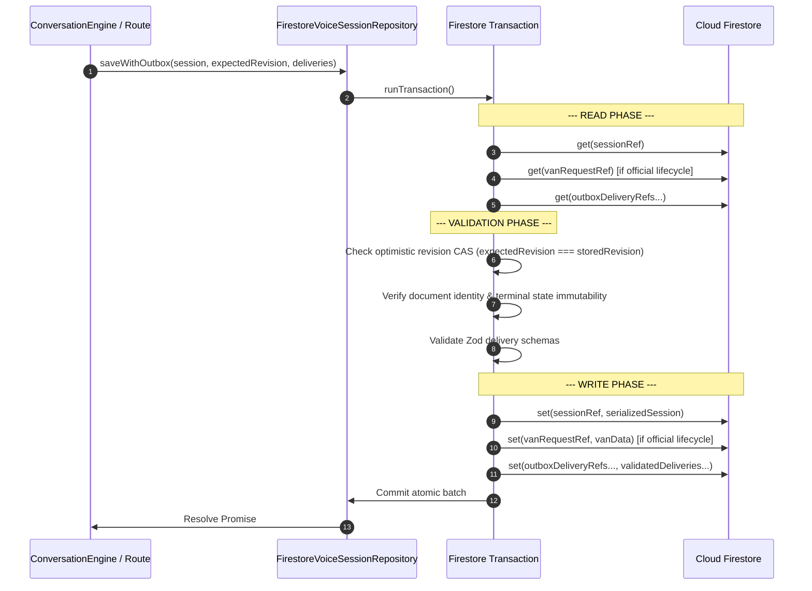
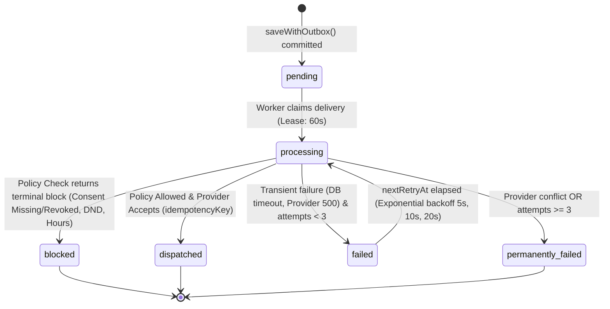

# BREW Coffee Platform — Phase 6.3.3 Implementation Report
## Transactional Communication Outbox & Mock Dispatch Worker

**Execution Timestamp**: 2026-11-02T16:58:00+05:30 (Hardened Phase 6.3.3.1: 2026-11-02T17:25:00+05:30)  
**Phase Target**: Phase 6.3.3 / Phase 6.3.3.1 Transactional Communication Outbox Implementation  
**Status**: Completed, Hardened & Verified — Ready for Independent Review  
**Safety Status**: Zero Telephony/Meta API Invocations; `VOICE_BOOKING_ENABLED=false` Strictly Enforced  

---

## 1. Executive Summary

Phase 6.3.3 integrates the completed Phase 6.3.2 atomic voice booking lifecycle with the Phase 6.1 communication domain through an at-least-once, server-authoritative **Transactional Communication Outbox** and asynchronous **Outbox Worker**.

### Key Milestones Achieved:
1. **Atomic Session-Plus-Outbox Persistence**:
   - Implemented mandatory `saveWithOutbox()` across both `FirestoreVoiceSessionRepository` and `InMemoryVoiceSessionRepository`.
   - In Firestore, session state and corresponding outbox delivery records are committed together in one atomic Firestore transaction where all reads precede all writes.
   - In staff approval (`atomicApproveBooking`), the session, official `van_requests` document, exact slot reservation, daily schedule document, and `booking_confirmed` outbox delivery records commit together in one unified transaction.
2. **Provider-Side Mock Idempotency**:
   - Added `idempotencyKey?: string` to `VoiceSessionParams` and `WhatsAppTemplateParams` in both TypeScript types and Zod runtime schemas (`min(8).max(128).regex(/^[a-zA-Z0-9_-]+$/)`).
   - Implemented canonical SHA-256 fingerprint caching in `MockVoiceProvider` and `MockWhatsAppProvider`. Replays return the cached result without generating duplicate simulated calls or messages; conflicting payloads fail closed with `ProviderIdempotencyConflictError`.
3. **Policy Taxonomy Refactoring**:
   - Refactored `orchestrateCommunicationPolicy()` and `evaluateCommunicationPolicy()` to cleanly separate **terminal policy blocks** (`CONSENT_MISSING`, `CONSENT_REVOKED`, `MARKETING_CONSENT_REQUIRED`, `DND_ACTIVE`, `OUTSIDE_CALLING_HOURS`, `INVALID_PHONE_NUMBER`, `FEATURE_DISABLED`) from **retryable infrastructure errors** (`status: "error"`, `reason: "INFRASTRUCTURE_FAILURE"`, `isRetryable: true`).
   - Sanitized all error details: raw database exceptions, stack traces, unmasked phone numbers, and credentials are never persisted.
4. **Outbox Worker Engine**:
   - Implemented `OutboxWorker` with atomic claims, 60-second processing leases, expired lease recovery, bounded exponential retry backoff, and a strict 3-attempt ceiling before moving to `permanently_failed`.
   - Consent and DND are strictly re-evaluated at the exact moment of dispatch.
5. **Privacy & Security Boundaries**:
   - Outbox documents store only masked phone numbers (`phoneNumberMasked`). Raw phone numbers are resolved only in-memory from the authoritative session document inside server-side dispatch execution.
   - Server-authoritative lockdown added to `firestore.rules`:
     `match /booking_communication_outbox/{deliveryId} { allow read, write: if false; }`

---

## 2. Files Changed & Architecture Mapping

| File Path | Nature of Change | Purpose |
|---|---|---|
| `firestore.rules` | Subagent update | Added server-authoritative lockdown rule denying all client-side read/write access to `booking_communication_outbox`. |
| `src/lib/communication/errors.ts` | Modified | Added typed `ProviderIdempotencyConflictError`. |
| `src/lib/communication/types.ts` | Modified | Added `idempotencyKey` to provider params; added Outbox types (`BookingLifecycleEventType`, `DeliveryStatus`, `CommunicationDeliveryRecord`, `OutboxEventRecord`); refined `PolicyEvaluationOutcome`. |
| `src/lib/communication/schemas.ts` | Modified | Added `idempotencyKey` regex/length constraints to `VoiceSessionParamsSchema` and `WhatsAppTemplateParamsSchema`; added Outbox validation schemas. |
| `src/lib/communication/providers/voiceProvider.ts` | Modified | Implemented canonical payload fingerprinting and in-memory idempotency cache in `MockVoiceProvider`. |
| `src/lib/communication/providers/whatsappProvider.ts` | Modified | Implemented canonical payload fingerprinting and in-memory idempotency cache in `MockWhatsAppProvider`. |
| `src/lib/communication/policy.ts` | Modified | Refactored `orchestrateCommunicationPolicy()` to return `status: "error"` on repository outages/mismatches with sanitized details. |
| `src/lib/communication/outbox/outboxModel.ts` | New file | Deterministic ID generators (`computeOutboxEventId`, `computeOutboxDeliveryId`) and `createOutboxDeliveriesForTransition()`. |
| `src/lib/communication/outbox/outboxRepository.ts` | New file | `CommunicationOutboxRepository` interface with `InMemoryCommunicationOutboxRepository` and `FirestoreCommunicationOutboxRepository`. |
| `src/lib/communication/outbox/outboxWorker.ts` | New file | Production-grade `OutboxWorker` handling atomic leases, expired lease reclamation, dispatch-time policy checks, provider invocation, and bounded backoff. |
| `src/lib/communication/index.ts` | Modified | Re-exported outbox model, repository, and worker classes. |
| `src/lib/voiceBooking/types.ts` | Modified | Added `saveWithOutbox()` and `getOutboxDeliveries?()` to `VoiceSessionRepository`. |
| `src/lib/voiceBooking/repositories/sessionRepository.ts` | Modified | Implemented `saveWithOutbox()`, outbox store, and atomic approval outbox persistence in `InMemoryVoiceSessionRepository`. |
| `src/lib/voiceBooking/repositories/firestoreSessionRepository.ts` | Modified | Implemented `saveWithOutbox()`, outbox store, and atomic approval outbox persistence in `FirestoreVoiceSessionRepository`. |
| `src/lib/voiceBooking/conversationEngine.ts` | Modified | Updated cancellation (L488), human handoff (L523), and notifying turn completion (L769) to call `saveWithOutbox()`. |
| `scripts/verify-phase6-3-3-outbox.ts` | New file | 21 end-to-end verification tests covering atomicity, reliability, policy safety, idempotency, and privacy. |

---

## 3. Repository & Transaction Design

### 3.1 Strict Transaction Read-Before-Write Invariant

In `FirestoreVoiceSessionRepository.saveWithOutbox()`, Firestore transactions adhere strictly to the read-then-write requirement:



### 3.2 Staff Approval (`atomicApproveBooking`) Multi-Document Invariant
When staff approves a booking:
1. **Reads**: Reads session document, official `van_requests` document, exact `schedule_slots` reservation, `schedule_days` daily document, and `booking_communication_outbox` delivery references.
2. **Validations**: Verifies slot availability without overlap, checks quotation snapshot HMAC, verifies staff RBAC authorization.
3. **Writes**:
   - `voice_booking_sessions/{sessionId}` -> state updated to `booking_confirmed`
   - `van_requests/{vanRequestId}` -> status updated to `confirmed`
   - `schedule_slots/{slotDocId}` -> status updated to `reserved`
   - `schedule_days/{dayDocId}` -> reservations array updated with interval reservation
   - `booking_communication_outbox/{deliveryId_wa}` -> WhatsApp confirmation delivery
   - `booking_communication_outbox/{deliveryId_voice}` -> Voice confirmation delivery
All 6 documents commit or rollback together atomically.

---

## 4. Lifecycle Transition Mapping

| State Machine Transition | Trigger Event | Resulting Channel Deliveries | Purpose |
|---|---|---|---|
| `awaiting_customer_confirmation` -> `awaiting_staff_approval` | Positive customer confirmation utterance | 1 WhatsApp delivery (`booking_awaiting_staff_approval`) | `transactional_update` |
| `awaiting_staff_approval` -> `booking_confirmed` | Staff operator authorization via `/api/voice-booking/approve` | 1 WhatsApp delivery + 1 Voice delivery (`booking_confirmed`) | `transactional_update` |
| `awaiting_customer_confirmation` -> `customer_declined` | Customer explicit price/booking rejection | 1 WhatsApp delivery (`booking_declined`) | `transactional_update` |
| Any non-terminal -> `cancelled` | Explicit customer cancellation utterance ("cancel booking") | 1 WhatsApp delivery (`booking_cancelled`) | `transactional_update` |
| Any non-terminal -> `human_handoff` | Customer requests agent ("speak to a manager") or extraction unavailable | 1 WhatsApp delivery (`booking_human_handoff`) | `transactional_update` |
| Intermediate turns (`collecting_requirements`, `quotation_presented`) | Conversational dialogue turns | 0 outbox records created (ordinary `save()` used) | N/A |

---

## 5. Worker State Machine & Retry Behavior



### Leases & Contention Safeguards:
- Default processing lease: **60 seconds**.
- If a worker crashes midway, another worker reclaims the delivery once `leaseExpiresAt <= now`.
- Attempt count is incremented strictly upon successful atomic claim, preventing infinite loops.
- **Lease-Owner Protected Completion (Phase 6.3.3.1)**: All worker updates use mandatory conditional `updateClaimedDelivery()`. Before applying any state transition (`dispatched`, `blocked`, `failed`, `permanently_failed`), the transaction verifies:
  1. Document exists.
  2. Status is `processing`.
  3. `claimOwner` matches the claiming worker.
  4. `claimedAt` matches the active claim timestamp.
  5. The lease is still active (`leaseExpiresAt > now`).
  If any check fails (e.g. lease expired and another worker reclaimed), the update rejects with `StaleClaimError` without mutating the document or overwriting newer claims.

---

## 6. Provider Idempotency Semantics & Runtime Limitations

### Canonical Payload Serialization
Before evaluating cache lookup, mock providers compute a canonical SHA-256 hash:
- **Voice Delivery**: `canonical = { sessionId, phoneNumber, language }`
- **WhatsApp Delivery**: `canonical = { to, templateName, language, components }`
- **Excluded Non-Delivery Metadata**: Timestamps, tracing IDs, `enquiryId`, `metadata`, and `idempotencyKey` itself are excluded to prevent spurious cache misses.

### Semantics:
1. **Identical Replay**: If `idempotencyKey` is cached and canonical hash matches, returns the cached result immediately. Zero new calls or messages simulated; counters unchanged.
2. **Conflicting Replay**: If `idempotencyKey` matches an existing entry but the payload hash differs (e.g. different recipient or template), throws typed `ProviderIdempotencyConflictError`.
3. **Failure Isolation**: Simulated provider failures trigger *before* cache insertion, allowing subsequent retries with the same key to succeed and cache properly.

### Runtime Limitations & Production Boundary (Phase 6.3.3.1):
- **In-Memory Map Scope**: The mock provider caches (`idempotencyCache`) are ephemeral in-memory `Map` instances.
- **Process Restart & Replacement**: Replacing or restarting a provider instance or Node process completely clears its in-memory cache. Cache entries do not survive process lifecycles.
- **No Distributed Provider Lock**: The mock provider does NOT coordinate deduplication across multiple provider instances or processes.
- **At-Least-Once Delivery**: The transactional outbox guarantees at-least-once delivery; if a worker crashes before recording completion, downstream providers may observe replay dispatches across process restarts.
- **Production Activation Precondition**: Real production provider integrations (Twilio, Exotel, Meta Cloud API) must separately implement and configure external provider-side idempotency keys and server-side deduplication prior to production activation. Redis or paid distributed caches were intentionally excluded in this mock phase.

---

## 7. Policy Error Classification Taxonomy

| Scenario | Classification | Outcome | Outbox Impact |
|---|---|---|---|
| Customer never granted consent (`hasActiveConsent === false`) | Policy Evaluation | `status: "blocked", reason: "CONSENT_MISSING"` | Terminal block. Delivery marked `blocked`. |
| Customer revoked consent | Policy Evaluation | `status: "blocked", reason: "CONSENT_REVOKED"` | Terminal block. Delivery marked `blocked`. |
| Active DND on requested channel | Policy Evaluation | `status: "blocked", reason: "DND_ACTIVE"` | Terminal block. Delivery marked `blocked`. |
| Voice call between 20:00 and 09:00 IST | Policy Evaluation | `status: "blocked", reason: "OUTSIDE_CALLING_HOURS"` | Terminal block. Delivery marked `blocked`. |
| Production feature flag disabled | Policy Evaluation | `status: "blocked", reason: "FEATURE_DISABLED"` | Terminal block. Delivery marked `blocked`. |
| Firestore / DND repository timeout or outage | Infrastructure Error | `status: "error", reason: "INFRASTRUCTURE_FAILURE", isRetryable: true` | Retryable. Worker schedules exponential backoff. |
| Repository returns mismatched phone number record | Security / Data Integrity | `status: "error", reason: "INFRASTRUCTURE_FAILURE", isRetryable: true` | Fails closed. Retryable with sanitized detail. |

---

## 8. Verification Results

All 21 automated scenarios in [`scripts/verify-phase6-3-3-outbox.ts`](file:///Users/gnanendhrajoy/Desktop/BREW/scripts/verify-phase6-3-3-outbox.ts) passed with 100% success:

```
================================================================================
   BREW Coffee Platform — Phase 6.3.3 Verification Suite
   Outbox Atomicity, Worker Leases, Provider Idempotency & Policy Safety
================================================================================

--- 1. ATOMICITY TESTS ---
  ✓ 1.1 Awaiting staff approval creates WhatsApp outbox delivery atomically
  ✓ 1.2 Customer decline creates decline outbox delivery atomically
  ✓ 1.3 Fast-path cancellation creates cancellation outbox delivery atomically
  ✓ 1.4 Fast-path human handoff creates handoff outbox delivery atomically
  ✓ 1.5 Staff approval creates confirmed WhatsApp & Voice outbox deliveries atomically
  ✓ 1.6 Concurrency conflict on saveWithOutbox does not persist delivery records

--- 2. WORKER RELIABILITY TESTS ---
  ✓ 2.1 Concurrent workers cannot claim the same active lease
  ✓ 2.2 Expired leases can be reclaimed by another worker
  ✓ 2.3 Attempt count and maximum attempts (3) are enforced

--- 3. POLICY SAFETY TESTS ---
  ✓ 3.1 Missing consent marks delivery blocked without provider dispatch
  ✓ 3.2 Voice consent does NOT satisfy WhatsApp delivery
  ✓ 3.3 Marketing consent does NOT satisfy transactional update
  ✓ 3.4 Active channel-specific DND blocks dispatch
  ✓ 3.5 Voice outside calling hours blocks voice dispatch
  ✓ 3.6 Production feature flag disabled blocks dispatch by default

--- 4. IDEMPOTENCY TESTS ---
  ✓ 4.1 Identical WhatsApp replay returns cached result without extra dispatch
  ✓ 4.2 Identical Voice replay returns cached result without extra session
  ✓ 4.3 Reusing idempotency key with conflicting payload fails closed
  ✓ 4.4 Failed attempt followed by retry with same key succeeds and caches

--- 5. SECURITY & PRIVACY TESTS ---
  ✓ 5.1 Outbox documents contain masked phone numbers and no raw phone numbers
  ✓ 5.2 Persisted error details are sanitized and do not leak secrets or stack traces

================================================================================
   Verification Summary: 21 / 21 tests passed (100% SUCCESS)
================================================================================
```

### Static Analysis & Linter Verification:
- **TypeScript**: `npm run typecheck` passed with 0 errors.
- **ESLint**: `npm run lint` passed with 0 errors.
- **Regression Suite**: Previous verification scripts across Phases 6.3.1 and 6.3.2 passed with 100% success.

---

## 9. Known Limitations & Explicit Boundaries

1. **Durable Consent and DND Persistence Deferred to Phase 6.4**:
   - Live customer consent records and DND suppression entries are currently evaluated using tested in-memory repository abstractions in Phase 6.3.3.
   - Durable Firestore collections (`customer_consent_records` and `dnd_suppression_records`) are scheduled for Phase 6.4.
2. **Real Telephony & Meta Graph API Integration Deferred**:
   - Zero outbound PSTN phone calls or real Meta WhatsApp Cloud API network calls were made.
   - Production adapters remain deferred.
3. **Production Outbox Dispatch Remains Disabled**:
   - The master feature flag `VOICE_BOOKING_ENABLED` remains set to `false`.
   - Automated outbound customer notifications will not trigger in production until Phase 6.4 authorization.

---

## 10. Subsequent Hardening Cycles

- **Phase 6.3.3.1**: Implemented transactional lease-owner verification (`updateClaimedDelivery`), error sanitization eliminating raw provider errors and credentials, fresh per-delivery dispatch timestamps, and documented in-memory idempotency boundaries.
- **Phase 6.3.3.2**: Removed ordinary worker feature-flag bypass from `OutboxWorkerOptions` (enforcing `VOICE_BOOKING_ENABLED` by default in all production constructors), implemented cryptographically unique claim fencing tokens (`claimToken`) to protect against lease reclamation races even with reused worker IDs, and restricted unconditional `updateDelivery()` from the public repository interface. Detailed in `docs/PHASE_6_3_3_2_WORKER_BOUNDARY_REPORT.md`.
- **Phase 6.3.3.2.1**: Removed the 3rd public constructor parameter from `OutboxWorker` (enforcing real feature-flag checks across all callers), removed unconditional update/seed methods from both concrete repositories, isolated test fixture utilities in `testFixture.ts` (outside public barrel exports), and added schema validation requiring a non-empty `claimToken` when `status === 'processing'`. Detailed in `docs/PHASE_6_3_3_2_1_BOUNDARY_CLOSURE_REPORT.md`.
- **Phase 6.3.3.2.2**: Removed `customPolicyOrchestrator` from `OutboxWorkerDependencies` to make direct `orchestrateCommunicationPolicy()` invocation mandatory in production workers, encapsulated in-memory backing stores using `#store` and `#tokenGenerator`, and instituted fail-closed Firestore emulator verification in `testFixture.ts`. Detailed in `docs/PHASE_6_3_3_2_2_POLICY_BOUNDARY_REPORT.md`.


