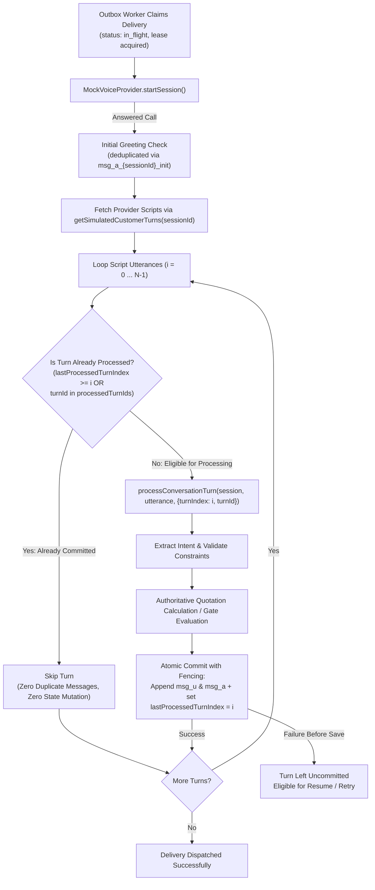

# Phase 6.3.4.3 & 6.3.4.3.1 — Multilingual Voice Conversation Engine Integration & Turn Idempotency

**Document ID:** `PHASE_6_3_4_3_IMPLEMENTATION_REPORT`  
**Phase:** 6.3.4.3 / 6.3.4.3.1 (Multilingual Voice Conversation Engine Integration, Conversation Turn Idempotency & Mock Session Isolation)  
**Date:** November 6, 2026  
**Status:** COMPLETE & VERIFIED  

---

## 1. Executive Summary

Phase 6.3.4.3 integrated the simulated voice-call lifecycle (Phase 6.3.4.2) with the conversational booking engine (`voiceBooking`), enabling simulated answered phone calls to conduct complete, multi-turn booking conversations across English, Hindi, and Telugu (including Hinglish and Tenglish).

Phase 6.3.4.3.1 hardens the conversation engine and worker lifecycle against partial execution failures and cross-session test leakage:
1. **Durable Per-Session Conversation Progress:**
   - Each simulated customer utterance has a stable identity derived deterministically from the session ID and script position: `${session.id}_turn_${i}`.
   - User messages (`msg_u_${session.id}_turn_${i}`), assistant responses (`msg_a_${session.id}_turn_${i}`), and initial greetings (`msg_a_${session.id}_init`) use deterministic IDs.
   - Progress is marked atomically on the session document via `lastProcessedTurnIndex`, `processedTurnIds`, and mirrored in `metadata` in the exact same persistence write as the conversation turn itself.
   - A resumed worker or retry automatically inspects `lastProcessedTurnIndex` / `processedTurnIds` and resumes execution from the first unprocessed utterance without duplicating already processed turns or assistant responses.
   - A new logical call attempt does not automatically replay already completed turns.
   - If a turn fails before persistence (e.g. extraction timeout or claim lease expiration), it remains uncommitted and fully eligible for retry.
2. **Strict Session Isolation for Mock Customer Scripts:**
   - Scripts in `MockVoiceProvider` are mapped strictly by session ID via `setSessionCustomerTurns(sessionId, turns)`.
   - `getSimulatedCustomerTurns(sessionId)` strictly returns only the script registered for that specific session ID. If not found, it returns `[]` and never silently falls back to a global default during normal worker execution.
   - A global default fallback is restricted strictly to isolated test harnesses via `setTestHarnessFallbackCustomerTurns(turns)` and requires explicit opt-in (`{ allowGlobalFallback: true }`).
   - Session ID validation prevents raw phone numbers from being passed as session keys.
   - Test scripts can be cleared per-session (`clearSessionCustomerTurns`) or globally (`clearCustomerTurns`).
3. **Safety & Policy Non-Negotiables:**
   - `VOICE_BOOKING_ENABLED=false` strictly preserved across production paths.
   - Zero real outbound PSTN, zero STT/TTS models, zero paid telephony, zero real WhatsApp or SMS messages.
   - Phone numbers remain masked in transcripts, messages, logs, and public responses.
   - Customer confirmation transitions to `awaiting_staff_approval`; separate authenticated staff approval via `/api/voice-booking/approve` remains mandatory for final confirmation.

---

## 2. Architectural Design & Turn Idempotency



### 2.1 Durable Progress & Message Identity Mapping

| Entity | Identity Format | Persistence Timing | Duplication Guard |
| :--- | :--- | :--- | :--- |
| **Initial Greeting** | `msg_a_${session.id}_init` | On answered call if history has no greeting | Checked via `session.conversationHistory.some(m => m.id === ...)` |
| **User Turn Message** | `msg_u_${session.id}_turn_${i}` | During `processConversationTurn` | Checked via `isTurnAlreadyProcessed` before extraction |
| **Assistant Turn Message** | `msg_a_${session.id}_turn_${i}` | During `processConversationTurn` | Tied 1:1 with user turn ID; returns existing response on replay |
| **Progress Marker** | `lastProcessedTurnIndex: i`<br/>`processedTurnIds: [..., turnId]` | Committed atomically with the turn in `save()` / `mutateSessionWithClaimFencing()` | Never written separately from the message update |

### 2.2 Mock Script Isolation Contract

```ts
// MockVoiceProvider isolation API:
setSessionCustomerTurns(sessionId: string, turns: string[]): void;
getSimulatedCustomerTurns(sessionId?: string, options?: { allowGlobalFallback?: boolean }): string[];
clearSessionCustomerTurns(sessionId: string): void;
clearCustomerTurns(): void;
```
- **Session Lookup Only:** When `getSimulatedCustomerTurns(delivery.sessionId)` is invoked by the worker, it queries `customerTurnsMap.get(sessionId)`. If unmapped, it returns `[]`.
- **No Accidental Inheritance:** Session B will never execute Session A's configured utterances.
- **Fail-Closed Validation:** `setSessionCustomerTurns` throws if `sessionId` starts with `+` or matches a 10-15 digit phone pattern.

---

## 3. Multilingual & Conversational Capabilities

- **English (`en`):** Full end-to-end booking flow, prompt generation, and quotation breakdown.
- **Hindi (`hi`):** Native Devanagari script (`शादी`, `मेहमान`, `बजट`) and Hinglish transliteration (`"mujhe 100 logon ke liye shaadi mein coffee counter chahiye"`).
- **Telugu (`te`):** Native Telugu script (`పెళ్లి`, `అతిథులు`, `వివాహం`) and Tenglish transliteration (`"maaku 150 mandiki pelli lo coffee bar kaavali"`).
- **Dynamic Code-Switching:** Automatically transitions conversation language when customer switches language with classification confidence $\ge 0.8$.
- **Disambiguated Extraction:** Regex matches explicit guest units (`guests`, `log`, `mandi`, `people`) before standalone numbers, preventing ISO date numbers (`2026-12-25`) from corrupting guest count.

---

## 4. Verification Suite & Test Results

### 4.1 Focused Test Suites

#### Phase 6.3.4.3.1 Turn Idempotency & Mock Isolation Suite
`npm run test:p63431` (`scripts/verify-phase6-3-4-3-1-turn-idempotency.ts`)
```
--- 1. DURABLE PROGRESS & RESUMPTION AFTER INTERRUPTION ---
  ✓ 1.1 Script with three turns interrupted after turn one resumes at turn two
  ✓ 1.2 Retry after turn two does not duplicate customer or assistant messages
  ✓ 1.3 Completed turn is not reprocessed on a new logical call attempt
  ✓ 1.4 Failure before turn persistence leaves that turn eligible for retry

--- 2. MOCK CUSTOMER SCRIPT SESSION ISOLATION ---
  ✓ 2.1 Two sessions configured with different scripts never exchange utterances
  ✓ 2.2 Session without configured script receives no other session's default script
  ✓ 2.3 Session ID validation prevents raw phone numbers from being used as keys

--- 3. CONCURRENCY, DEDUPLICATION & GATES ---
  ✓ 3.1 Duplicate worker execution does not duplicate greeting or conversation turns
  ✓ 3.2 Stale claim fencing still prevents session mutation
  ✓ 3.3 Customer confirmation and staff approval remain separate

--- 4. MULTILINGUAL & CODE-SWITCHING INTEGRITY ---
  ✓ 4.1 English, Hindi, Telugu, Hinglish, and Tenglish conversations track turn progress

Phase 6.3.4.3.1 Verification Complete: 11 / 11 tests passed (100% SUCCESS)
```

#### Phase 6.3.4.3 Multilingual Conversation Suite
`npm run test:p6343` (`scripts/verify-phase6-3-4-3-multilingual-conversation.ts`)
```
--- 1. MULTILINGUAL CONVERSATION FLOWS (ENGLISH, HINDI, TELUGU) ---
  ✓ 1.1 English conversation from greeting through quotation
  ✓ 1.2 Hindi conversation (Devanagari script)
  ✓ 1.3 Telugu conversation (Telugu script)
  ✓ 1.4 Hinglish and Tenglish input detection and extraction
  ✓ 1.5 Explicit language switching during a conversation

--- 2. REQUIREMENT COLLECTION, VALIDATION & QUOTATIONS ---
  ✓ 2.1 Missing requirements prompt follow-up questions sequentially
  ✓ 2.2 Invalid event timing triggers operational clarification without presenting quotation

--- 3. CONFIRMATION SAFETY GATE, QUOTATION INTEGRITY & DECLINE ---
  ✓ 3.1 Ambiguous customer statement does NOT trigger confirmation
  ✓ 3.2 Explicit positive confirmation transitions to awaiting_staff_approval
  ✓ 3.3 Customer decline transitions to customer_declined
  ✓ 3.4 Material requirement changes invalidate quotation and require re-confirmation

--- 4. PERSISTENCE, RECOVERY, CONCURRENCY & REVISION SAFETY ---
  ✓ 4.1 Session reload and conversation continuation across turns
  ✓ 4.2 Duplicate delivery execution does not duplicate greeting turns
  ✓ 4.3 Stale worker cannot append conversation turns after lease reclaim
  ✓ 4.4 Staff approval remains separate from customer confirmation gate

--- 5. END-TO-END OUTBOX WORKER WITH SIMULATED CUSTOMER TURNS ---
  ✓ 5.1 End-to-end answered call conducts multi-turn conversation via OutboxWorker
  ✓ 5.2 simulateVoiceConversation helper runs full conversational sequences

Phase 6.3.4.3 Verification Complete: 17 / 17 tests passed (100% SUCCESS)
```

### 4.2 Full Regression Suite Summary

| Suite Command | Test Target | Verification Type | Result |
| :--- | :--- | :--- | :--- |
| `npm run test:p63431` | Phase 6.3.4.3.1 Turn Idempotency & Mock Isolation | Unit & Outbox Worker Integration | **11 / 11 Passed** |
| `npm run test:p6343` | Phase 6.3.4.3 Multilingual Voice Conversation | Unit & Conversational Integration | **17 / 17 Passed** |
| `npm run test:p6342` | Phase 6.3.4.2 Voice Lifecycle & Concurrency | Mock Outbox Worker & Lease Fencing | **24 / 24 Passed** |
| `npm run test:p6341` | Phase 6.3.4.1 Booking Foundation & Phone Privacy | API Route & Real Firestore Rules | **33 / 33 Passed** |
| `npm run test:p633` | Phase 6.3.3 Outbox Foundation | Unit & Concurrency Isolation | **21 / 21 Passed** |
| `npm run test:p6331` | Phase 6.3.3.1 Outbox Hardening | Outbox Worker Lease Ownership | **10 / 10 Passed** |
| `npm run test:p6332` | Phase 6.3.3.2 Worker Boundary | Claim Token Fencing | **11 / 11 Passed** |
| `npm run test:p63321` | Phase 6.3.3.2.1 Boundary Closure | Repository Segregation | **11 / 11 Passed** |
| `npm run test:p63322` | Phase 6.3.3.2.2 Policy Boundary | Real Policy Mandate | **12 / 12 Passed** |
| `npm run test:p63323` | Phase 6.3.3.2.3 Mutation Isolation | Emulator Host Isolation | **14 / 14 Passed** |
| `node scripts/verify-all.mjs` | Master Production Verification Suite | Full End-to-End Server & Database Suite | **19 / 19 Passed** |
| `npm run typecheck` | TypeScript Compiler (`tsc --noEmit`) | Static Analysis | **0 Errors** |
| `npm run lint` | ESLint | Code Quality & Style | **0 Errors** |

> **Note on Verification Modality:**
> - Mock tests (`test:p63431`, `test:p6343`, `test:p6342`, `test:p633x`) run with in-memory test repositories (`InMemoryVoiceSessionRepository`, `TestInMemoryCommunicationOutboxRepository`) and deterministic mock providers (`MockVoiceProvider`, `MockWhatsAppProvider`).
> - Cloud persistence tests (`test:p6341`, `verify-all.mjs`) verify production Firestore persistence, security rules, and real API endpoints (`/api/request-van`, `/api/payments/*`, `/api/health`).

---

## 5. Security, Privacy & Gate Compliance Checklist

- [x] **Durable Progress Guarantee:** `lastProcessedTurnIndex` and `processedTurnIds` are committed atomically with `conversationHistory`.
- [x] **No Replay Duplication:** Resumed workers and logical retry attempts skip completed turns and never duplicate customer or assistant messages.
- [x] **Mock Session Isolation:** Customer scripts are strictly scoped to `sessionId`; provider global fallback is restricted to test harnesses.
- [x] **Zero Telephony Network Calls:** `MockVoiceProvider` handles simulation in-process; no PSTN or carrier connection.
- [x] **Feature Flag Invariant:** `VOICE_BOOKING_ENABLED=false` strictly preserved across all production routes.
- [x] **Phone Privacy:** Full customer phone numbers are never stored in conversation transcripts, assistant message strings, or public responses.
- [x] **Separation of Confirmation & Staff Approval:** Customer acceptance transitions to `awaiting_staff_approval`. Only authenticated staff can transition to `booking_confirmed`.
- [x] **Zero Git Mutation:** No git staging (`git add`), commits, or pushes were performed.
