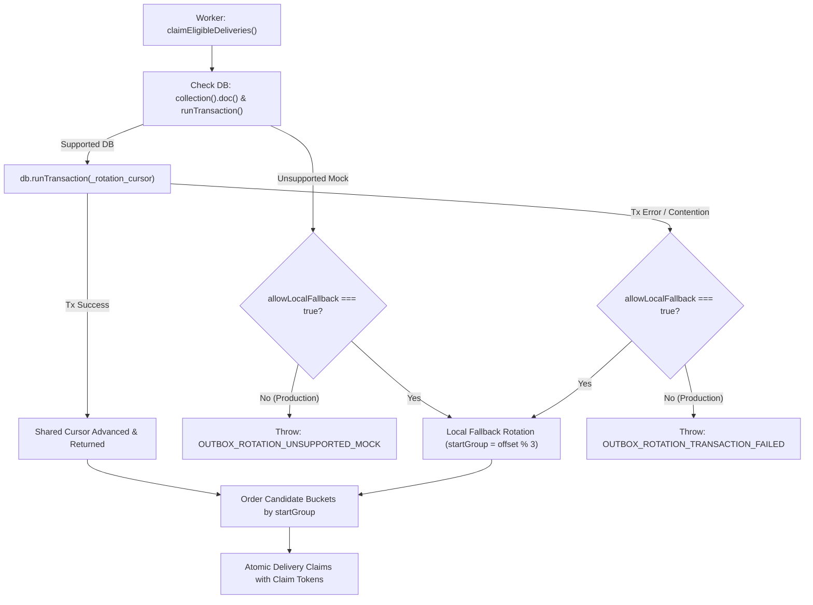

# Phase 6.5.5 — Fail-Closed Distributed Cursor & Mock Fallback Controls Report

## Executive Summary
In Phase 6.5.5, we implemented fail-closed enforcement for distributed rotation cursor transactions within `FirestoreCommunicationOutboxRepository`.

In Phase 6.5.4, shared queue rotation across candidate groups (Expired Leases -> Due Retries -> Pending Deliveries) was introduced using an atomic Firestore transaction on document `_rotation_cursor`. However, when a transaction failed or an unsupported database object was encountered, the repository caught the error and silently fell back to instance-local rotation. In a production cluster or distributed worker environment, this silent fallback would compromise distributed queue fairness without alerting operators or halting compromised delivery claiming.

Phase 6.5.5 enforces strict fail-closed semantics in production:
1. **Production Transactions Fail Closed**: If a Firestore transaction on `_rotation_cursor` aborts or encounters an error during `claimEligibleDeliveries`, the error (`[OUTBOX_ROTATION_TRANSACTION_FAILED]`) is propagated directly to the worker and cron route, triggering failure logging and HTTP 500 status rather than silently losing distributed fairness.
2. **Explicit Test/Mock Fallback Only**: Local instance-level rotation fallback is permitted only when explicitly opted in via configuration (`{ allowLocalFallback: true }` in repository options or `repo.setAllowLocalFallback(true)`).
3. **Multi-Instance Integrity**: Fully verified with two independent repository instances in production mode (`allowLocalFallback: false`) under small batch sizes (`batchSize = 1, 2, 3`) and concurrent claim execution.

---

## Architectural Changes



### 1. Repository Configuration (`FirestoreCommunicationOutboxRepository`)
- **Options Interface**:
  ```typescript
  export interface FirestoreCommunicationOutboxRepositoryOptions {
    allowLocalFallback?: boolean;
  }
  ```
- **Constructor Support**:
  Supports standard signatures while defaulting `allowLocalFallback` strictly to `false`:
  ```typescript
  constructor(
    tokenGeneratorOrOptions?: (() => string) | FirestoreCommunicationOutboxRepositoryOptions,
    dbProvider?: (() => FirebaseFirestore.Firestore | null) | FirestoreCommunicationOutboxRepositoryOptions,
    options?: FirestoreCommunicationOutboxRepositoryOptions
  )
  ```
- **Runtime Methods**:
  - `setAllowLocalFallback(allow: boolean): void`
  - `isLocalFallbackAllowed(): boolean`

### 2. Transaction Fail-Closed Implementation (`getAndAdvanceRotationCursor`)
- If `db.collection().doc` or `db.runTransaction` is missing:
  - If `allowLocalFallback` is `false`: throws `[OUTBOX_ROTATION_UNSUPPORTED_MOCK]`.
  - If `allowLocalFallback` is `true`: uses `this.fallbackRotationOffset` and increments local offset.
- Inside `db.runTransaction`:
  - If `db.runTransaction` aborts or throws:
    - If `allowLocalFallback` is `false`: re-throws with `[OUTBOX_ROTATION_TRANSACTION_FAILED]` and preserves the underlying exception message.
    - If `allowLocalFallback` is `true`: logs and uses local fallback.

### 3. Worker & Route Propagation
- When `claimEligibleDeliveries` throws `[OUTBOX_ROTATION_TRANSACTION_FAILED]`:
  - `OutboxWorker.processCycle()` throws directly, preventing execution of deliveries without distributed fairness.
  - `runOutboxWorkerCycles()` bubbles the error to caller.
  - `POST /api/cron/outbox-worker` catches the fatal error, logs `[CRON_OUTBOX_WORKER] Fatal error during outbox cycle execution:`, and responds with `500 Internal Server Error`.

---

## Verification Results (`scripts/verify-phase6-5-5-fail-closed-cursor.ts`)

| Test Group | Test Case | Status |
| :--- | :--- | :--- |
| **1. Transient Firestore Transaction Failure** | 1.1 In production mode (`allowLocalFallback: false`), transient transaction error rejects with `[OUTBOX_ROTATION_TRANSACTION_FAILED]` | **PASS** |
| | 1.2 Worker `processCycle` propagates rotation transaction failure instead of dispatching compromised deliveries | **PASS** |
| | 1.3 `getSharedRotationCursor` and `setSharedRotationCursor` reject in production when Firestore fails | **PASS** |
| **2. Unsupported Test Mocks** | 2.1 Unsupported test mock without `doc()` or `runTransaction()` rejects when `allowLocalFallback: false` | **PASS** |
| | 2.2 Unsupported test mock succeeds using local fallback when `{ allowLocalFallback: true }` is configured | **PASS** |
| | 2.3 `repo.setAllowLocalFallback(true)` dynamically enables local fallback on existing instance | **PASS** |
| **3. Multi-Instance Production Rotation** | 3.1 Two independent repositories with `allowLocalFallback: false` alternate candidate groups on `batchSize = 1` | **PASS** |
| | 3.2 Concurrent workers advance shared cursor atomically without losing state | **PASS** |

### Complete Regression Suite
- `npm run test:p655`: **8/8 passed (100%)**
- `npm run test:p654`: **5/5 passed (100%)**
- `npm run test:p653`: **6/6 passed (100%)**
- `npm run test:p652`: **8/8 passed (100%)**
- `npm run test:p651`: **9/9 passed (100%)**
- `npm run test:p65`: **23/23 passed (100%)**
- `npm run typecheck`: **0 errors**
- `npm run lint`: **0 errors** (3 existing warnings in legacy scripts)

---

## Safety & Invariant Compliance
- `VOICE_BOOKING_ENABLED=false` unconditionally preserved.
- Zero outbound voice calls or telephony triggers.
- WhatsApp recipient allowlist enforced with fail-closed checks.
- No paid cloud infrastructure or billing resources added.
- Git working tree remains completely unstaged: no `git add`, `git commit`, `git push`, or deployment.
