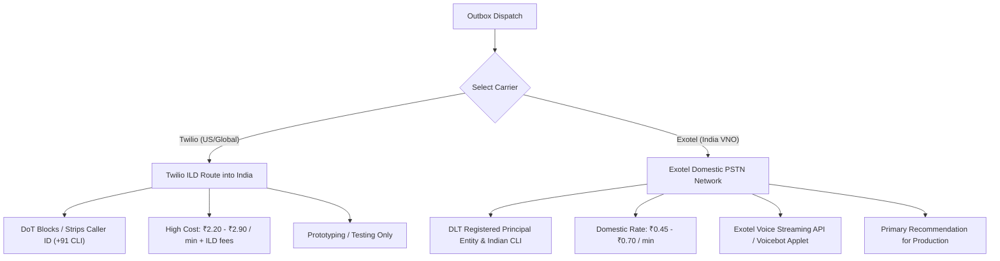
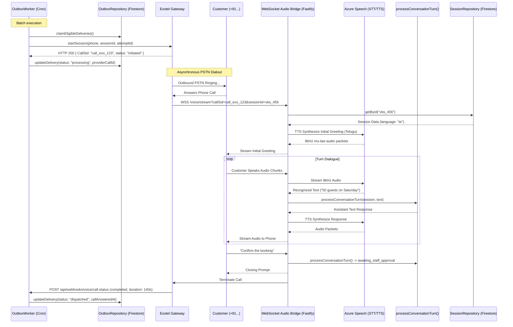
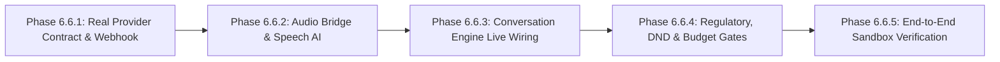

# Phase 6.6.0.1 — Real Voice Calling Preflight Corrections & Technical Plan

## Executive Summary
This document revisits Phase 6.6.0 to rectify assumptions against the verified BREW Coffee source code and telecom carrier realities in India. 

### Key Corrections Applied:
1. **Quotation Integrity Safeguard**: Reaffirmed authenticated **HMAC-SHA256** using `BREW_QUOTATION_SECRET`. (The reference to MD5 in Phase 6.6.0 was incorrect; MD5 is neither used nor permitted in this architecture).
2. **Asynchronous Call Execution**: In the existing codebase, `outboxWorker.ts` simulates customer turns synchronously in-process for mock tests. In real PSTN calling, outbound call dispatch is fundamentally asynchronous; audio streaming and turns occur over an external WebSocket bridge, and completion is reported via webhooks.
3. **Carrier Reassessment (Twilio vs. Exotel)**: Twilio cannot legally or reliably originate domestic Indian caller IDs (`+91` CLI) without enterprise SIP trunking, and ILD routing risks CLI stripping or blocking by Indian telcos. **Exotel** is evaluated as the primary domestic carrier for India.
4. **Azure Speech Identifiers & Free-Tier Boundaries**: Verified exact voice models (`en-IN-NeerjaNeural`, `hi-IN-SwaraNeural`, `te-IN-ShrutiNeural`) and documented that Azure Free Tier (F0) is capped at **1 concurrent stream**, making it strictly a single-user prototype tier.
5. **WebSocket Hosting**: Evaluated Render Free deployment. Because Render Free spins down after 15 minutes of inactivity (causing 50-90s cold starts) and Next.js serverless routes cannot hold long-lived streaming WebSockets, a dedicated, persistent WebSocket microservice is required for live audio streaming.
6. **Regulatory & DND Clarity**: Clarified that the application's `DndRepository` is an **internal opt-out database** in Firestore; it does **not** perform live TRAI NCPR scrubbing. Live scrubbing must occur at the carrier DLT layer.

---

## 1. Verified Architecture & Source Code Facts

### A. Quotation Integrity Implementation ([`quotationAdapter.ts`](file:///Users/gnanendhrajoy/Desktop/BREW/src/lib/voiceBooking/quotationAdapter.ts#L275-L315))
- **Algorithm**: Authenticated **HMAC-SHA256** via `crypto.createHmac("sha256", secret).update(canonicalPayload).digest("hex")`.
- **Secret Provider**: `getQuotationHmacSecret()` reads `BREW_QUOTATION_SECRET` (with fail-closed validation in production).
- **Canonical Payload**: Versioned JSON with sorted keys capturing all 7 material fields (`durationHours`, `eventDate`, `eventType`, `guestCount`, `selectedTier`, `startTime`, `venueAddress`).
- **Verification Gate**: `verifyQuotationIntegrity(session)` recalculates the HMAC-SHA256 digest on the stored snapshot and verifies it using constant-time comparison before allowing state transition to `awaiting_staff_approval`.

### B. Current Voice Provider Contract & Outbox Worker Disconnect
- **Current Interface ([`src/lib/communication/types.ts`](file:///Users/gnanendhrajoy/Desktop/BREW/src/lib/communication/types.ts#L190-L204))**:
  - `startSession(params: VoiceSessionParams): Promise<VoiceSessionResult>`
  - `getStatus(sessionId: string): Promise<VoiceSessionStatusResult>`
  - `endSession(sessionId: string, reason?: string): Promise<VoiceSessionEndResult>`
- **Mock Synchrony vs. Real Asynchrony ([`outboxWorker.ts`](file:///Users/gnanendhrajoy/Desktop/BREW/src/lib/communication/outbox/outboxWorker.ts#L720-L835))**:
  - In `outboxWorker.ts`, when `startSession` returns `callOutcome: "answered"`, the worker immediately and synchronously executes turns in a loop (`for (const utterance of customerTurns) processConversationTurn(...)`).
  - **Correction for Real Voice**:
    1. `startSession()` only initiates the carrier call and returns `status: "initiated"` with a `providerCallId`.
    2. The outbox delivery transitions to `processing` (or pending webhook acknowledgement).
    3. The live call, audio stream, and turns are executed asynchronously by the WebSocket Audio Bridge Server when the customer answers.
    4. Upon call termination, the carrier sends a final webhook to `/api/webhooks/voice/call-status`, which updates the outbox delivery to `dispatched` (or `failed`) and updates session metadata.

### C. Conversation Turn Processing ([`conversationEngine.ts`](file:///Users/gnanendhrajoy/Desktop/BREW/src/lib/voiceBooking/conversationEngine.ts#L433-L495))
- `processConversationTurn(session, userUtterance, dependencies)` is completely text-based and pure.
- It accepts a transcript string and returns an assistant text response.
- Audio streaming, STT, and TTS sit strictly outside `conversationEngine.ts`. No modifications to the conversation engine or state machine are necessary.

### D. Internal DND vs. TRAI NCPR Scrubbing ([`src/lib/communication/dnd.ts`](file:///Users/gnanendhrajoy/Desktop/BREW/src/lib/communication/dnd.ts))
- The application's `DndRepository` manages **internal customer opt-outs** stored in the Firestore `communication_dnd` collection.
- It does **not** communicate with TRAI's live National Customer Preference Register (NCPR).
- Live NCPR scrubbing must be handled by the carrier's DLT infrastructure before dial-out.

---

## 2. Telephony Carrier Reassessment: Twilio vs. Exotel in India

### Twilio Reality in India:
- **CLI / Caller ID Restriction**: Under DoT regulations, outbound calls into India from international carriers cannot spoof domestic Indian mobile numbers. Twilio ILD calls often display random Singapore or US numbers, or show "Unknown Caller" / "Spam", leading to massive customer rejection rates (>80%).
- **No Self-Serve Virtual Numbers**: Twilio does not offer self-service `+91` local mobile numbers; obtaining one requires an enterprise contractual agreement and physical entity presence in India.
- **Verdict on Twilio**: Excellent for US/global, but unsuitable as a production telephony carrier for Indian domestic calls.

### Exotel as Primary Carrier:
- **Regulatory Standing**: Licensed Virtual Network Operator (VNO) headquartered in Bangalore.
- **CLI Compliance**: Outbound calls originate from registered domestic Indian Virtual Numbers (e.g. `080-XXXXXXXX`), preserving trust and answering rates.
- **Voice Streaming API Mechanism**:
  - Call triggered via REST API: `POST https://<subdomain>/v1/Accounts/<AccountSid>/Calls/connect.json`
  - Parameters: `From` (customer phone), `CallerId` (Exotel VN), `Url` (pointing to an Exotel Audio Stream Applet).
  - Exotel establishes a bidirectional WebSocket connection to the configured backend URL with:
    - Audio format: 8kHz, 16-bit PCM or μ-law.
    - Session tracking: Exotel sends `CallSid` and carries our `CustomField` parameter (containing `sessionId`) in query parameters and initial handshake.

---

## 3. Multilingual Speech AI: Azure Speech Evaluation

### Verified Voice Identifiers (Azure Neural TTS):
- **Indian English (`en-IN`)**: `en-IN-NeerjaNeural` (Female), `en-IN-PrabhatNeural` (Male)
- **Hindi (`hi-IN`)**: `hi-IN-SwaraNeural` (Female), `hi-IN-MadhurNeural` (Male)
- **Telugu (`te-IN`)**: `te-IN-ShrutiNeural` (Female), `te-IN-MohanNeural` (Male)

### Azure Free Tier (F0) vs. Standard (S0) Boundaries:
| Feature | Free Tier (F0) | Standard Paid (S0) |
| :--- | :--- | :--- |
| **STT Monthly Allowance** | 5 audio hours / month | Pay-as-you-go ($1.00 USD / hour $\approx$ ₹1.40 / min) |
| **Neural TTS Monthly Allowance**| 0.5 million characters / month | Pay-as-you-go ($16.00 USD / 1M chars $\approx$ ₹1.35 / 10k chars) |
| **Concurrency Limit** | **Strictly 1 concurrent connection** | 20 concurrent connections (expandable to 100+) |
| **Suitability** | Developer unit tests & single-call sandbox only | Production & multi-user operational calls |

---

## 4. Persistent Audio Gateway & Hosting Architecture

### Why Render Free Cannot Support Live Audio:
1. **Cold Starts**: Render Free instances spin down after 15 minutes of inactivity. Cold start recovery takes **50 to 90 seconds**. Incoming telephony webhooks timeout within 10–15 seconds, causing dropped calls.
2. **Serverless Connection Lifecycle**: Next.js App Router API route handlers are request/response scoped and run in ephemeral environments; they cannot maintain persistent, bi-directional stateful WebSockets for streaming audio.
3. **CPU Throttling & Audio Jitter**: Render Free shares throttled CPU cores. Audio transcoding (8kHz μ-law $\leftrightarrow$ 16kHz Linear PCM) and real-time buffering (20ms frames at 50 packets/sec per call) result in severe buffer underruns, packet loss, and voice stutter.

### Recommended Audio Bridge Hosting Options:
- **Dedicated Node.js / Fastify WebSocket Microservice**:
  - **Option A (Google Cloud Run in `asia-south1` - Mumbai)**: Min-instances set to 1 (no cold start), WebSocket support enabled, low latency (~15ms to Indian telecom exchanges). Cost: ~₹700 – ₹1,200 / month.
  - **Option B (AWS Lightsail / EC2 in `ap-south-1` - Mumbai)**: Dedicated static instance (~$5 USD $\approx$ ₹420 / month).
  - **Option C (Render Paid Starter)**: Always-on Node process ($7 USD $\approx$ ₹590 / month).

---

## 5. End-to-End Real Voice Call Lifecycle & Correlation

---

## 6. Transparent Cost Recalculation (in INR)

### Itemized Unit Economics

| Cost Category | Item | Provider / Rate | Cost per 2.5-min Call (INR) |
| :--- | :--- | :--- | :--- |
| **Telephony Carrier** | Domestic Outbound PSTN | Exotel: ₹0.55 / min | **₹1.38** |
| **Speech-to-Text (STT)** | Real-Time Audio Transcription | Azure Speech: ₹1.40 / min (150s) | **₹3.50** |
| **Text-to-Speech (TTS)** | Neural Speech Synthesis | Azure Neural: ₹1.35 / 10k chars (~2.8k chars) | **₹0.38** |
| **LLM Entity Extraction**| Structured JSON Extraction | Gemini 1.5 Flash (6 turns) | **₹0.20** |
| **Statutory Taxes** | GST on Telecom & Cloud | 18% on domestic services | **₹0.98** |
| **Total Variable Cost per Completed Call** | | | **₹6.44 INR** |

### Fixed Monthly Operating Costs (Independent of Call Volume)
- **Exotel Virtual Number Rental**: ~₹1,000 / month + GST = **₹1,180 / month**.
- **Dedicated WebSocket Bridge Hosting (Cloud Run min-instance / Lightsail)**: ~**₹600 – ₹1,000 / month**.
- **Total Fixed Monthly Overhead**: ~**₹1,780 – ₹2,180 INR / month**.

### Retry & Abandonment Cost Impact:
- Unanswered calls (busy, no answer) that disconnect prior to carrier IVR pickup: ₹0 carrier charge, but count towards worker attempt limits.
- Calls answered by customer voicemail or operator announcement: Billed for 1 pulse (~₹0.55).
- With a typical 25% retry rate across bookings, add **~₹0.30 INR** per booked session.

---

## 7. Phased Implementation Roadmap

1. **Phase 6.6.1 — Telephony Provider Contract & Webhooks**:
   - Create `ExotelVoiceProvider` implementing `VoiceProvider`.
   - Update `outboxWorker.ts` voice dispatch to record `initiated` status without synchronous turn execution.
   - Implement `POST /api/webhooks/voice/call-status` with HMAC verification to handle `answered`, `completed`, `busy`, `no_answer`.
2. **Phase 6.6.2 — Persistent WebSocket Audio Bridge**:
   - Build lightweight Fastify/Node WebSocket audio service.
   - Implement bi-directional μ-law $\leftrightarrow$ PCM transcoding.
   - Wire Azure Speech SDK for streaming STT & Neural TTS in `en-IN`, `hi-IN`, `te-IN`.
3. **Phase 6.6.3 — Real-Time Turn Integration & Barge-In**:
   - Route finalized STT transcript to `processConversationTurn()`.
   - Implement Voice Activity Detection (VAD) to interrupt/truncate ongoing TTS playout when customer speaks.
4. **Phase 6.6.4 — Regulatory, Time-of-Day & Budget Gates**:
   - Enforce TRAI 09:00 AM – 09:00 PM IST calling-hour window in `outboxWorker.ts`.
   - Implement 300-second call duration ceiling and ₹500/day spending limit.
5. **Phase 6.6.5 — Verification & Review Bundle**:
   - End-to-end sandbox testing using staff test numbers.
   - Verify `VOICE_BOOKING_ENABLED=false` circuit breaker.

---

## 8. Summary of Facts, Estimates, and Unresolved Questions

### A. Verified Facts (from Code & Regulations)
- `quotationAdapter.ts` enforces data integrity using authenticated **HMAC-SHA256**, not MD5.
- The existing `outboxWorker.ts` voice branch executes simulated turns synchronously for mock tests; real calls require decoupled, asynchronous WebSocket streaming.
- `DndRepository` is an in-app Firestore collection; it does not query TRAI NCPR.
- Azure Free Tier (F0) is limited to **1 concurrent stream**.
- Commercial voice calling in India is prohibited between 9:00 PM and 9:00 AM IST by TRAI regulations.

### B. Estimates & Projections
- Variable cost per completed booking call: **~₹6.44 INR** (including 18% GST).
- Fixed monthly telephony & hosting overhead: **~₹1,800 – ₹2,200 INR / month**.
- End-to-end speech turnaround latency in India: **600ms – 900ms** (using Mumbai cloud region).

### C. Unresolved Provider Questions (Prior to Commercial Activation)
1. **Exotel Streaming API Tier**: Does Exotel's Voicebot/Streaming Applet require an enterprise platform license add-on beyond standard pay-as-you-go minutes?
2. **DLT Entity Approval Timeline**: Enterprise KYC, DLT principal registration (via Airtel/Jio/Vodafone portal), and commercial CLI whitelisting typically require 7–14 business days in India.
3. **PSTN Call Recording Compliance**: If calls are recorded for dispute resolution, DoT mandates explicit caller notification at call commencement (*"This call is recorded for quality purposes"*).
