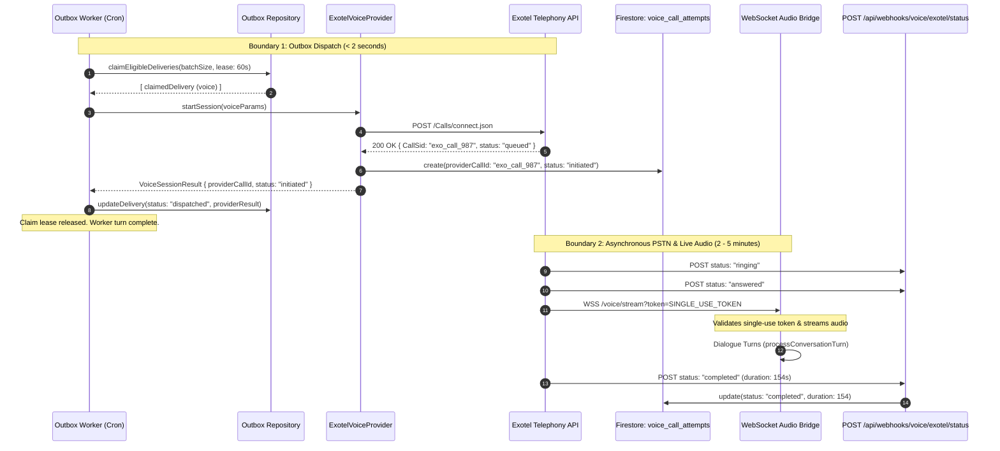
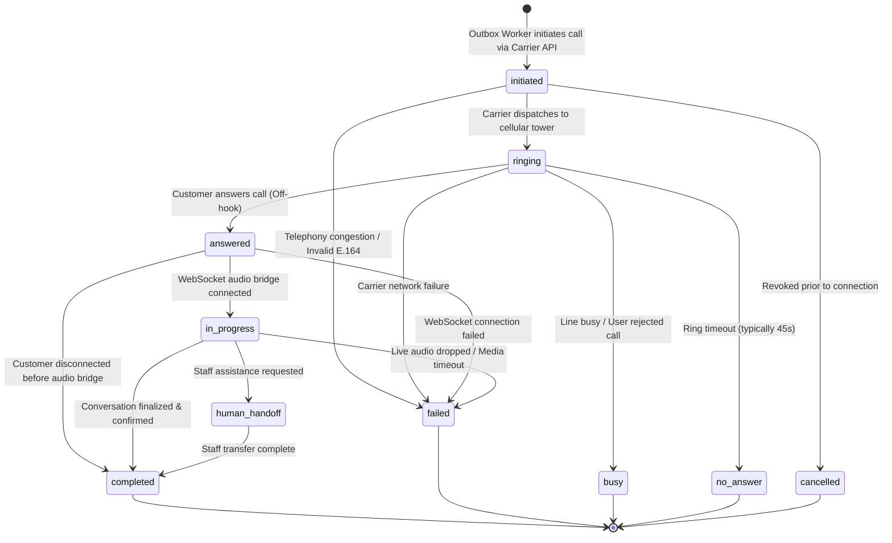
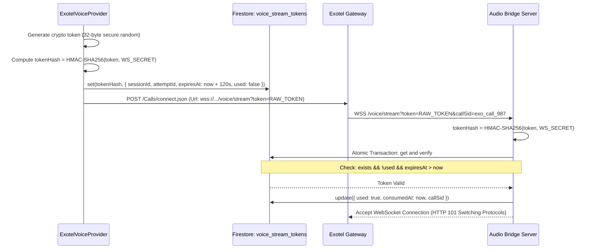

# Phase 6.6.0.2 — Asynchronous Voice Call Lifecycle Design

## 1. Executive Summary & Design Overview

This architecture document defines the **end-to-end asynchronous voice call lifecycle** for the BREW Coffee event catering platform.

### Core Architecture Principles:
1. **Decoupled Outbox Contract**: The communication outbox delivery represents short-lived, transactional carrier dispatch (< 2 seconds). The actual PSTN phone call is a long-lived, multi-minute, asynchronous event. Outbox workers must never hold concurrency claim leases for the duration of a phone call.
2. **Durable Voice Call State Machine**: Dedicated call attempt records track carrier progression (`initiated` $\rightarrow$ `ringing` $\rightarrow$ `answered` $\rightarrow$ `in_progress` $\rightarrow$ `completed` / `busy` / `no_answer` / `failed` / `cancelled`).
3. **Cryptographic Single-Use Stream Authentication**: Live WebSocket audio connections must never trust unverified caller query parameters. Connections require server-generated, short-lived, single-use bearer tokens.
4. **Resilient Webhook Processing**: Idempotent, signature-verified status webhooks with monotonic rank ordering to handle out-of-order, delayed, or missing carrier webhooks, backed by scheduled reconciliation.
5. **Regulatory Reality**: Consented booking callbacks qualify as **Service / Transactional Communications** under TRAI TCCCPR 2018 regulations, operating under explicit customer consent rather than unsolicited promotional 140-series restrictions.

---

## 2. Decoupled Transaction Boundaries: Outbox vs. Live Call



### Transaction Boundary Analysis:
- **Outbox Delivery Role**: Guarantees at-least-once carrier submission. Once Exotel accepts the request and issues a `CallSid`, the outbox dispatch contract is complete (`status: "dispatched"`).
- **Lease Safety**: The worker's 60-second lease is released immediately upon carrier acceptance. The worker never blocks or idles during ringing or conversation.
- **Durable Call Tracking**: Telephony progression is tracked independently in a dedicated Firestore collection (`voice_call_attempts`) keyed by `providerCallId`.

---

## 3. Durable Call State Machine & Allowed Transitions



### State Monotonic Rank Table (Out-of-Order Webhook Resolution)
To guarantee deterministic handling when carrier webhooks arrive out-of-order, every state is assigned an immutable rank:

| Rank | State | Category | Description |
| :---: | :--- | :--- | :--- |
| **1** | `initiated` | Non-terminal | Carrier accepted outbound request; call queued. |
| **2** | `ringing` | Non-terminal | Recipient network alerted; phone is ringing. |
| **3** | `answered` | Non-terminal | Customer off-hook; carrier establishing audio stream. |
| **4** | `in_progress`| Non-terminal | WebSocket audio bridge active; turns in progress. |
| **5** | `completed` | **Terminal** | Call terminated normally after conversation. |
| **5** | `busy` | **Terminal** | Recipient line busy; retry eligible. |
| **5** | `no_answer` | **Terminal** | Call rang out without pickup; retry eligible. |
| **5** | `failed` | **Terminal** | Carrier network error; retry eligible based on error. |
| **5** | `cancelled` | **Terminal** | Cancelled administratively or through revocation. |

**Invariance Rule**: Any incoming webhook event with a rank $\le$ current persisted rank is safely acknowledged and discarded as obsolete, preventing race conditions.

---

## 4. Secure WebSocket Session Authentication

### The Security Vulnerability:
If a WebSocket endpoint accepts unverified session IDs (e.g. `wss://.../voice/stream?sessionId=vbs_123`), an attacker can brute-force session IDs, hijack live audio streams, eavesdrop on private catering requirements, or inject malicious voice turns.

### The Cryptographic Single-Use Token Architecture:


1. **Token Generation**: On `startSession()`, generate a 256-bit cryptographically secure random token (`crypto.randomBytes(32).toString("hex")`).
2. **Storage**: Store the token hash in Firestore `voice_stream_tokens/{tokenHash}` with:
   - `sessionId`: Associated `VoiceBookingSession.id`.
   - `attemptId`: Unique call attempt key.
   - `expiresAt`: Short-lived TTL (120 seconds).
   - `used`: `false`.
3. **Single-Use Consumption**:
   - The Audio Bridge hashes the incoming token.
   - Executes an atomic Firestore transaction verifying `used === false` and `expiresAt > Date.now()`.
   - Immediately sets `used: true`.
   - Replay attempts, expired tokens, or forged strings are rejected with **WebSocket close code `4401 (Unauthorized)`**.

---

## 5. Webhook Security, Idempotency & Failure Recovery

### Webhook Authentication
- **Endpoint**: `POST /api/webhooks/voice/exotel/status`
- **Authentication**:
  - Exotel provides an account token/API secret.
  - Webhooks include an authentication signature in headers (or secure path token `?auth_token=...`).
  - Constant-time verification using `crypto.timingSafeEqual` prevents timing attacks.

### Safe Mapping of Provider Call IDs to Sessions
- When creating the call, pass `CustomField` to Exotel:
  ```json
  {
    "sessionId": "vbs_20261106_abc12",
    "attemptId": "del_evt_123_voice_call1"
  }
  ```
- Exotel preserves and returns `CustomField` on all status webhooks.
- In addition, write an index document in `voice_call_attempts/{providerCallId}` containing `{ sessionId, attemptId }`.
- This ensures $O(1)$ constant-time lookup without scanning sessions or relying on unmasked phone numbers.

### Handling Delayed, Missing, or Duplicate Webhooks:
1. **Duplicate Webhook Delivery**:
   - Webhook processing checks `voice_call_attempts/{providerCallId}`.
   - If `lastProcessedEventId === webhookEventId` or payload is byte-for-byte identical, return `200 OK` with `{ status: "already_processed" }`.
2. **Missing Final Status Webhook (Reconciliation Cron)**:
   - What happens if Exotel fails to deliver the terminal `completed` webhook?
   - A reconciliation job runs every 10 minutes:
     - Queries `voice_call_attempts` where `status IN ['initiated', 'ringing', 'in_progress']` and `createdAt < now - 15 minutes`.
     - Calls Exotel REST API: `GET https://<subdomain>/v1/Accounts/<AccountSid>/Calls/{CallSid}.json`.
     - Reconciles final status, actual duration, and carrier termination reason directly from Exotel's authoritative ledger.

---

## 6. Indian Telecom Regulatory Classification: Service vs. Promotional

Under the **Telecom Commercial Communications Customer Preference Regulations, 2018 (TRAI TCCCPR 2018)**:

| Attribute | Promotional Communications | Consented Booking Callback (BREW Platform) |
| :--- | :--- | :--- |
| **Nature** | Unsolicited advertising, cold sales. | **Service / Transactional Communication**. Explicitly requested by customer. |
| **TRAI Category** | Commercial / Marketing. | **Service Explicit** (Category code 1 / 4). |
| **DND (NCPR) Scrubbing** | Strictly blocked on all registered DND numbers. | **Permitted on DND numbers** because explicit, verifiable customer consent exists. |
| **Caller CLI Series** | Mandated 140-series prefixes (e.g. `140XXXXXXX`). | Can use standard **10-digit virtual business numbers** (e.g. `080-XXXXXXXX` or landline/mobile DID). |
| **Calling Hours** | Strictly restricted to 09:00 AM – 09:00 PM IST. | Permitted, but **industry best practice strictly observes 09:00 AM – 09:00 PM IST** to prevent customer complaints. |
| **Consent Evidence** | Requires registration on DLT Consent Portal. | Verifiable consent record maintained in Firestore `communication_consent` with timestamp and IP address. |

---

## 7. Data Models & Schemas

### `VoiceCallAttemptRecord` (Stored in `voice_call_attempts/{providerCallId}`)
```typescript
export interface VoiceCallAttemptRecord {
  id: string; // providerCallId (e.g. "exo_call_9876543210")
  sessionId: string; // Internal VoiceBookingSession ID
  deliveryId: string; // Outbox delivery ID
  attemptId: string; // del_..._call1
  channel: "voice";
  provider: "exotel";
  direction: "outbound";
  recipientPhoneMasked: string; // "+91 98*** ***10"
  status:
    | "initiated"
    | "ringing"
    | "answered"
    | "in_progress"
    | "completed"
    | "busy"
    | "no_answer"
    | "failed"
    | "cancelled";
  statusRank: number; // 1 to 5 for monotonic ordering
  initiatedAt: string; // ISO 8601 UTC
  answeredAt?: string | null;
  completedAt?: string | null;
  durationSeconds?: number | null;
  callTerminationReason?: string | null;
  recordingUrl?: string | null; // Null unless explicitly configured
  rawProviderMetadata?: Record<string, unknown>;
  createdAt: string;
  updatedAt: string;
}
```

### `VoiceStreamTokenRecord` (Stored in `voice_stream_tokens/{tokenHash}`)
```typescript
export interface VoiceStreamTokenRecord {
  tokenHash: string; // SHA-256 hash of single-use bearer token
  sessionId: string; // Internal session
  attemptId: string; // Specific call attempt
  expiresAt: number; // Epoch milliseconds (120-second TTL)
  used: boolean;
  consumedAt?: string | null;
  callSid?: string | null;
  createdAt: string;
}
```

---

## 8. File Manifest: Updated Architecture

### Existing Source Files (Zero Modifications Required):
- `src/lib/voiceBooking/conversationEngine.ts` — Core text-based dialogue turns (`processConversationTurn`).
- `src/lib/voiceBooking/quotationAdapter.ts` — HMAC-SHA256 quotation snapshots and integrity verification.
- `src/lib/voiceBooking/stateMachine.ts` — State machine and mandatory field rules.
- `src/lib/voiceBooking/prompts.ts` — Prompts in `en`, `hi`, `te`.
- `src/lib/voiceBooking/language.ts` — Language detection and switching.
- `src/lib/voiceBooking/repositories/firestoreSessionRepository.ts` — Session storage.
- `src/lib/communication/outbox/outboxRepository.ts` — Outbox claiming, recovery, and rotating fairness.
- `src/app/api/voice-booking/approve/route.ts` — Staff approval gate.

### New Source Files for Real Voice Implementation:
1. `src/lib/communication/providers/exotelVoiceProvider.ts` — Exotel REST client implementing `VoiceProvider`.
2. `src/lib/communication/voice/callAttemptRepository.ts` — Firestore repository for `VoiceCallAttemptRecord`.
3. `src/lib/communication/voice/streamTokenManager.ts` — Single-use cryptographic token generator and validator.
4. `src/lib/communication/voice/audioStreamServer.ts` — Fastify/Node WebSocket audio server (8kHz μ-law $\leftrightarrow$ PCM transcoding).
5. `src/lib/communication/voice/azureSpeechAdapter.ts` — Azure streaming STT & Neural TTS adapter (`en-IN`, `hi-IN`, `te-IN`).
6. `src/app/api/webhooks/voice/exotel/status/route.ts` — Exotel status callback webhook handler.
7. `scripts/verify-phase6-6-asynchronous-voice-lifecycle.ts` — End-to-end verification test suite.

---

## 9. Phased Implementation Roadmap

1. **Phase 6.6.1 — Outbox Decoupling & Exotel REST Provider**:
   - Implement `ExotelVoiceProvider` implementing `VoiceProvider.startSession()`.
   - Update `outboxWorker.ts` so `startSession()` returning `initiated` marks delivery `dispatched` in < 2s without holding the lease.
   - Create `voice_call_attempts` collection.
2. **Phase 6.6.2 — Authenticated Status Webhooks & Reconciliation**:
   - Implement `POST /api/webhooks/voice/exotel/status` with constant-time token verification.
   - Implement monotonic state ranking and idempotent deduplication.
   - Implement 15-minute background reconciliation for lost webhooks.
3. **Phase 6.6.3 — Single-Use Token Manager & Fastify Audio Bridge**:
   - Implement `voice_stream_tokens` single-use token lifecycle.
   - Implement Fastify WebSocket audio bridge with 8kHz μ-law transcoding.
   - Wire Azure Speech STT & Neural TTS for `en-IN`, `hi-IN`, `te-IN`.
4. **Phase 6.6.4 — Dialogue Wiring & Barge-In**:
   - Connect STT finalized transcript to `processConversationTurn()`.
   - Implement Voice Activity Detection (VAD) to interrupt ongoing TTS playout.
5. **Phase 6.6.5 — Calling Hours, Budget Caps & Review Sandbox**:
   - Enforce TRAI 09:00 AM – 09:00 PM IST calling hours in `outboxWorker.ts`.
   - Enforce ₹500/day hard budget and 300s duration caps.
   - Comprehensive test suite and review ZIP.

---

## 10. Unresolved Exotel Commercial & Operational Questions

1. **Exotel Streaming Applet Access**: Does Exotel's Voicebot/Streaming Applet require an enterprise platform fee or minimum monthly commitment beyond per-minute calling rates?
2. **DLT Entity Approval Lead Time**: How many business days does Exotel require to whitelist the principal entity registration and assign the dedicated domestic virtual number?
3. **Call Disconnect Notification**: Does Exotel send a WebSocket `stop` event simultaneously with the HTTP status webhook when the customer hangs up?
