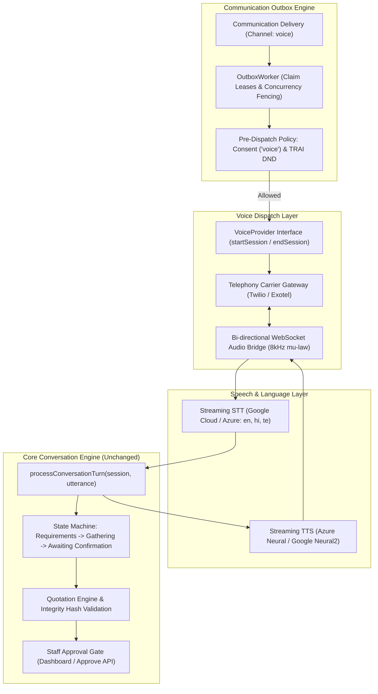
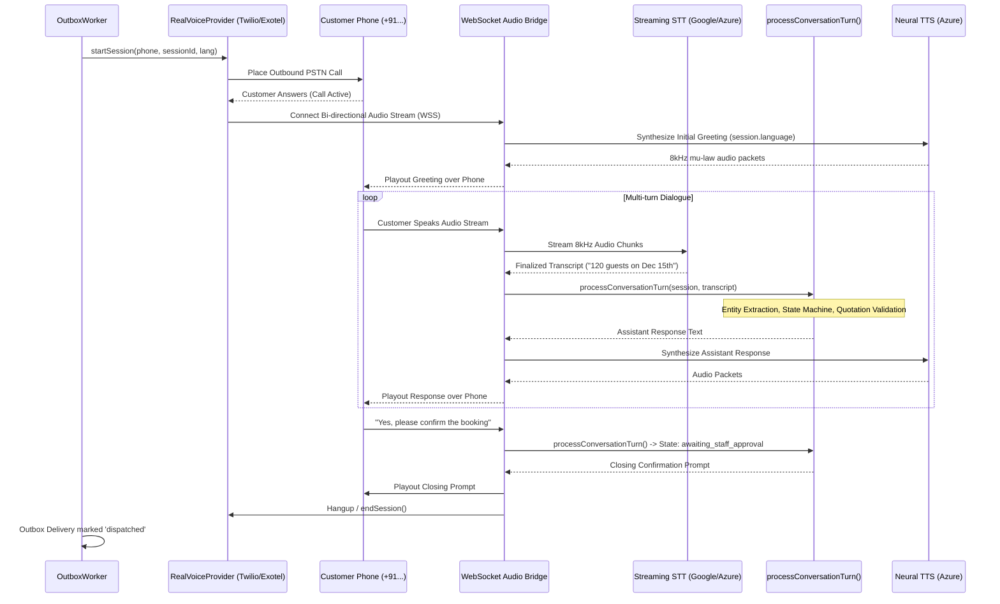

# Phase 6.6.0 — Real Voice Calling Preflight & Implementation Plan

## 1. Executive Summary
This document outlines the technical preflight assessment and implementation plan for introducing real outbound AI phone calls to the BREW Coffee event catering platform.

Currently, the voice-booking subsystem executes via `MockVoiceProvider` in simulation mode with `VOICE_BOOKING_ENABLED=false`. The core conversational state machine, quotation adapter, multi-turn dialogue engine (`processConversationTurn`), communication outbox, and staff approval workflow are already architected to support transactional voice bookings.

This plan details how to transition from simulated execution to real PSTN outbound calling in India while preserving safety constraints, TRAI regulatory compliance, multilingual support (`en`, `hi`, `te`), and zero billing activations during preflight.

---

## 2. Existing Architecture Inspection



### Inspection Summary:
1. **Conversation Engine (`conversationEngine.ts`)**:
   - Turn-by-turn processing accepts text `userUtterance` and outputs text `assistantResponse`.
   - Reusable as-is: decoupling audio transport (STT/TTS) from dialogue reasoning keeps business rules completely clean.
2. **Quotation & State Safety (`quotationAdapter.ts`, `stateMachine.ts`)**:
   - MD5 integrity hashing on quotations prevents price tampering or requirement drift during phone calls.
   - Confirmation transitions to `awaiting_staff_approval`; staff must approve before any card charge or van dispatch.
3. **Outbox & Claim Fencing (`outboxWorker.ts`, `outboxRepository.ts`)**:
   - Fenced updates ensure that a worker whose lease expires cannot commit stale session changes or duplicate calls.
   - Shared Firestore cursor (`_rotation_cursor`) prevents candidate starvation.
4. **Consent & DND (`policy.ts`, `consent.ts`, `dnd.ts`)**:
   - Explicit opt-in consent for voice is checked immediately before carrier dispatch.

---

## 3. Telephony Providers for India Evaluation

| Provider | India Carrier Status & DLT Compliance | Real-Time Audio Streaming API | Latency (Estimated) | Outbound Calling Cost (INR/min) | Trial / Test Options | Recommendation |
| :--- | :--- | :--- | :--- | :--- | :--- | :--- |
| **Exotel** | Native Indian Cloud Telephony (Bangalore HQ). Full TRAI/DLT compliance. Indian virtual numbers. | Voice Streaming API / Voicebot integration via WebSockets. | ~180ms – 250ms within India. | **₹0.40 – ₹0.70 / min** | ₹500 test credit on signup with KYC. | **Recommended for Production**: Lowest per-minute domestic call cost in India, local telecom compliance. |
| **Twilio** | Global carrier with India termination. Requires verified caller IDs or local KYC. | Industry-standard **Media Streams** (Bi-directional 8kHz μ-law WebSocket). | ~200ms – 300ms (via SG/IN edges). | **₹2.10 – ₹2.90 / min** ($0.025–$0.035 USD) | $15 trial credit with verified test numbers. | **Recommended for Development**: Unmatched developer tooling, turnkey bi-directional audio streaming. |
| **Plivo** | Strong Indian presence, local and toll-free numbers. | Audio Stream API (bi-directional WebSocket). | ~200ms – 280ms. | **₹1.25 – ₹1.85 / min** ($0.015–$0.022 USD) | Free trial sandbox credits for verified numbers. | Viable alternative for production scaling. |

---

## 4. Speech AI Evaluation: STT & TTS for English, Hindi, and Telugu

The agent must seamlessly converse with customers in Indian English (`en-IN`), Hindi (`hi-IN`), and Telugu (`te-IN`), including code-mixed speech (e.g. Hinglish, Telugish).

### Speech-to-Text (STT)

| Provider / Model | Supported Locales | Code-Mixing Handling | Streaming Protocol | Latency | Estimated Cost (INR/min) |
| :--- | :--- | :--- | :--- | :--- | :--- |
| **Google Cloud Speech-to-Text v2 (Chirp / Standard)** | `en-IN`, `hi-IN`, `te-IN` | Excellent baseline; handles accents across Andhra/Telangana & North India. | gRPC / WebSocket streaming. | ~250ms – 350ms | **₹1.80 – ₹2.10 / min** |
| **Azure Cognitive Services Speech** | `en-IN`, `hi-IN`, `te-IN` | Strong accuracy in Telugu and Hindi regional dialects. | WebSocket streaming SDK. | ~200ms – 300ms (Central India region) | **₹1.35 – ₹1.60 / min** |
| **Deepgram Nova-2** | `en-IN`, `hi` (beta) | Outstanding English/Hindi speed; limited native Telugu support. | WebSocket streaming. | ~150ms | **₹0.85 – ₹1.10 / min** |

### Text-to-Speech (TTS)

| Provider / Model | Supported Locales & Voices | Naturalness / Pronunciation | Audio Formats | Estimated Cost |
| :--- | :--- | :--- | :--- | :--- |
| **Azure Neural TTS** | `en-IN-NeerjaNeural`, `hi-IN-SwaraNeural`, `te-IN-ShrutiNeural` | Industry-leading natural Telugu and Hindi prosody; sounds human and warm. | 8kHz μ-law, 16kHz, 24kHz. | **₹0.40 – ₹0.60 / call** (~₹1.30 per 10k chars) |
| **Google Cloud Neural2 / Journey** | `en-IN`, `hi-IN`, `te-IN` | High-quality neural voices; excellent Telugu numeral reading. | Linear16, μ-law, MP3. | **₹0.45 – ₹0.65 / call** (~₹1.35 per 10k chars) |

**Speech Recommendation**: **Azure Speech (Central India datacenter)** or **Google Cloud Speech v2** for STT + **Azure Neural TTS** (`ShrutiNeural` for Telugu, `SwaraNeural` for Hindi, `NeerjaNeural` for Indian English) provides the highest intelligibility, lowest latency, and natural conversational cadence.

---

## 5. End-to-End Audio & Conversation Architecture

### Sequence of an Outbound Call


---

## 6. Webhooks, Streaming, Interruptions & Human Handoff

### Webhook & Protocol Design:
1. `POST /api/webhooks/voice/call-status`:
   - Handles carrier lifecycle events (`initiated`, `ringing`, `answered`, `completed`, `busy`, `no-answer`, `failed`).
   - Authenticated fail-closed via cryptographic signature (`X-Twilio-Signature` or Exotel HMAC token).
   - Reconciles call status to outbox delivery records and updates session visibility metadata.
2. `POST /api/webhooks/voice/connect`:
   - Returns Voice XML or JSON instructions establishing the bi-directional audio WebSocket stream (`<Stream url="wss://app.brewcoffee.internal/api/voice/stream" />`).
3. `WebSocket /api/voice/stream`:
   - Server-side WebSocket connection handling streaming media chunks (8kHz, 160-byte payload per 20ms chunk).

### Interruption / Barge-in Handling:
- Inbound Voice Activity Detection (VAD) monitors incoming customer audio while TTS is actively playing out.
- If user speech energy exceeds threshold for >150ms:
  - Immediately send a carrier `clear` / `truncate` packet over the WebSocket to flush the phone speaker's playout buffer.
  - Cancel any in-flight TTS synthesis pipeline.
  - Process the incoming speech as a new turn.

### Retries & Exponential Backoff:
- If call attempt status is `busy`, `no-answer`, or `failed`:
  - Worker computes exponential backoff: `backoffBaseMs * 2^(attempt - 1)` (e.g. 5m, 10m, 20m).
  - Maximum 3 attempts (`maxAttempts: 3`). Once exhausted, delivery marks `permanently_failed` and sets `metadata.staffFollowUpRequired = true`.

### Human Handoff:
- Customer requests human assistance ("I want to speak with an agent" / "Can someone call me?").
- `processConversationTurn()` transitions session state to `human_handoff`.
- Telephony system plays prompt: *"I have noted your request. Our event concierge will call you shortly."*
- Call terminates gracefully, notifying staff on the dashboard.

---

## 7. Security, Regulatory, and Cost Safeguards

1. **TRAI / DoT India Regulatory Compliance**:
   - Calling hours are strictly restricted by TRAI to **09:00 AM to 09:00 PM IST** (03:30 to 15:30 UTC).
   - Outbox worker evaluates recipient time before placing real call; any dispatch scheduled outside 9 AM - 9 PM IST is deferred to 9 AM the following morning.
   - Caller CLI must use registered commercial series or verified business DID.
2. **Explicit Consent & DND Check**:
   - Outbox worker re-evaluates `consentRepository.hasExplicitConsent(phone, "voice")` and TRAI DND registry status milliseconds before carrier dispatch.
3. **Hard Duration & Budget Caps**:
   - **Call Duration Cap**: Maximum 300 seconds (5 minutes) per call enforced via carrier configuration.
   - **Concurrency Limit**: Maximum 2 concurrent outbound calls to prevent resource/rate spikes.
   - **Daily Spending Cap**: Hard limit of ₹500/day. If daily telephony + speech AI charges reach ₹500, all subsequent voice deliveries fail closed with `DAILY_BUDGET_EXCEEDED`.
4. **Data Privacy (Zero PII in Logs)**:
   - Audio recordings are NOT stored on public cloud buckets.
   - Phone numbers are masked (`+91 98*** ***10`) in outbox and session logs.

---

## 8. Financial Cost Estimation (INR)

Assumptions:
- Average booking call duration: **2.5 minutes (150 seconds)**.
- Average dialogue: **6 turns** (approx. 3,000 characters TTS, 150 seconds STT, 6 LLM extraction turns).

| Component | Service | Cost per 2.5-min Call |
| :--- | :--- | :--- |
| **Telephony Carrier (Outbound India)** | Exotel (~₹0.50/min) or Twilio (~₹2.50/min) | **₹1.25** (Exotel) / **₹6.25** (Twilio) |
| **Speech-to-Text (STT)** | Google Cloud Speech v2 / Azure Speech (150s) | **₹4.50 – ₹5.25** |
| **Text-to-Speech (TTS)** | Azure Neural / Google Neural2 (3k chars) | **₹0.40 – ₹0.60** |
| **LLM Entity Extraction** | Gemini 1.5 Flash / 2.5 Flash (6 turns) | **₹0.15 – ₹0.30** |
| **Hosting & Network Overhead** | WebSocket relay bandwidth | **₹0.10** |
| **Total Estimated Cost per Completed Call** | **Exotel + Cloud Speech AI**<br>**Twilio + Cloud Speech AI** | **~₹6.40 – ₹7.50 / call**<br>**~₹11.40 – ₹12.50 / call** |

*Estimated monthly operating cost for 200 completed calls:* **₹1,300 – ₹2,500 INR/month** *(plus ~₹800/mo virtual number rental).*

---

## 9. File Manifest: Reused vs New Files

### Reused Existing Files (Zero Modifications Required):
- `src/lib/voiceBooking/conversationEngine.ts` — Core turn processing, extraction, quotation generation.
- `src/lib/voiceBooking/stateMachine.ts` — Valid state transitions and mandatory field verification.
- `src/lib/voiceBooking/prompts.ts` — Multilingual prompts for `en`, `hi`, `te`.
- `src/lib/voiceBooking/language.ts` — Dynamic language detection and switching.
- `src/lib/voiceBooking/quotationAdapter.ts` — Pricing rules and integrity hashing.
- `src/lib/voiceBooking/repositories/firestoreSessionRepository.ts` — Session storage.
- `src/lib/communication/outbox/` — Outbox claiming, recovery, retries, rotating fairness.
- `src/lib/communication/policy.ts`, `consent.ts`, `dnd.ts` — Compliance gates.
- `src/app/api/voice-booking/approve/route.ts` — Staff approval.

### New Files to be Created in Subsequent Implementation Phases:
1. `src/lib/communication/providers/realVoiceProvider.ts` — Production implementation of `VoiceProvider` interface (Twilio / Exotel).
2. `src/lib/communication/voice/audioStreamServer.ts` — WebSocket audio streaming server bridging telephony μ-law audio to speech engines.
3. `src/lib/communication/voice/sttAdapter.ts` — Google / Azure streaming STT adapter.
4. `src/lib/communication/voice/ttsAdapter.ts` — Azure / Google neural TTS adapter.
5. `src/app/api/webhooks/voice/call-status/route.ts` — Telephony status callback webhook with signature authentication.
6. `src/app/api/webhooks/voice/connect/route.ts` — Telephony connection endpoint establishing audio stream.
7. `scripts/verify-phase6-6-real-voice-preflight.ts` — Verification test suite checking environment configuration, fail-closed safeguards, and audio interfaces.

---

## 10. Required Environment Variables

```bash
# Feature Flag (Must remain false until final approval)
VOICE_BOOKING_ENABLED=false

# Telephony Carrier Credentials
TELEPHONY_PROVIDER=twilio # Options: "twilio" | "exotel"
TWILIO_ACCOUNT_SID=ACxxxxxxxxxxxxxxxxxxxxxxxxxxxxxxxx
TWILIO_AUTH_TOKEN=xxxxxxxxxxxxxxxxxxxxxxxxxxxxxxxx
TWILIO_PHONE_NUMBER=+91xxxxxxxxxx # Pre-registered CLI
# Or Exotel:
# EXOTEL_API_KEY=xxxxxxxxxxxxxxxxxxxxxxxxxxxxxxxx
# EXOTEL_API_TOKEN=xxxxxxxxxxxxxxxxxxxxxxxxxxxxxxxx
# EXOTEL_SUBDOMAIN=api.exotel.com
# EXOTEL_CALLER_ID=080xxxxxxxx

# Speech AI Credentials
AZURE_SPEECH_KEY=xxxxxxxxxxxxxxxxxxxxxxxxxxxxxxxx
AZURE_SPEECH_REGION=centralindia # Lowest latency to Indian telecom gateways
# Or Google Cloud:
# GOOGLE_SPEECH_CREDENTIALS={"type":"service_account",...}

# Operational Safety Safeguards
VOICE_MAX_CALL_DURATION_SEC=300       # Hard 5-minute cap per call
VOICE_MAX_CONCURRENT_CALLS=2          # Maximum concurrent outbound calls
VOICE_DAILY_BUDGET_INR=500            # Daily spending circuit breaker
VOICE_CALLING_HOURS_START_IST=09:00   # TRAI compliance (9:00 AM IST)
VOICE_CALLING_HOURS_END_IST=21:00     # TRAI compliance (9:00 PM IST)
```

---

## 11. Phased Implementation Roadmap
1. **Phase 6.6.1 — Telephony Adapter & Status Webhook**:
   - Implement `RealVoiceProvider` behind existing `VoiceProvider` interface.
   - Implement authenticated `call-status` webhook with constant-time signature verification.
   - Support `simulated` vs `real` provider selection flag.
2. **Phase 6.6.2 — Streaming Audio Gateway (WebSocket Bridge)**:
   - Implement WebSocket audio bridge handling 8kHz μ-law packets.
   - Wire streaming STT and Neural TTS for `en-IN`, `hi-IN`, `te-IN`.
3. **Phase 6.6.3 — Conversation Turn Wiring & Interruption Handling**:
   - Connect transcribed utterances to `processConversationTurn()`.
   - Implement VAD-based playout interruption (barge-in).
4. **Phase 6.6.4 — Regulatory & Budget Circuit Breakers**:
   - Enforce TRAI 9 AM - 9 PM IST window, 300s duration cap, and daily ₹500 spending threshold.
   - Human handoff fallback flow.
5. **Phase 6.6.5 — Verification & Review Bundle**:
   - Comprehensive test suite covering status webhooks, audio packetization, TRAI hour gates, budget limits, and review ZIP.

---

## 12. Key Risks & Mitigations

| Risk | Impact | Mitigation Strategy |
| :--- | :--- | :--- |
| **High Latency in Turnaround** | Customer experience degrades if response delay > 1.5s. | Use Central India cloud regions (Azure Central India / Google Mumbai). Stream TTS audio chunks before entire response is fully synthesized. |
| **Code-Mixed Dialect Errors (Hinglish/Telugish)** | Failure to recognize customer intent or quantities. | Combine acoustic STT with LLM-based entity extraction (`MockExtractionProvider` / Gemini Flash) to reconstruct phonetic variants into structured quantities. |
| **TRAI DND Fines & Sanctions** | Regulatory violations if calls are placed to registered DND numbers or outside hours. | Hardcoded TRAI 9 AM - 9 PM IST window check in outbox worker. Re-evaluate explicit consent and DND status milliseconds before call initiation. |
| **Unexpected Telephony Cost Spikes** | Infrastructure cost runaways during testing. | Hard circuit breakers: max 2 concurrent calls, 300s duration timeout, daily spend ceiling (₹500/day). |
