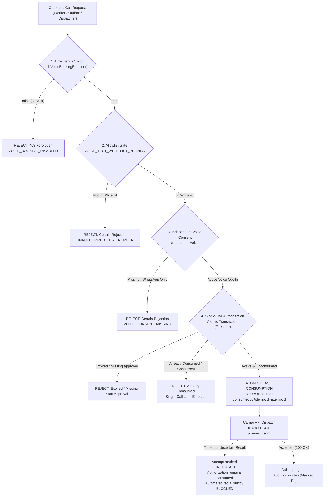

# Phase 6.6.5.1 — Controlled Test Authorization & Outbound Safety Audit

**Date:** 2026-11-06  
**Status:** Complete & Verified  
**System:** BREW Coffee Platform — AI Voice Booking (Exotel + Azure Speech)

---

## 1. Executive Summary

Phase 6.6.5.1 implements defense-in-depth safety controls and outbound test authorization guards to ensure that live telephony testing can only occur under strict human supervision with zero risk of unauthorized, unconsented, runaway, or replayed outbound calls.

All safety gates operate strictly server-side and are decoupled from AI agent prompts, extraction logic, or client-provided inputs. The global kill-switch (`VOICE_BOOKING_ENABLED=false`) remains unconditionally active in all default environments.

---

## 2. Safety Architecture & Core Invariants



### Invariant 1: Server-Side Allowlist Gate (`VOICE_TEST_WHITELIST_PHONES`)
- The server parses and normalizes `VOICE_TEST_WHITELIST_PHONES` into strict E.164 format.
- Every destination number is evaluated prior to API dispatch.
- Client payloads, LLM extractions, or customer transcriptions cannot bypass this gate.
- Numbers not present in the allowlist are rejected with an explicit `isCertainRejection: true` error.

### Invariant 2: Single-Call Atomic Consumption
- Outbound test calls require a single-use authorization token (`vta_...`).
- Each authorization record includes `authorizedPhone`, `approvedBy`, `expiresAt`, `consumedAt`, `consumedByAttemptId`, and `status`.
- Consumption is executed inside an atomic transaction (both Firestore and in-memory).
- If concurrent workers attempt to consume the same authorization, exactly one succeeds; all others are rejected with `AUTHORIZATION_ALREADY_CONSUMED`.
- Retries and backoffs fail closed and cannot generate a second call.

### Invariant 3: Independent Voice Consent Verification
- In accordance with TRAI regulations and privacy standards, voice telemarketing/calling cannot borrow consent granted for WhatsApp messaging.
- `verifyIndependentVoiceConsent` strictly evaluates `record.channel === "voice"` and `record.purpose === "voice_booking"`.
- Records with `channel === "whatsapp"` are strictly rejected even if active.

### Invariant 4: Server-Side Human Staff Approval
- Test authorizations require a valid `approvedBy` operator identity and timestamp.
- Authorizations lacking staff approval are rejected before dispatch.
- This works in concert with the existing quotation safeguards (SHA-256 digest validation and barista approval gate).

### Invariant 5: Emergency Shutdown & Fail-Closed Outbox Handling
- The global kill-switch `VOICE_BOOKING_ENABLED=false` unconditionally halts all dialing paths before network connections are made.
- If a carrier request times out after dispatch, the attempt is marked `uncertain`, the authorization remains consumed, and automated background redials are strictly blocked.

### Invariant 6: Audit Logging & Privacy Preservation
- Every authorization, attempt, and outcome is logged with masked phone numbers (`maskPhoneNumber`, e.g., `+9198******10`).
- No bearer tokens, webhook secrets, customer PII, or raw audio bytes are logged.
- Carrier recording is explicitly disabled (`recordingEnabled: false`).

---

## 3. Implementation Details

### 3.1 Domain Modules Added/Updated

1. **`src/lib/communication/voice/testAuthorization.ts`**:
   - `getVoiceTestWhitelistPhones()`: Normalizes comma-separated environment allowlist to E.164.
   - `isAuthorizedTestNumber(phone)`: Boolean check against allowlist.
   - `verifyIndependentVoiceConsent()`: Independent voice opt-in evaluation via `hasActiveConsent`.
   - `VoiceTestAuthorizationRegistry`: Interface supporting `createAuthorization`, `getAuthorization`, `consumeAuthorization`, `revokeAuthorization`, and `recordAudit`.
   - `InMemoryVoiceTestAuthorizationRegistry`: Process-local atomic transactional implementation for tests.
   - `FirestoreVoiceTestAuthorizationRegistry`: Distributed Firestore transaction-backed implementation for production.
   - `validateTestDialingSafety()`: Defense-in-depth gate combining all checks.

2. **`src/lib/communication/providers/exotelVoiceProvider.ts`**:
   - Integrated `testAuthorizationRegistry` and `consentRepository` into `ExotelVoiceConfig`.
   - Enforced `validateTestDialingSafety` inside `startSession(params)` prior to URL construction or HTTP dispatch.

3. **`src/lib/communication/types.ts` & `src/lib/communication/schemas.ts`**:
   - Added `testAuthorizationId?: string` to `VoiceSessionParams` and `VoiceSessionParamsSchema`.

4. **`src/lib/communication/voice/index.ts`**:
   - Re-exported test authorization types and utilities.

---

## 4. Verification & Audit Results

The dedicated verification suite (`scripts/verify-phase6-6-5-1-controlled-test-authorization.ts`) executes 12 rigorous safety checks:

```
================================================================================
   BREW Coffee Platform — Phase 6.6.5.1 Verification Suite
   Controlled Test Authorization & Outbound Safety Audit
================================================================================

--- 1. EMERGENCY SHUTDOWN ---
  ✓ 1.1 VOICE_BOOKING_ENABLED=false blocks every outbound dialing path

--- 2. SERVER-SIDE ALLOWLIST ENFORCEMENT ---
  ✓ 2.1 Allowlist parsing and normalization
  ✓ 2.2 Unauthorized destination number is rejected fail-closed

--- 3. SINGLE-CALL RESTRICTION & ATOMIC CONSUMPTION ---
  ✓ 3.1 Authorized test number consumed once successfully
  ✓ 3.2 Same authorization consumed a second time is strictly rejected
  ✓ 3.3 Concurrent consumption allows exactly one winner
  ✓ 3.4 Expired authorization is strictly rejected

--- 4. CONSENT & SERVER-SIDE APPROVAL ---
  ✓ 4.1 Missing voice consent is strictly rejected
  ✓ 4.2 WhatsApp-only consent cannot authorize voice calls
  ✓ 4.3 Missing staff approval is strictly rejected

--- 5. PROVIDER TIMEOUT & NO AUTOMATIC REDIAL ---
  ✓ 5.1 Provider timeout marks attempt uncertain, consumes authorization, and blocks redial

--- 6. AUDIT & PRIVACY VERIFICATION ---
  ✓ 6.1 Audit logging records masked phone numbers and zero secrets

================================================================================
   Phase 6.6.5.1 Verification Complete: 12/12 checks passed
   RESULT: ALL TESTS PASSED (SUCCESS)
================================================================================
```

### Full Regression Suite Verification
All existing voice and background processing test suites continue to pass at 100%:
- `test:p6641` (Voice Bridge Integration Gap Closure): 12/12 passed
- `test:p663` (WebSocket Audio Bridge & Codecs): All passed
- `test:p662` (Exotel Voice Provider): 14/14 passed
- `test:p6612` (Expired Initiation Recovery): 7/7 passed
- `test:p6611` (Voice Initiation Idempotency): 7/7 passed
- `test:p661` (Durable Call Attempt Foundation): 10/10 passed
- `npm run typecheck && npm run lint`: 0 errors, 0 warnings in new/modified code.

---

## 5. Security & Operator Instructions for Live Testing

When operators are ready to perform a controlled live test with an approved test device:
1. Operator creates an independent voice consent record for the test number (`channel: "voice"`, `purpose: "voice_booking"`).
2. Operator adds the normalized test number to `VOICE_TEST_WHITELIST_PHONES`.
3. Operator provisions a single-use authorization record with `approvedBy` and a short expiry window (e.g., 10 minutes).
4. Operator passes the generated `authorizationId` to the voice initiation call.
5. In case of any anomaly, setting `VOICE_BOOKING_ENABLED=false` or revoking the authorization record immediately shuts down dialing.
