# BREW Coffee — Phase 6: Voice Booking & WhatsApp Integration Plan

## 1. Executive Summary & Architectural Scope

Phase 6 introduces two asynchronous customer communication channels to the **BREW Coffee Platform**:
1. **Multilingual AI Voice Booking Agent** capable of engaging customers in English, Hindi, and Telugu to collect event requirements, quote pricing dynamically using the existing pricing engine, and coordinate staff approval.
2. **WhatsApp Automation Suite** delivering transactional quote summaries, payment reminders, status alerts, and post-event feedback via official WhatsApp Business templates.

### Architectural Preservation Commitment
This plan preserves the existing production website:
- **Zero modification to existing customer ordering and checkout flows.**
- **Zero changes to existing staff login, KDS, inventory, fleet management, and RBAC policies.**
- **Zero modification to existing Firestore schemas**; all new data resides in dedicated, isolated collections (`voice_sessions`, `whatsapp_messages`, `communication_consent`, `dnd_registry`).
- **Reuse of existing battle-tested core modules**:
  - `src/lib/eventBookingConcierge/*`: Reuses `calculateTierEconomics`, `calculateStaffing`, `calculateConsumption`, and `validateEventRequirements`.
  - `src/lib/firebaseAdmin.ts`: Reuses server-side privileged Firestore SDK for audit logging and transactional writes.
  - `src/lib/rateLimit.ts`: Reuses Upstash Redis sliding-window atomic Lua rate limiter (`applyRateLimit`).
  - `src/lib/boundedBody.ts`: Reuses bounded JSON body reader (100 KB payload limit).
  - `src/lib/adminAuth.ts`: Reuses session token authentication and RBAC checks (`fleet_admin`, `barista`).

---

## 2. Target File Structure & Module Isolation

All Phase 6 logic is strictly isolated in designated modules:

```text
src/
├── app/
│   └── api/
│       ├── voice-booking/
│       │   ├── session/
│       │   │   └── route.ts          # Create & retrieve voice sessions
│       │   ├── stream/
│       │   │   └── route.ts          # Server-Sent Events / WebSocket voice audio stream
│       │   ├── webhook/
│       │   │   └── route.ts          # Telephony provider call status webhook
│       │   └── approve/
│       │       └── route.ts          # Staff approval / rejection of voice quotes (RBAC protected)
│       └── whatsapp/
│           ├── webhook/
│           │   └── route.ts          # Meta WhatsApp Cloud API incoming webhook & delivery status
│           ├── send/
│           │   └── route.ts          # Outbound transactional message dispatcher
│           └── templates/
│               └── route.ts          # Template preview & verification
└── lib/
    ├── voiceBooking/
    │   ├── types.ts                  # Voice session state machine, transcript types
    │   ├── stateMachine.ts           # 16-state deterministic conversation machine
    │   ├── prompts.ts                # Multilingual prompts (EN, HI, TE) with system guards
    │   ├── extractor.ts              # Zod-based structured entity extraction
    │   ├── voiceAdapter.ts           # IVoiceProvider abstraction (WebSpeech, Mock, Telephony)
    │   └── pricingBridge.ts          # Bridge to eventBookingConcierge calculations
    ├── whatsapp/
    │   ├── types.ts                  # WhatsApp message schemas, payload types
    │   ├── client.ts                 # Meta Cloud API Graph client (v21.0) with mock fallback
    │   ├── templates.ts              # WhatsApp Business approved template definitions
    │   ├── signature.ts              # HMAC-SHA256 X-Hub-Signature-256 verification
    │   └── messageFormatter.ts       # Text, receipt, and PDF attachment formatters
    └── communication/
        ├── consentManager.ts         # TRAI/DND compliant consent verification & audit logger
        ├── rateLimiter.ts            # Outbound communication rate limiting per phone number
        └── dndRegistry.ts            # Local opt-out suppression registry
```

---

## 3. Multilingual Conversation State Machine

### 3.1 State Diagram & Transition Rules
The voice conversation flows through 16 deterministic states:

```mermaid
stateDiagram-v2
    [*] --> created: Customer submits enquiry with voice consent
    created --> consent_verified: System verifies explicit checkbox & IP audit
    consent_verified --> call_scheduled: Outbound job enqueued in Redis
    call_scheduled --> calling: Dispatcher triggers voice provider
    calling --> connected: Telephony/WebSpeech handshake complete
    calling --> call_failed: Busy, no answer, or invalid number
    connected --> language_selected: Language detected or chosen (EN/HI/TE)
    language_selected --> collecting_requirements: Gather guest count, location, date, hours
    collecting_requirements --> details_collected: Zod validation passes all required fields
    collecting_requirements --> human_handoff: Low confidence (<0.65) or customer requests agent
    details_collected --> quotation_presented: Pricing engine calculates 3 tiers; agent quotes
    quotation_presented --> awaiting_customer_confirmation: Customer selects tier & reviews terms
    awaiting_customer_confirmation --> customer_confirmed: Customer verbally confirms tier
    awaiting_customer_confirmation --> customer_declined: Customer declines quote or cancels
    customer_confirmed --> awaiting_staff_approval: Session saved; staff alerted via Realtime SSE
    awaiting_staff_approval --> booking_confirmed: Fleet Admin / Barista approves booking
    booking_confirmed --> [*]: WhatsApp confirmation & Razorpay link dispatched
    customer_declined --> [*]: WhatsApp cancellation receipt dispatched
    call_failed --> [*]: Retry scheduled or SMS fallback
    human_handoff --> [*]: Staff notified for manual follow-up
```



### 3.2 State Definitions
1. `created`: Enquiry submitted via form with phone number.
2. `consent_verified`: Cryptographically sealed consent record verified.
3. `call_scheduled`: Call time slot verified against business hours (09:00 - 20:00 IST).
4. `calling`: Telephony SIP trunk or WebRTC browser channel initiated.
5. `connected`: Audio stream bidirectional link established.
6. `language_selected`: Primary language established (English, Hindi, or Telugu).
7. `collecting_requirements`: Agent actively eliciting date, location, hours, attendee count.
8. `details_collected`: Structured parameters fully extracted and verified.
9. `quotation_presented`: Dynamic pricing calculated via `calculateTierEconomics` and presented.
10. `awaiting_customer_confirmation`: Listening for affirmative confirmation of tier selection.
11. `customer_confirmed`: Customer confirmed selected package and estimated price.
12. `awaiting_staff_approval`: Booking placed in staff review queue (`van_requests` status: `pending_approval`).
13. `booking_confirmed`: Admin approves booking; moves to confirmed state.
14. `customer_declined`: Customer declined pricing or requested cancellation.
15. `call_failed`: Call was dropped, busy, or unanswered (triggers exponential backoff retry).
16. `human_handoff`: Agent encountered ambiguous input, language mismatch, or explicit human request.

---

## 4. Multilingual Prompts & Structured Extraction

### 4.1 Supported Languages
- **English (en-IN)**: Clear, courteous, professional luxury coffee brand tone.
- **Hindi (hi-IN)**: Respectful, conversational tone (*"नमस्ते, ब्रू कॉफ़ी से बात कर रहे हैं..."*).
- **Telugu (te-IN)**: Polite, natural conversational tone (*"నమస్కారం! బ్రూ కాఫీ ఈవెంట్స్ నుండి మాట్లాడుతున్నాము..."*).

### 4.2 Code-Switching & Mid-Conversation Language Switching
The system prompt instructs Gemini to detect user language switches dynamically:
```text
System Directive:
If the user responds in Telugu while in Hindi mode, seamlessly acknowledge and transition:
"తప్పకుండా, మనం తెలుగులోనే మాట్లాడుకుందాం." (Sure, let us speak in Telugu.)
Maintain exact state and previously collected entities across language shifts.
```

### 4.3 Structured Extraction Schema (Zod)
The LLM response is forced through a deterministic JSON schema:

```typescript
import { z } from "zod";

export const VoiceBookingExtractionSchema = z.object({
  detectedLanguage: z.enum(["en", "hi", "te"]),
  guestCount: z.number().int().min(10).max(1000).nullable(),
  eventDate: z.string().regex(/^\d{4}-\d{2}-\d{2}$/).nullable(),
  startTime: z.string().regex(/^\d{2}:\d{2}$/).nullable(),
  durationHours: z.number().min(1).max(12).nullable(),
  locationAddress: z.string().min(5).max(300).nullable(),
  selectedTier: z.enum(["standard", "premium", "luxury"]).nullable(),
  beveragePreferences: z.array(z.string()).default([]),
  customerConfirmation: z.boolean().default(false),
  handoffRequested: z.boolean().default(false),
  confidenceScore: z.number().min(0).max(1),
  unresolvedQuestions: z.array(z.string()).default([])
});

export type VoiceBookingExtraction = z.infer<typeof VoiceBookingExtractionSchema>;
```

### 4.4 Pricing Engine Integration (Zero Hallucination)
Under NO circumstances does the LLM invent prices. All quotations are calculated server-side:
```typescript
import { calculateTierEconomics } from "@/lib/eventBookingConcierge/calculations";

export function computeVoiceQuote(guestCount: number, durationHours: number) {
  // Leverages existing, tested pure functions
  return calculateTierEconomics(guestCount, durationHours);
}
```

---

## 5. Explicit Consent, Regulatory Compliance & DND Controls

### 5.1 Regulatory Framework
- **Telecom Regulatory Authority of India (TRAI) Telecom Commercial Communications Customer Preference Regulations (TCCCPR, 2018)**.
- **Digital Personal Data Protection Act (DPDPA, 2023)**.

### 5.2 Consent Rules
1. **Explicit, Affirmative Action**: Unchecked-by-default checkbox on the booking form.
   > *"I consent to receiving an automated voice call and WhatsApp updates on this phone number regarding this event booking enquiry. I understand I can opt out anytime by replying STOP."*
2. **Separation of Concerns**: Transactional booking communication consent is stored strictly separate from marketing/promotional consent.
3. **Audit Trail**: Every consent record logs:
   - Phone number (normalized to E.164: `+91XXXXXXXXXX`).
   - Exact consent text shown to the user.
   - ISO 8601 UTC timestamp.
   - Client IP address and User-Agent.
   - Session/enquiry ID.
4. **Calling Hours Enforcement**: Automated voice calls are strictly restricted to **09:00 AM to 08:00 PM IST**. Calls outside this window are automatically scheduled for 09:15 AM next day.
5. **Immediate Opt-Out (DND Registry)**:
   - If a customer says *"stop"*, *"don't call me"*, *"unsubscribe"*, or replies *"STOP"* on WhatsApp, the system immediately records them in `dnd_registry` and ceases all outbound attempts.

---

## 6. WhatsApp Integration Architecture

### 6.1 Transactional Templates

| Template Name | Category | Trigger Event | Variables |
|---|---|---|---|
| `brew_booking_quote_v1` | TRANSACTIONAL | Details collected via voice | `{{customer_name}}`, `{{guest_count}}`, `{{date}}`, `{{tier_name}}`, `{{quote_amount}}` |
| `brew_booking_approved_v1`| TRANSACTIONAL | Barista/Admin approves | `{{customer_name}}`, `{{event_id}}`, `{{payment_link}}`, `{{expires_at}}` |
| `brew_event_reminder_v1` | TRANSACTIONAL | 24 hours prior to event | `{{customer_name}}`, `{{event_time}}`, `{{van_callsign}}`, `{{lead_barista}}` |
| `brew_post_event_feedback`| TRANSACTIONAL | 2 hours post-event | `{{customer_name}}`, `{{feedback_url}}` |

### 6.2 Security & Verification
- **Meta Webhook Verification**: Validates `hub.mode === "subscribe"` and matches `hub.verify_token` against `WHATSAPP_WEBHOOK_VERIFY_TOKEN`.
- **Payload Signature Validation**: Validates `X-Hub-Signature-256` header on incoming webhooks using HMAC-SHA256 with `WHATSAPP_APP_SECRET`.
- **Idempotency**: Message IDs (`wamid.HBg...`) are deduplicated via Redis `SETNX whatsapp:msg:<id> 1 EX 86400` to prevent duplicate processing.

---

## 7. Data Models (Firestore)

### 7.1 Collection: `voice_sessions`
```typescript
interface VoiceSessionDoc {
  id: string; // e.g. "vs_1740000000_abc"
  enquiryId: string;
  customerPhone: string; // E.164
  language: "en" | "hi" | "te";
  state: VoiceSessionState;
  callDurationSeconds: number;
  extractedRequirements?: VoiceBookingExtraction;
  calculatedQuote?: {
    standard: number;
    premium: number;
    luxury: number;
    selectedTier: string;
    finalPrice: number;
  };
  transcript: Array<{
    speaker: "agent" | "customer";
    text: string;
    timestamp: string;
    language: string;
  }>;
  staffApproval: {
    status: "pending" | "approved" | "rejected";
    reviewedBy?: string; // staff UID
    reviewedAt?: string;
    notes?: string;
  };
  createdAt: FirebaseFirestore.Timestamp;
  updatedAt: FirebaseFirestore.Timestamp;
}
```

### 7.2 Collection: `communication_consent`
```typescript
interface CommunicationConsentDoc {
  id: string; // phone number (+91XXXXXXXXXX)
  consentVoiceCall: boolean;
  consentWhatsApp: boolean;
  consentMarketing: boolean; // separate flag
  consentText: string;
  ipAddress: string;
  userAgent: string;
  enquiryId: string;
  grantedAt: FirebaseFirestore.Timestamp;
  revokedAt?: FirebaseFirestore.Timestamp;
}
```

### 7.3 Collection: `dnd_registry`
```typescript
interface DNDEntryDoc {
  phoneNumber: string; // E.164
  channel: "all" | "voice" | "whatsapp";
  reason: "customer_requested" | "verbal_opt_out" | "invalid_number";
  registeredAt: FirebaseFirestore.Timestamp;
}
```

---

## 8. API Route Specifications

| Route | Method | Access Control | Purpose |
|---|---|---|---|
| `/api/voice-booking/session` | `POST` | Public with rate limit (5 req/min) | Creates voice session after validating consent |
| `/api/voice-booking/session` | `GET` | Staff Session or Enquiry Owner | Returns session state and live transcript |
| `/api/voice-booking/stream` | `GET` (SSE) | Authenticated / Tokenized | Real-time audio stream & transcript updates |
| `/api/voice-booking/webhook` | `POST` | Provider Signature Verified | Inbound telephony status callbacks |
| `/api/voice-booking/approve` | `POST` | Staff RBAC (`fleet_admin`, `barista`) | Approves/Rejects quotation, triggers WhatsApp confirmation |
| `/api/whatsapp/webhook` | `GET` / `POST` | Meta Signature Verified | Webhook verification & incoming message delivery |
| `/api/whatsapp/send` | `POST` | Internal / Staff Session | Dispatches transactional message template |

---

## 9. Implementation Phasing Roadmap

- **Phase 6.1**: Isolated Data Models, Consent Engine & Unit Tests (`src/lib/communication/*`).
- **Phase 6.2**: Multilingual Voice Booking State Machine, Prompts & Extraction Engine (`src/lib/voiceBooking/*`).
- **Phase 6.3**: Browser Web Speech API & Mock Telephony Provider Integration.
- **Phase 6.4**: WhatsApp Business API Integration & Webhook Handler (`src/lib/whatsapp/*`).
- **Phase 6.5**: Staff Approval Workflow & KDS / Admin Dashboard Integration.
- **Phase 6.6**: End-to-End Multilingual Voice & WhatsApp Verification Suite.
