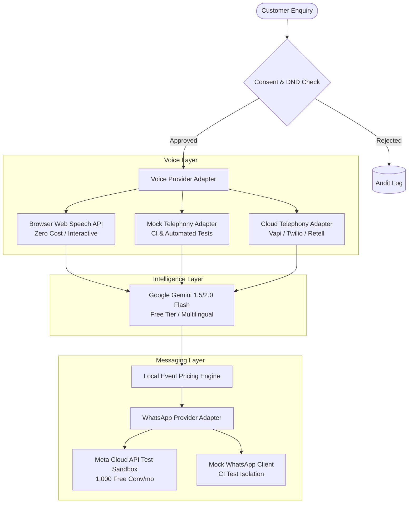

# BREW Coffee — Phase 6: Provider Strategy & Cost Analysis

## 1. Provider Strategy Overview

Phase 6 enables multilingual conversational AI and transactional messaging while strictly honoring the project's zero-cost development mandate during preflight and testing.



---

## 2. Voice AI Provider Comparison & Selection

### 2.1 Provider Evaluation Matrix

| Criterion | Browser Web Speech API | Mock Telephony Provider | Vapi AI | Retell AI | Twilio Voice |
|---|---|---|---|---|---|
| **Upfront Cost** | **$0.00** | **$0.00** | $10 free credit | Free trial | Pay-as-you-go |
| **Outbound Calling** | Simulated / In-Browser | Simulated (Memory/Log) | Real PSTN/SIP | Real PSTN/SIP | Real PSTN |
| **Indian PSTN Support (+91)** | N/A | N/A | Yes (Twilio/Vonage SIP) | Yes | Yes (Local DLT required) |
| **Multilingual (EN/HI/TE)** | OS Native TTS/STT | Synthetic Text | Deepgram / ElevenLabs | Deepgram Nova-2 | Google Cloud Speech |
| **Latency (Audio-to-Audio)** | <100ms | <10ms | ~600ms - 900ms | ~700ms - 1000ms | ~1200ms - 1800ms |
| **Preflight Applicability** | **Primary Interactive** | **Primary Automated CI** | Production Candidate | Production Candidate | Traditional Candidate |

### 2.2 Selected Strategy: Tiered Architecture
1. **Development & Showcase Tier (Active for Phase 6)**:
   - **Interactive Browser Web Speech API (`SpeechRecognition` & `SpeechSynthesis`)**: Provides zero-cost, high-fidelity voice testing in Chrome/Safari without requiring SIP trunks, telephony credentials, or external billing.
   - **Mock Telephony Adapter**: Allows deterministic end-to-end testing of outbound calling queues, call drops, busy signals, and retry backoff in CI environments.
2. **Production Candidate Recommendation**:
   - **Vapi AI with Twilio Indian SIP Trunk**: Offers the lowest sub-second latency for conversational interruptions, direct Gemini Flash support, and compliant E.164 outbound dialing for Indian phone numbers.

---

## 3. WhatsApp Messaging Provider Comparison & Selection

### 3.1 Provider Evaluation Matrix

| Feature | Meta WhatsApp Cloud API (Graph API) | Twilio WhatsApp API | Mock Provider |
|---|---|---|---|
| **Direct Provider** | Yes (Meta official direct) | No (Aggregator) | In-Memory / Local |
| **Setup Cost** | **$0.00** | $0.00 | $0.00 |
| **Free Tier Allowance** | **1,000 free Service conversations/month** | None (per-msg markup) | Unlimited |
| **Template Management** | Native in Meta Business Manager | Synced from Meta | Local JSON schema |
| **Test Sandbox** | Built-in (up to 5 test numbers) | Sandbox join codes | Instant simulated |
| **Cost per Transactional (India)** | ~₹0.35 / utility conversation | ~₹0.35 + $0.005 fee | $0.00 |

### 3.2 Selected Strategy: Meta WhatsApp Cloud API (Direct)
- **Primary**: Official **Meta WhatsApp Cloud API (v21.0)** using a Free Meta Developer Account and Test Sandbox.
  - Allows 1,000 free service-initiated conversations per calendar month.
  - Test numbers can send templated quotes, receipt PDFs, and interactive button messages to verified tester numbers at zero expense.
- **CI / Local Fallback**: Deterministic mock provider logging payload dispatches to memory and validating against official WhatsApp payload schemas.

---

## 4. LLM Intelligence Layer (Multilingual Capabilities)

### 4.1 Model Selection: Google Gemini Free Tier
- **Selected Models**: `gemini-1.5-flash` or `gemini-2.0-flash-exp` via Google AI Studio Free Tier.
- **Rate Limit Capacity**:
  - 15 Requests Per Minute (RPM)
  - 1,000,000 Tokens Per Minute (TPM)
  - 1,500 Requests Per Day (RPD)
- **Multilingual Benchmark**:
  - **English (India)**: Flawless comprehension of Indian-English phrasing, currency denominations (*lakhs*, *crores*, *rupees*), and coffee terminology.
  - **Hindi (Devanagari & Hinglish)**: Native comprehension of Devanagari script and Romanized Hindi (*"kitna kharcha aayega"*, *"kitne mehmaan hain"*).
  - **Telugu (Telugu script & Tenglish)**: Accurate understanding of formal and colloquial Telugu (*"ఎంత ఖర్చు అవుతుంది"*, *"entha kharchu avthundi"*).
- **Cost**: **$0.00** under AI Studio Free Tier quota.

---

## 5. Cost Projections & Unit Economics

### 5.1 Unit Cost Baseline (Indian Market)

| Channel / Service | Unit | Provider | Free Tier Limit | Production Unit Cost |
|---|---|---|---|---|
| **LLM Inference** | 1,000 tokens | Google Gemini Flash | 1,500 RPD free | $0.00015 (₹0.013) |
| **Interactive Voice (Web)**| 1 session | Web Speech API | Unlimited | **₹0.00** |
| **Outbound Telephony (PSTN)**| 1 minute | Vapi / Twilio SIP | Trial credits | ~₹1.80 / min |
| **WhatsApp Transactional** | 1 conversation | Meta Cloud API | 1,000 conv/month | ~₹0.35 / conv |

### 5.2 Monthly Operating Cost Projections

Assumptions:
- Average voice call duration: **3 minutes**.
- Each booking involves: 1 outbound call + 3 WhatsApp messages (Quote, Confirmation, Reminder).

```text
Volume: 100 Bookings / Month
- Voice Telephony: 100 calls × 3 min × ₹1.80 = ₹540 ($6.50) [₹0 if Browser Web Speech]
- WhatsApp Utility: 100 conversations (covered within 1,000 free allowance) = ₹0.00
- Gemini Free Tier: ~300 requests = ₹0.00
Total Estimated Monthly Cost (Telephony): ₹540 (~$6.50)
Total Estimated Monthly Cost (Browser Voice Demo): ₹0.00

Volume: 500 Bookings / Month
- Voice Telephony: 500 calls × 3 min × ₹1.80 = ₹2,700 ($32.50)
- WhatsApp Utility: 500 conversations (covered within 1,000 free allowance) = ₹0.00
- Gemini Free Tier: ~1,500 requests = ₹0.00
Total Estimated Monthly Cost: ₹2,700 (~$32.50)

Volume: 1,000 Bookings / Month
- Voice Telephony: 1,000 calls × 3 min × ₹1.80 = ₹5,400 ($65.00)
- WhatsApp Utility: 1,000 conversations (covered within 1,000 free allowance) = ₹0.00
- Gemini API: Paid Tier overage: ~₹150 ($1.80)
Total Estimated Monthly Cost: ₹5,550 (~$66.80)
```

---

## 6. Required Environment Variables

All configuration uses standard environment variable conventions. **No secrets or active tokens are hardcoded.**

### 6.1 Core & Intelligence Layer
```bash
# Google Gemini API
GEMINI_API_KEY=               # Free tier API key from Google AI Studio
VOICE_AGENT_MODEL=            # Defaults to gemini-1.5-flash
```

### 6.2 Voice Layer (Decoupled Provider Architecture)
```bash
# Voice Engine Mode: 'webspeech' | 'mock' | 'vapi' | 'twilio'
VOICE_PROVIDER=               # Default: webspeech (Zero cost browser demo)

# Telephony credentials (only required when VOICE_PROVIDER is set to cloud providers)
VAPI_API_KEY=                 # Optional: Vapi API Private Key
VAPI_ASSISTANT_ID=            # Optional: Preconfigured multilingual assistant ID
TWILIO_ACCOUNT_SID=           # Optional: For SIP outbound dialing
TWILIO_AUTH_TOKEN=            # Optional: Twilio Auth Token
TWILIO_PHONE_NUMBER=          # Optional: Verified Indian caller ID
```

### 6.3 WhatsApp Layer (Meta Cloud API)
```bash
# WhatsApp Provider Mode: 'meta' | 'mock'
WHATSAPP_PROVIDER=            # Default: mock for tests, meta for sandbox

# Meta WhatsApp Cloud API credentials
WHATSAPP_ACCESS_TOKEN=        # Meta System User or User Access Token
WHATSAPP_PHONE_NUMBER_ID=     # Meta Phone Number ID from App Dashboard
WHATSAPP_BUSINESS_ACCOUNT_ID= # Meta Business Account ID
WHATSAPP_WEBHOOK_VERIFY_TOKEN=# Arbitrary secure token for GET verification
WHATSAPP_APP_SECRET=          # App Secret used for HMAC-SHA256 signature verification
```

### 6.4 Communication & Compliance
```bash
# Calling & Notification Business Hours (IST)
CALLING_HOURS_START=09:00     # 09:00 AM IST (TRAI compliance)
CALLING_HOURS_END=20:00       # 08:00 PM IST (TRAI compliance)
MAX_CALL_RETRIES=2            # Max retry attempts for unanswered calls
RETRY_BACKOFF_MINUTES=30      # Delay between retries
```
