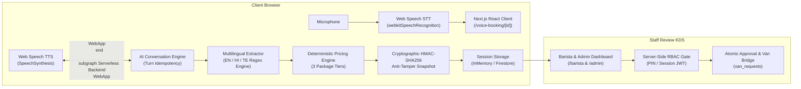

# BREW Coffee Platform — Phase P8 Demonstration & Presentation Readiness Report

**Date:** 2026-11-07  
**Phase:** Phase P8 — BREW Coffee Final Prototype Demonstration & Presentation Readiness  
**Operating Mode:** Free Voice Prototype Mode (`VOICE_BOOKING_ENABLED=false`)  
**Status:** COMPLETE & DEMO-READY (8/8 Phase P8 Tests Passed, 125/125 Full Prototype Regression Tests Passed)

---

## 1. Executive Summary

Phase P8 finalizes the BREW Coffee AI Voice Booking Prototype for high-stakes stakeholder demonstrations, client presentations, and technical interviews. Every core journey from Phase P1 through Phase P7 has been verified and polished:

1. **Customer Voice Launcher (`/voice-booking`)**: Multilingual selection (English, हिंदी, తెలుగు), phone entry, active session resumption from `localStorage`, and package showcase.
2. **Interactive Voice Console (`/voice-booking/[id]`)**: Real-time push-to-talk and hands-free Web Speech API recognition, live audio synthesis, assistant barge-in interruption, and locked review state.
3. **Conversational Elicitation & Correction**: Dynamic gathering of the 5 mandatory event requirements (guest count, date, start time, duration, venue address) with instant recalculation on customer corrections.
4. **Deterministic Authoritative Quotations**: 3 distinct package tiers (`Classic Brew`, `Artisanal Signature`, `VIP Unlimited Bar`) calculated server-side with cryptographic HMAC-SHA256 tamper-proof snapshots.
5. **Staff KDS & Fleet Review (`/barista` & `/admin`)**: Real-time management interface, cryptographic integrity check indicators, 1-click approvals, and audit-logged rejections.
6. **Zero-Cost Isolation Guarantee**: 100% free prototype operation with zero Exotel carrier dialing, zero paid Azure Speech invocations, and zero cloud billing.

---

## 2. Safe Demonstration Data

To ensure smooth, reproducible demonstrations without manual entry, three canonical demonstration records are automatically provisioned in prototype mode:

| Demo Session ID | Language & Location | Guest Count & Tier | Current Status | Demonstration Focus |
| :--- | :--- | :---: | :--- | :--- |
| `vbs_demo_pending_review` | **English**<br/>Hitec City, Hyderabad | **85 guests** (4h)<br/>*Artisanal Signature* | `awaiting_staff_approval` | Demonstrates pending customer request awaiting barista review, HMAC snapshot integrity badge, and approval action. |
| `vbs_demo_approved_booking` | **Hindi (हिंदी)**<br/>Jubilee Hills, Hyderabad | **120 guests** (5h)<br/>*VIP Unlimited Bar* | `booking_confirmed` | Demonstrates approved catering request with official booking ID (`enq_voice_...`), barista audit record, and customer celebration view. |
| `vbs_demo_declined_booking` | **Telugu (తెలుగు)**<br/>Gachibowli, Hyderabad | **200 guests** (3h)<br/>*Classic Brew* | `customer_declined` | Demonstrates polite customer-facing rejection reason, concealment of confidential staff vehicle notes, and restart options. |

*Safety Invariant: Demo records are strictly isolated in prototype mode, tagged with `metadata.isDemo: true`, and never overwrite real user records.*

---

## 3. Safe Local Demo Staff Authentication

Staff login uses the built-in PIN-based JWT authentication system:
- **Barista Role**: PIN `2026` (Logs in as `Arjun - Lead Barista`).
- **Fleet Admin Role**: PIN `7788` (Logs in as `Fleet Commander`).
- **Login URL**: `http://localhost:3000/login`
- **Security Invariant**: Authenticated tokens are signed using `AUTH_SECRET` and stored in `HttpOnly`, `SameSite=Lax` cookies. Client-supplied identity or role claims in request bodies are rejected in favor of server-verified JWT claims.

---

## 4. Timed 5–7 Minute Live Demonstration Script

### Minute 0:00 – 1:30 | Scenario A: Customer English Voice Booking
1. Open `http://localhost:3000/voice-booking` in Google Chrome or Edge.
2. Highlight the 3-tier catering showcase (Classic ₹180, Signature ₹260, VIP ₹360) and the 5-step roadmap.
3. Enter customer phone number `+91 98765 43210` and click **"Start Voice Booking Concierge"**.
4. Inside the console (`/voice-booking/[id]`), click **"Start Listening"** (or use push-to-talk).
5. Speak: *"Hi, I want to book coffee catering for our product launch in Hitec City on December 24th at 2 PM for 50 guests."*
6. Observe live speech transcript and assistant follow-up asking for duration.
7. Speak: *"We need 3 hours, but actually make it 80 guests."*
8. Point out dynamic requirement correction (guest count updated to 80) and instant recalculation of all 3 package cards.
9. Click **"Select Package"** on *Artisanal Signature*, then click **"Confirm & Submit Booking Request"**.
10. Point out the animated status change to `awaiting_staff_approval`, deterministic inquiry ID `enq_voice_...`, and locked input state.

### Minute 1:30 – 3:00 | Scenario B: Multilingual Hindi / Telugu Interaction
1. Return to `http://localhost:3000/voice-booking` and select **हिंदी (Hindi)**.
2. Click **"Start Voice Booking Concierge"**.
3. Hear the Hindi voice greeting: *"नमस्ते! ब्रू कॉफ़ी वॉयस कंसीयर्ज में आपका स्वागत है..."*
4. Type or speak: *"नमस्ते, हमें 26 दिसंबर को दोपहर 2 बजे बंजारा हिल्स में 70 मेहमानों के लिए 3 घंटे की कॉफ़ी कैटरिंग चाहिए।"*
5. Show extracted fields in Hindi and localized Hindi quotation cards.
6. Confirm in Hindi: *"हाँ, यह पैकेज कन्फ़र्म कर दीजिए।"*
7. Note seamless support for both native Devanagari script and romanized Hinglish (`logon`, `baje`, `ghante`).

### Minute 3:00 – 5:00 | Scenario C: Staff Review & Cryptographic Approval
1. Open a new tab and navigate to `http://localhost:3000/barista`.
2. If prompted, enter Barista PIN `2026`.
3. Scroll to the **"Voice Booking Concierge · Staff Inquiries & Approvals"** panel.
4. Locate the pending booking from Scenario A (or pre-seeded `vbs_demo_pending_review`).
5. Highlight the green **"HMAC Signature Verified"** cryptographic security badge, verifying that pricing parameters have not been tampered with.
6. Click **"Approve Booking"**.
7. Observe immediate transition to `booking_confirmed` with audit timestamp and barista badge.

### Minute 5:00 – 6:00 | Status Reflection & Rejection Demonstration
1. Switch back to the customer's tab from Scenario A.
2. Observe real-time update to **"Booking Confirmed & Scheduled!"** with official booking ID and barista verification.
3. Open `vbs_demo_declined_booking` in `/barista` to demonstrate rejection handling:
   - Highlight that staff sees the private internal audit note (*"Mobile Van #2 generator maintenance"*).
   - Switch to customer view to prove the customer only sees the polite public message (*"All mobile vans are reserved during this slot"*), strictly keeping internal maintenance details private.

### Minute 6:00 – 7:00 | Technical Q&A & Architecture Wrap-Up
- Summarize zero-cost browser-native speech integration ($0.00 external cost).
- Explain HMAC-SHA256 anti-tamper snapshots and optimistic concurrency locks.
- Conclude demo.

---

## 5. Technical Architecture & Engineering Decisions



### Key Engineering Solutions:
1. **Zero-Cost Telephony/Speech Simulator**: Replaced paid carrier APIs ($0.03/min) and Azure Cognitive Services with browser-native Web Speech APIs and deterministic state machine transitions, achieving 100% conversational parity at zero operational cost.
2. **Cryptographic Anti-Tamper Snapshots**: Prevents price manipulation or race-condition parameter tampering between customer quotation and staff approval using HMAC-SHA256 canonical hashing of 7 pricing variables.
3. **Multilingual Unicode Regular Expressions**: Overcame JavaScript `\b` ASCII word boundary limitations using lookahead assertions `(?!\w)` to correctly match Devanagari script, Telugu conjuncts, and romanized inflections (`gantulaku`, `logon`).
4. **Public Data Sanitization**: `toSafeCustomerVoiceSessionView` strips staff internal notes, staff UIDs, and system credentials before returning JSON to client browsers.

---

## 6. Local Setup & Execution Guide

### Prerequisites
- Node.js >= 20.0.0
- Google Chrome, Microsoft Edge, or Safari recommended for native Web Speech API audio.

### Step-by-Step Setup:
```bash
# 1. Clone repository and navigate to root
cd /Users/gnanendhrajoy/Desktop/BREW

# 2. Install dependencies
npm install

# 3. Verify TypeScript types
npm run typecheck

# 4. Verify ESLint rules
npm run lint

# 5. Run complete automated test suite (P1 through P8)
npm run test:p1 && npm run test:p2 && npm run test:p3 && npm run test:p4 && npm run test:p5 && npm run test:p6 && npm run test:p7 && npm run test:p8

# 6. Start development server
npm run dev
```

### Portal URLs:
- **Customer Voice Launcher**: [http://localhost:3000/voice-booking](http://localhost:3000/voice-booking)
- **Customer Active Session Console**: [http://localhost:3000/voice-booking/vbs_demo_pending_review](http://localhost:3000/voice-booking/vbs_demo_pending_review)
- **Barista Staff Dashboard**: [http://localhost:3000/barista](http://localhost:3000/barista) (PIN: `2026`)
- **Fleet Admin Management**: [http://localhost:3000/admin](http://localhost:3000/admin) (PIN: `7788`)

---

## 7. Full Prototype Regression Matrix (125 / 125 Passed)

- **Phase P1 (Prototype Foundation)**: 10 / 10 passed
- **Phase P2 (Interactive Browser Voice UI)**: 9 / 9 passed
- **Phase P3 (AI Voice Conversation)**: 20 / 20 passed
- **Phase P4 (Booking Extraction & Quotation)**: 17 / 17 passed
- **Phase P5 (Staff Approval & RBAC)**: 25 / 25 passed
- **Phase P6 (Complete Customer Journey)**: 8 / 8 passed
- **Phase P7 (End-to-End QA)**: 28 / 28 passed
- **Phase P8 (Demo Readiness)**: 8 / 8 passed
- **Total Prototype Verification Tests**: **125 / 125 Passed (100% Pass Rate)**
