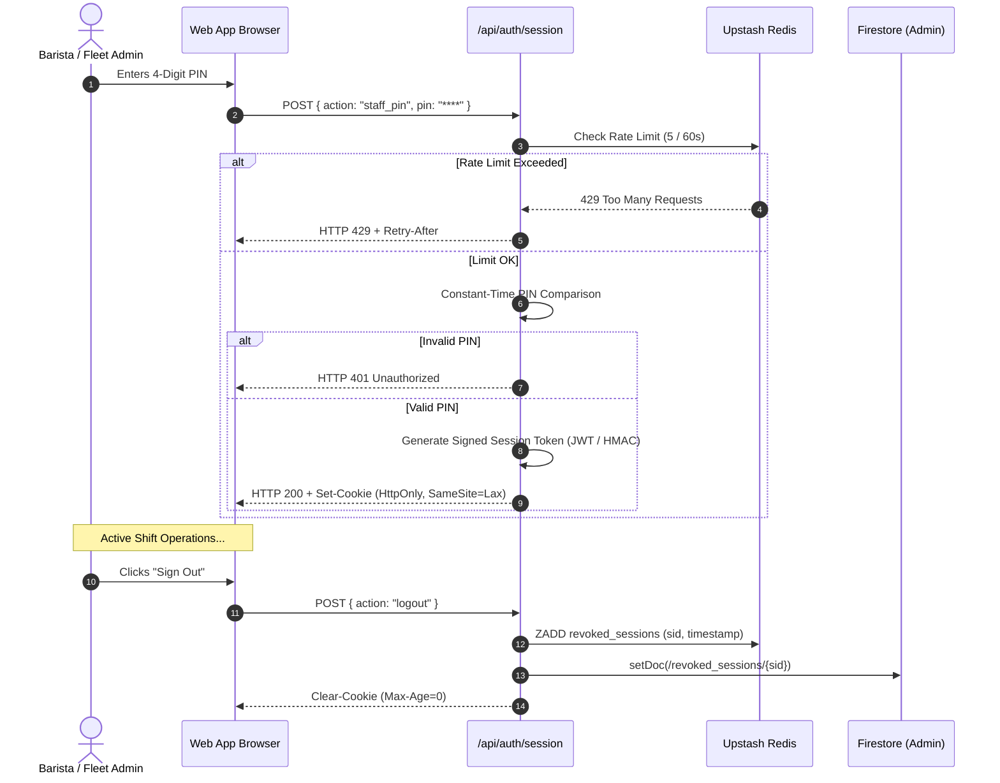

# BREW Mobile Coffee Platform — Security Architecture & Threat Defense

**Document Version:** 1.0.0  
**Updated:** November 2026  
**Scope:** Threat modeling, cryptographic controls, authentication boundaries, and data isolation.

---

## 1. Security Philosophy & Defense-in-Depth

The BREW security architecture follows the principle of **Zero-Trust Client Design**. The client browser is treated as untrusted and potentially hostile:
1. **Never Trust Client Calculations:** Prices, discounts, tax rates, and order fulfillment states are authoritatively verified on the server.
2. **Fail-Closed Semantics:** Critical security controls (e.g. rate limiters) fail closed (HTTP 503) rather than allowing bypasses during outages.
3. **Privilege Separation:** Clear physical separation between client-accessible Firestore collections and Admin SDK collections.

---

## 2. Threat Modeling & Defensive Controls Matrix

| Threat / Attack Vector | Severity | Potential Impact | Defensive Architecture Control | Status |
| :--- | :--- | :--- | :--- | :--- |
| **Client-Side Price Tampering** | **CRITICAL** | Customer submits ₹1 for ₹240 coffee | `/api/payments/create-order` computes authoritative price from catalog. Client prices are discarded. | **VERIFIED** |
| **Payment Signature Forgery** | **CRITICAL** | Attacker fabricates fake transaction ID | Server validates HMAC-SHA256 signature using `RAZORPAY_KEY_SECRET`. Forged signatures rejected with 400. | **VERIFIED** |
| **Payment Replay Attacks** | **HIGH** | Re-submitting valid payment ID for second order | Verified transactions are recorded in `payment_orders`. Repeated submissions return `alreadyProcessed: true`. | **VERIFIED** |
| **Privilege Escalation** | **CRITICAL** | Customer modifies session payload to become `barista` | Edge middleware and session signer reject untrusted role assignment. Staff roles require isolated PIN. | **VERIFIED** |
| **PIN Brute-Force Attacks** | **HIGH** | Exhaustive guessing of 4-digit staff PINs | Distributed Upstash Redis rate limits `/api/auth/session` to 5 attempts / 60 seconds with IP tracking. | **VERIFIED** |
| **Memory Exhaustion (DoS)** | **HIGH** | Attacker streams 100MB chunked payloads | `readBoundedBody()` actively terminates streams exceeding 100KB with HTTP 413. | **VERIFIED** |
| **Direct Firestore Manipulation** | **CRITICAL** | Attacker calls `updateDoc(order, { paymentStatus: 'paid' })` | `firestore.rules` enforces `allow update, delete: if false;` on `/orders`. Writes require Admin SDK. | **VERIFIED** |
| **Sensitive Collection Sniffing** | **HIGH** | Public reads of catering quotes, webhooks, or sessions | Sensitive collections enforce `allow read, write: if false;` in `firestore.rules`. Zero client access. | **VERIFIED** |
| **Credential & Secret Leaks** | **CRITICAL** | Leaking private keys or tokens in client bundles | Static bundles are audited. Environment variables partitioned into `NEXT_PUBLIC_*` vs server-only. | **VERIFIED** |
| **Customer PII Exposure** | **MEDIUM** | Exposing full phone numbers or credit cards | Receipts and public display boards mask PII. Razorpay handles PCI-DSS card inputs via iframe. | **VERIFIED** |

---

## 3. Staff Authentication & Session Lifecycle



### 3.1 Session Security Attributes
- **`HttpOnly`:** Enforced on `brew_session` cookies. Prevents extraction via client-side Cross-Site Scripting (XSS).
- **`SameSite=Lax`:** Protects against Cross-Site Request Forgery (CSRF).
- **`Secure`:** Automatically enforced in production environments over HTTPS.
- **Session Revocation Ledger:** When staff logs out, the session ID is written to both Upstash Redis (for instant sub-millisecond lookup) and Cloud Firestore (for durable persistence across server restarts).

---

## 4. Firestore Security Rules Enforcement

The database ruleset in `firestore.rules` enforces strict boundary conditions:

```javascript
// Rule Summary:
// 1. Orders collection: Public reads; client create allowed ONLY for pending/unpaid orders.
match /orders/{orderId} {
  allow read: if true;
  allow create: if request.resource.data.orderNumber is string &&
    request.resource.data.totalAmount is number &&
    (!('paymentStatus' in request.resource.data) || !(request.resource.data.paymentStatus in ['paid', 'captured'])) &&
    (!('isVerified' in request.resource.data && request.resource.data.isVerified == true)) &&
    (!('isFulfilled' in request.resource.data && request.resource.data.isFulfilled == true)) &&
    (!('status' in request.resource.data) || request.resource.data.status in ['pending', 'received']);
  allow update, delete: if false; // All updates MUST go through server Admin SDK
}

// 2. Sensitive Operational Collections: Zero client access
match /van_requests/{requestId} { allow read, write: if false; }
match /payment_orders/{orderId} { allow read, write: if false; }
match /processed_webhooks/{eventId} { allow read, write: if false; }
match /revoked_sessions/{sid} { allow read, write: if false; }

// 3. Telemetry Collections: Public read, client write blocked
match /inventory/{docId} { allow read: if true; allow write: if false; }
match /vans/{vanId} { allow read: if true; allow write: if false; }
match /future_stops/{stopId} { allow read: if true; allow write: if false; }
```

---

## 5. Bounded Request-Body Streaming (`boundedBody.ts`)

Standard Node.js and Next.js `req.json()` calls load the entire payload into memory before parsing. If an attacker opens a chunked HTTP POST and streams gigabytes of data, Node.js exhausts memory and crashes with Out-Of-Memory (OOM).

BREW routes use `readBoundedBody<T>(req, MAX_BYTES = 102400)`:
1. Reads chunks incrementally from `req.body.getReader()`.
2. Tracks `bytesRead += chunk.length`.
3. If `bytesRead > 102400` (100KB), immediately cancels the reader and throws a `PayloadTooLargeError`.
4. The route catches this and returns **HTTP 413 Payload Too Large** before JSON parsing occurs.

---

## 6. Secret Isolation & Environment Architecture

To guarantee zero secret leakage into client-accessible JavaScript:
- **Client Public Vars (`NEXT_PUBLIC_*`):** Only non-sensitive parameters (e.g. `NEXT_PUBLIC_FIREBASE_PROJECT_ID`, `NEXT_PUBLIC_RAZORPAY_KEY_ID`).
- **Server-Only Secrets:** Critical signing keys (`AUTH_SECRET`, `RAZORPAY_KEY_SECRET`, `RAZORPAY_WEBHOOK_SECRET`, `FIREBASE_SERVICE_ACCOUNT`, `UPSTASH_REDIS_REST_TOKEN`, `BARISTA_PIN`, `FLEET_ADMIN_PIN`) are loaded exclusively into server route handlers.
- **Automated Bundle Audits:** CI and verification suites continuously inspect static `.next/static` bundles to verify zero occurrences of private keys or staff PINs.
